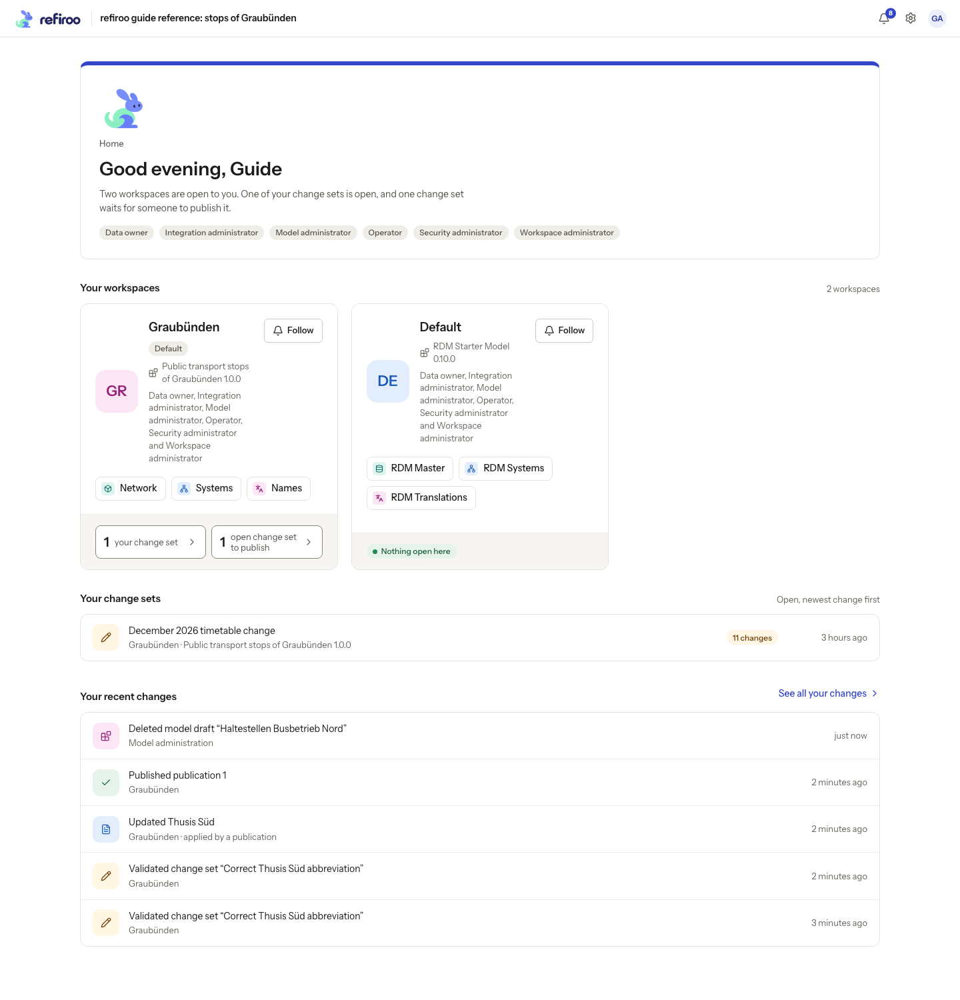

<p align="center"></p>

<p align="center"><strong>Reference data, without the suite.</strong><br>
Open-source reference data management: one home for the lists, codes and mappings<br>
every system in an organisation has to agree on.</p>

<p align="center">
<a href="https://refiroo.org">Website</a> ·
<a href="https://refiroo.org/docs/">Documentation</a> ·
<a href="https://refiroo.org/docs/api/">API reference</a> ·
<a href="https://demo.refiroo.com">Live demo</a> ·
<a href="#quick-start">Quick start</a>
</p>

---

**refiroo is a reference data management (RDM) system.** Reference data is the shared vocabulary
of an organisation: countries, currencies, product categories, statuses, units, delivery methods.
Every system keeps its own copy under its own codes, so the same delivery method is "Collection" in
the central list, `PICKUP` in the webshop and "Store collection" in the warehouse system.

refiroo gives that data one home. People keep the shared values in the browser, connect each
system's code to the value it means and add the translations. Every system then reads the agreed
version through an API instead of keeping a list of its own. It is API-first and runs on your own
server with Docker.

<p align="center"></p>

## What it does

- **Start from a spreadsheet.** Drop a workbook on the canvas: its sheets and columns become record
  types, fields and relationships, every row is checked before anything is loaded, and the result
  becomes a workspace in one step. The next month's file loads through the saved profile.
- **Maintain the data in the browser.** Tables, trees, mapping grids and relation matrices over
  lists of any size; edit a value in place and it saves when you leave it, with Undo.
- **Map and translate.** Connect each system's codes to the shared value they mean, and fill
  translation gaps across a whole list.
- **Edit live, or prepare a change together.** A correction is live when saved. A change set gathers
  coordinated changes, shows a review of everything it touches and publishes them in one step, with
  approval if the workspace asks for it.
- **Keep the history.** Every change is recorded with who made it and when; any record can be read as
  it was on a given date.
- **Serve every system through the API.** Everything the browser does is in the management API.
  Consumer APIs, declared in the model, give each system a stable read API of its own, with webhooks
  for changes, imports and exports as background jobs, and an MCP endpoint for AI assistants.
- **Describe your domain, don't program it.** A versioned JSON model declares record types, fields,
  hierarchies, relationships and the screens; refiroo builds the rest. Another domain is another
  model, not new code, and each workspace can run a model of its own.
- **Run it properly.** Sign-in with passwords, passkeys, second factors or your organisation's
  OpenID Connect provider; roles and groups per workspace; audit, backups, health checks and
  one-command deploys and upgrades.

<p align="center"></p>

## Quick start

### Try it on your computer

Needs Docker (Docker Desktop, or Docker Engine with Compose 2.24 or newer) on macOS, Linux or Windows.

```bash
git clone https://github.com/refiroo/refiroo.git
cd refiroo
scripts/deploy.sh --local
```

The script writes the settings file with generated secrets, builds the images, creates the database,
starts everything and creates the first administrator; it asks for their e-mail address and a
password. Then open http://localhost:8080 and sign in. `--help` lists every option and `--dry-run`
prints the commands without running any.

```bash
docker compose stop       # stop, keeping everything
docker compose up -d      # start again
docker compose down -v    # remove it completely, the database and files too (cannot be undone)
```

### Deploy on a server

On a Linux server with Docker, the same script sets up an installation people reach over HTTPS.
`--https` takes `acme` (certificates for a public name that renew themselves; DNS must point here and
ports 80 and 443 must be open), `files` (your certificate and key in `certs/` as `fullchain.pem` and
`privkey.pem`) or `proxy` (plain HTTP behind a load balancer that ends HTTPS; add `--trusted-proxies`).
Run without options, it asks for each.

```bash
scripts/deploy.sh --url https://refiroo.example.org --https acme \
  --admin-email me@example.org --admin-name "Me"
```

> [!IMPORTANT]
> With `--https acme` the installation runs on `compose.yml` and `compose.acme.yml`. **Every later
> `docker compose` command needs both files** (`-f compose.yml -f compose.acme.yml`), or set
> `COMPOSE_FILE=compose.yml:compose.acme.yml` in the shell once. Without the overlay, the web
> container is recreated without Caddy and the site goes down.

Mail and a sign-in provider are set in the application afterwards. The guide's
[Deploy to production with Docker](https://refiroo.org/docs/run/install-with-compose/) and
[OPERATIONS.md](docs/OPERATIONS.md#deploying) explain every step.

### Upgrade

In the installation's checkout:

```bash
git fetch --tags && git checkout <new-tag>
scripts/upgrade.sh --dry-run      # shows every command, runs nothing
scripts/upgrade.sh
```

It backs up the database (a dump it checks can be read back), the files and the settings file to
`/opt/refiroo/backups` (`--backups DIR` for another folder), builds the new version, upgrades the
database and starts it again. If the database upgrade fails, it stops and prints the commands that
restore the backup it has just made. With automatic HTTPS add `-f compose.yml -f compose.acme.yml`.
See [Upgrades](https://refiroo.org/docs/run/upgrades/).

### Develop

You need PostgreSQL 17, Python 3.14 and Node 22.

- **macOS:** `brew install postgresql@17 python@3.14 node@22`
- **Linux:** PostgreSQL 17 from the [PGDG repository](https://www.postgresql.org/download/linux/),
  Node 22 from [nodejs.org](https://nodejs.org/en/download), Python 3.14 from your distribution or
  [python.org](https://www.python.org/downloads/) (or pyenv or uv). Tell the database script where
  PostgreSQL is: `export RDM_POSTGRES_BIN=/usr/lib/postgresql/17/bin` on Debian and Ubuntu,
  `/usr/pgsql-17/bin` on Fedora and RHEL.
- **Windows:** WSL2 with a Linux distribution, then the Linux steps.

Once:

```bash
scripts/postgres.sh start                       # a development database in backend/.postgres/
(cd backend && python3.14 -m venv .venv && .venv/bin/pip install -e '.[dev]')
(cd frontend && npm install)
scripts/dev.sh settings                         # .dev/settings.env: the database and a secrets key
scripts/dev.sh admin you@example.org "Your Name"  # the first administrator; asks for a password
```

Then each in its own terminal, and open http://localhost:5173:

```bash
scripts/dev.sh engine
scripts/dev.sh frontend
```

To open it from a phone or another computer on the network over HTTPS, run `scripts/dev.sh cert`
once ([mkcert](https://github.com/FiloSottile/mkcert) needed) and add `--network` to both commands.
`scripts/postgres.sh stop` stops the database. How to run the tests is in the
[test execution guide](docs/testing/EXECUTION_GUIDE.md).

## How it works

You do not program refiroo for your data; you describe it. A **model**, a versioned JSON document,
declares:

- **Record types and their fields**: a country with its ISO code, a status with its sort order.
- **How records connect**: a parent and its children, a system's code and the shared value it means,
  a value and its translations.
- **Applications**: named working areas in the browser, each grouping some record types with the
  screens for them (tables, trees, mapping grids and relation matrices).
- **Consumer APIs**: the read APIs systems use, each with its own stable contract.

refiroo builds the rest from the model: the screens, the management API, the consumer APIs,
validation, history, search, imports and exports. Data lives in **workspaces**, each with its own
model; a changed model is installed as a release and activated only after a compatibility check
against the data the workspace holds.

The repository ships an example model, `model/rdm-starter.json`, with three applications (master
values, system values and translations). It is an example, not a built-in module or a template to
follow ([explained](docs/EXAMPLE_MODEL.md)).

## Status

The latest version is **0.17.1** (2026-11-13). 0.17, the plain path: a workbook shaped on a canvas and made
into a workspace in one step, themes, a page for each workspace, Settings by task, fields that save
when you leave them, an e-mail template, account security messages, and the complete management API
reference. 0.15 (the interface language) is the last release before 1.0. PostgreSQL is the only
supported database. See the [roadmap](docs/ROADMAP.md), the [project status](docs/PROJECT_STATUS.md)
and the [changelog](CHANGELOG.md).

Every API call needs a signed-in person or an access token; see
[OPERATIONS.md](docs/OPERATIONS.md#authentication).

## Links

| | |
| --- | --- |
| Website (open source) | <https://refiroo.org> — [features](https://refiroo.org/features/), [get started](https://refiroo.org/get-started/), [roadmap](https://refiroo.org/roadmap/), [questions](https://refiroo.org/questions/) |
| Documentation | <https://refiroo.org/docs/> — the guide for people, administrators and integrators |
| API reference | <https://refiroo.org/docs/api/> |
| Live demo | <https://demo.refiroo.com> — the published sign-in is on [the demo page](https://refiroo.org/demo/) |
| Hosted by us | <https://refiroo.com> — [hosting](https://refiroo.com/hosting/) and [early access](https://refiroo.com/early-access) |
| Security | <https://refiroo.org/security/> and [SECURITY.md](SECURITY.md) |
| Source | <https://github.com/refiroo/refiroo> |

## Technology stack

| Area | Technology |
| --- | --- |
| Backend | Python 3.14, FastAPI (on Starlette) served by Uvicorn, Pydantic 2 for model and API contracts |
| Persistence | SQLAlchemy 2, Alembic migrations, psycopg 3 |
| Database | PostgreSQL 17 with ICU root collation; the only supported database since 0.9.0-alpha.1 |
| API description | OpenAPI generated by FastAPI and locked in tests; API reference page at `/docs/api` rendered by [Scalar](https://github.com/scalar/scalar) 1.72.2 (MIT), bundled so it works offline |
| Frontend | React 19 and TypeScript, built and served in development by Vite; Node 22 |
| UI components | React Aria Components (behaviour only, behind repository-owned wrappers), Lucide icons, plain CSS tokens; no UI kit or CSS framework |
| Backend tests | pytest with pytest-xdist, httpx for API calls, openapi-spec-validator for the consumer APIs' documents |
| Frontend tests | Vitest with jsdom and Testing Library |
| Browser tests | Playwright (Chromium) runners in `frontend/e2e/`, axe-core accessibility gate, pixelmatch visual regression gate |
| Code quality | Ruff (backend); ESLint with typescript-eslint and react-hooks, Prettier (frontend) |
| Delivery | Docker and Docker Compose (`postgres:17-alpine`, `python:3.14-slim`, `node:22-alpine` building the application for `nginx-unprivileged`), GitHub Actions CI |

## Documentation

The published guide and API reference are at [refiroo.org/docs](https://refiroo.org/docs/); every running instance
also serves its own copy, the guide at `/docs` and the API reference at `/docs/api`. The documents in this repository:

| Document | Read it for |
| --- | --- |
| [BRANDING.md](docs/BRANDING.md) | The name refiroo, how it relates to "the engine", and the logo files |
| [PRODUCT.md](docs/PRODUCT.md) | What the product does, for whom, and what is planned |
| [Product functionality](docs/product-functionality/README.md) | Capability catalogue, user stories, journeys and acceptance scenarios |
| [ARCHITECTURE.md](docs/ARCHITECTURE.md) | How the engine is built and why |
| [OPERATIONS.md](docs/OPERATIONS.md) | Configuring, running, upgrading and recovering it |
| [API.md](docs/API.md) | Management API contracts |
| [APPLICATION_MODEL.md](docs/APPLICATION_MODEL.md) | The model language |
| [EXAMPLE_MODEL.md](docs/EXAMPLE_MODEL.md) | The bundled example applications |
| [ROADMAP.md](docs/ROADMAP.md) | Releases and their scope |
| [PROJECT_STATUS.md](docs/PROJECT_STATUS.md) | Where delivery stands |
| [DECISIONS.md](docs/DECISIONS.md) | Architecture decision records |
| [Testing strategy](docs/testing/STRATEGY.md) | How the engine is tested |
| [CHANGELOG.md](CHANGELOG.md) | What changed in each release |
| [AGENTS.md](AGENTS.md) | Instructions for coding agents |

## Repository layout

| Path | Contents |
| --- | --- |
| `model/` | Example models: `rdm-starter.json` ([explained](docs/EXAMPLE_MODEL.md)) |
| `backend/app/models/` | The model contract (`schema.py`) and the persistence schema |
| `backend/app/engine/` | The domain: model compilation, records and write rules, change sets, reads, jobs |
| `backend/app/management/` | The management API (`/api/v1`): routes, schemas, presenters |
| `backend/app/common/` | Paging, cursors and helpers that know neither the model nor the API |
| `backend/app/migrations/` | Alembic database migrations |
| `backend/tests/` | Backend tests |
| `frontend/src/` | The browser application ([module layout](docs/FRONTEND_STRUCTURE_REFACTOR.md)) |
| `frontend/e2e/` | Browser runners, accessibility and visual regression gates |
| `guide/` | The user guide (Astro Starlight) and its coverage check |
| `scripts/` | `deploy.sh` and `upgrade.sh` for Docker installations; `dev.sh` and `postgres.sh` for development |
| `docs/` | Product, architecture, operations, API and planning documents |

## How it is built

refiroo is delivered by LLM coding agents, Claude Code and ChatGPT Codex, under human supervision.
In technical documents and code its core is "the engine" or "the RDM engine", and the code and
Python package are named `rdm-engine` ([naming](docs/BRANDING.md)).

The supplied vendor package and API examples were used to identify the generic object–attribute–
relation model, application packaging, hierarchy and UI configuration concepts. They are deliberately
not included in this repository; refiroo uses its own keys, schema, database, API and interface.

## Licence

Copyright (C) 2026 Krisztian Toth. refiroo is free software under the
**GNU Affero General Public License, version 3 or later** (`AGPL-3.0-or-later`); the complete text is in
[`LICENSE`](LICENSE). Commercial use is allowed. A separate commercial licence, support and implementation
help are available ([COMMERCIAL.md](COMMERCIAL.md)).

- **Source of a release.** Every release is a git tag `v<version>` in
  <https://github.com/refiroo/refiroo>; that tag is the corresponding source of that version. A security fix
  is a new tag.
- **If you run a modified version over a network** (the AGPL's section 13), every user must be offered the
  source of your version, with your modifications and the scripts and configuration that are part of it. Set
  `SOURCE_CODE_URL` to where it is ([OPERATIONS](docs/OPERATIONS.md)); Settings › About and the account menu
  show it, and `GET /api/v1/system` returns it.
- **Third-party components** and their licences are listed in
  [`THIRD_PARTY_NOTICES.md`](THIRD_PARTY_NOTICES.md) (generated by `scripts/third_party_notices.py`).
- **What is promised to integrators** from 0.12.0, and how a contract changes: [docs/COMPATIBILITY.md](docs/COMPATIBILITY.md).
- [CONTRIBUTING.md](CONTRIBUTING.md), [SECURITY.md](SECURITY.md) and [TRADEMARKS.md](TRADEMARKS.md) say how
  to take part, how to report a vulnerability and how the name may be used.
