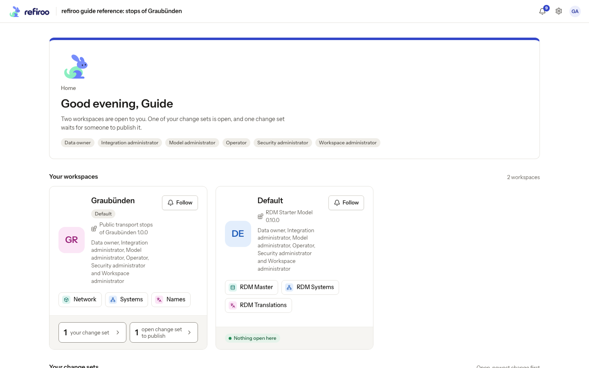
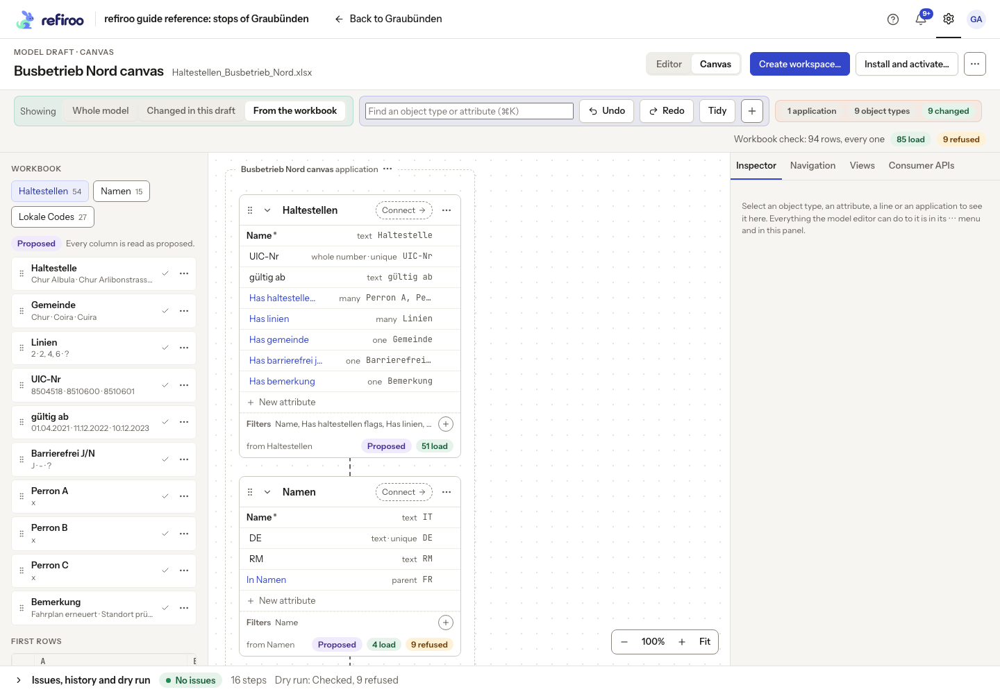
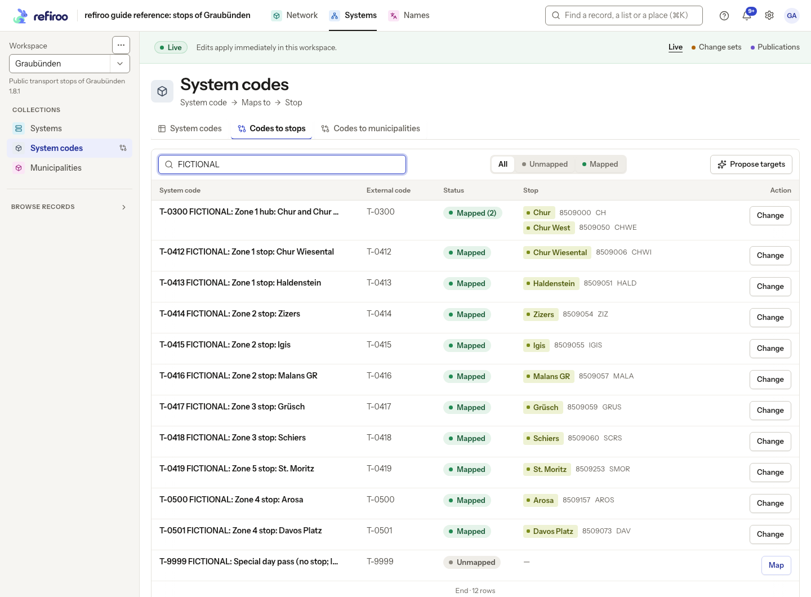
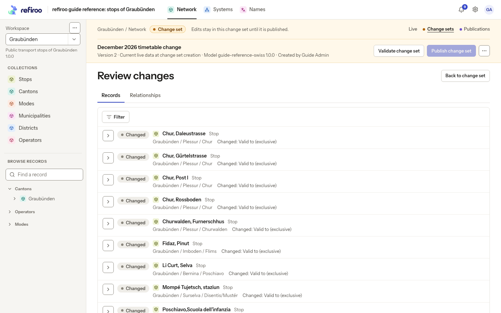

<p align="center"></p>

<h3 align="center">Reference data, without the suite.</h3>

<p align="center">
Lists, codes and mappings every system agrees on.<br>
Model-driven, API-first, open source — every feature, no paid edition.
</p>

<p align="center">
<a href="https://refiroo.org">Website</a> ·
<a href="https://demo.refiroo.com">Live demo</a> ·
<a href="https://refiroo.org/docs/">Guide</a> ·
<a href="https://refiroo.org/docs/api/">API reference</a> ·
<a href="#run-it-in-two-minutes">Run it</a>
</p>

<p align="center">
<a href="LICENSE"></a>
<a href="CHANGELOG.md"></a>
<a href="https://claude.com/product/claude-code"></a>
<a href="https://openai.com/codex/"></a>
</p>

---

## One product, three spellings

Your ERP calls a product **`100245`**. The webshop calls it **`cof-arabica-1kg`**. The warehouse
system calls it **`WH-CF-01`**. It is the same coffee.

Every organisation has dozens of lists like this — product categories, countries, currencies,
statuses, units, delivery methods, markets, languages — and every system keeps its own copy under its
own codes. Somebody keeps a spreadsheet that says which code means what. Integrations break when it
drifts. Translations live somewhere else again.

**refiroo gives that shared data one home.** People keep the agreed values in the browser, link each
system's code to the value it means, and complete the translations. Every system then reads the
agreed version through an API instead of keeping a list of its own.

It is a small, focused reference data management (RDM) system: no enterprise suite, no licence
negotiation, no locked features. One `docker compose`, your PostgreSQL, and you are running.

<p align="center"></p>

## From a spreadsheet to an API, in six steps

### 1. Bring the workbook you have

Drop the spreadsheet you already keep onto the canvas. Its sheets and columns become record types,
fields and relationships; every row is checked before anything is loaded, and the result becomes a
workspace in one step. Next month's file loads through the same saved profile. Rather describe it in
two sentences? An AI assistant can propose the model with you — and you edit what it proposes before
anything goes live.

<p align="center"></p>

### 2. Shape it your way

You do not program refiroo for your data — you describe it. A versioned **model** declares your
record types, their fields, how they connect and which screens show them. refiroo builds everything
else from it: the screens, the APIs, validation, history, search, imports and exports. A changed
model is activated only after a compatibility check against the data you already hold, so a model
change cannot quietly break your lists. Another domain is another model, not new code.

### 3. Map the mess

Line up every system's code against the shared value it means, in a mapping grid built for it. Each
system keeps its own spelling; all of them point at one record. See at a glance what is still
unmapped.

<p align="center"></p>

### 4. Change together, publish once

A quick correction is live as soon as you save it, with Undo. For bigger work — rename a product,
move it to another category and change its webshop code — gather the edits into a **change set**.
Review everything it touches, ask for approval if the workspace wants one, then publish it in one
step. Nobody ever sees half a change. Every change is recorded with who made it and when, and any
record can be read as it stood on any date.

<p align="center"></p>

### 5. Every language

Keep each value's name in every language you need. Fill in missing translations across a whole list
instead of opening one record at a time.

### 6. Plug it into everything

Everything the browser does is in the **management API** — the browser is just one of its clients.
On top of that, each system can get a **consumer API** of its own: a stable, documented read API
declared in the model, with OpenAPI, cross-reference lookups (*"what is `100245` in the warehouse?"*)
and reads as of any date. **Webhooks** and a change feed tell systems when something moves. AI
assistants can work with the data through an **MCP** endpoint — and nothing they prepare reaches live
data until a person approves it.

```bash
curl -G https://refiroo.example.com/api/consumer/catalogue/v1/xref \
  -d workspace=shop -d query=100245 -d asOf=2026-11-01
```

## And the things you expect to be there

- **Tables, trees, mapping grids and relation matrices** over lists of any size, with in-place editing
  and bulk changes.
- **Imports and exports** as background jobs: Excel, CSV and JSON Lines, with every row checked before
  anything is written.
- **Workspaces**, each with a model of its own, and roles and groups per workspace.
- **Sign-in** with passwords, passkeys, second factors or your organisation's OpenID Connect provider.
- **History and audit** for every change; read any record as of a date.
- **Five themes**, each in light and dark, and e-mails that carry your logo.
- **Operations built in:** health checks, backups you can restore, one-command deploys and upgrades.
- **Your data stays yours:** export any workspace at any time, through the browser or the API.

## Who it is for

**It is for** data stewards who own the lists many systems share; integration developers who need one
place to ask *which code means what*, and an API that answers; and architects who want shared lists
kept out of every application — and out of a heavy suite.

**It is not for** transactional data (orders, stock, invoices — keep those in the system that runs
them) or analytics. refiroo holds the lists you report by, not the reports.

## Why open source

When refiroo started, there was no reference data system that put integration first, let you work
without artificial limits and came without a costly enterprise subscription. refiroo was made to fill
that need.

- **The whole tool is open.** Every feature is in this repository under the AGPL. There is no "Pro"
  tier waiting behind a locked door, and commercial use is welcome.
- **It is built with AI, so its code should be open to anyone's eyes.** refiroo is delivered by AI
  coding agents (Claude Code and ChatGPT Codex) under human review. You can read every line they
  wrote, and the plans, decisions and changelog behind it.
- **You need not rely on one person.** refiroo is a one-person project. Because every plan, decision
  and release is public and the source is yours to keep under the AGPL, the work can carry on beyond
  its maker.

Prefer not to run it yourself? Hosting by us is being prepared at [refiroo.com](https://refiroo.com) —
the same software, with backups, upgrades and monitoring looked after.

## Run it in two minutes

You need Docker (Docker Desktop, or Docker Engine with Compose 2.24 or newer) on macOS, Linux or
Windows.

```bash
git clone https://github.com/refiroo/refiroo.git
cd refiroo
scripts/deploy.sh --local
```

The script generates the secrets, builds the images, creates the database, starts everything and asks
for the first administrator's e-mail address and password. Open <http://localhost:8080> and sign in.
Or look around first in the [live demo](https://demo.refiroo.com) (the sign-in is on
[the demo page](https://refiroo.org/demo/)).

```bash
docker compose stop       # stop, keeping everything
docker compose up -d      # start again
docker compose down -v    # remove it completely, database and files included (cannot be undone)
```

`scripts/deploy.sh --help` lists every option; `--dry-run` prints the commands without running them.

<details>
<summary><b>Deploy on a server</b></summary>

On a Linux server with Docker, the same script sets up an installation people reach over HTTPS.
`--https` takes `acme` (certificates for a public name that renew themselves; DNS must point here and
ports 80 and 443 must be open), `files` (your certificate and key in `certs/` as `fullchain.pem` and
`privkey.pem`) or `proxy` (plain HTTP behind a load balancer that ends HTTPS; add `--trusted-proxies`).
Run without options, it asks for each.

```bash
scripts/deploy.sh --url https://refiroo.example.org --https acme \
  --admin-email me@example.org --admin-name "Me"
```

> [!IMPORTANT]
> With `--https acme` the installation runs on `compose.yml` and `compose.acme.yml`. **Every later
> `docker compose` command needs both files** (`-f compose.yml -f compose.acme.yml`), or set
> `COMPOSE_FILE=compose.yml:compose.acme.yml` in the shell once. Without the overlay, the web
> container is recreated without Caddy and the site goes down.

Mail and a sign-in provider are set in the application afterwards. The guide's
[Deploy to production with Docker](https://refiroo.org/docs/run/install-with-compose/) and
[OPERATIONS.md](docs/OPERATIONS.md#deploying) explain every step, and the
[production checklist](https://refiroo.org/docs/run/production-checklist/) helps you decide whether it
is ready for your use.

</details>

<details>
<summary><b>Upgrade</b></summary>

In the installation's checkout:

```bash
git fetch --tags && git checkout <new-tag>
scripts/upgrade.sh --dry-run      # shows every command, runs nothing
scripts/upgrade.sh
```

It backs up the database (a dump it checks can be read back), the files and the settings file to
`/opt/refiroo/backups` (`--backups DIR` for another folder), builds the new version, upgrades the
database and starts it again. If the database upgrade fails, it stops and prints the commands that
restore the backup it has just made. With automatic HTTPS add `-f compose.yml -f compose.acme.yml`.
See [Upgrades](https://refiroo.org/docs/run/upgrades/).

</details>

<details>
<summary><b>Develop</b></summary>

You need PostgreSQL 17, Python 3.14 and Node 22.

- **macOS:** `brew install postgresql@17 python@3.14 node@22`
- **Linux:** PostgreSQL 17 from the [PGDG repository](https://www.postgresql.org/download/linux/),
  Node 22 from [nodejs.org](https://nodejs.org/en/download), Python 3.14 from your distribution or
  [python.org](https://www.python.org/downloads/) (or pyenv or uv). Tell the database script where
  PostgreSQL is: `export RDM_POSTGRES_BIN=/usr/lib/postgresql/17/bin` on Debian and Ubuntu,
  `/usr/pgsql-17/bin` on Fedora and RHEL.
- **Windows:** WSL2 with a Linux distribution, then the Linux steps.

Once:

```bash
scripts/postgres.sh start                       # a development database in backend/.postgres/
(cd backend && python3.14 -m venv .venv && .venv/bin/pip install -e '.[dev]')
(cd frontend && npm install)
scripts/dev.sh settings                         # .dev/settings.env: the database and a secrets key
scripts/dev.sh admin you@example.org "Your Name"  # the first administrator; asks for a password
```

Then each in its own terminal, and open <http://localhost:5173>:

```bash
scripts/dev.sh engine
scripts/dev.sh frontend
```

To open it from a phone or another computer on the network over HTTPS, run `scripts/dev.sh cert`
once ([mkcert](https://github.com/FiloSottile/mkcert) needed) and add `--network` to both commands.
`scripts/postgres.sh stop` stops the database. How to run the tests is in the
[test execution guide](docs/testing/EXECUTION_GUIDE.md).

</details>

## Where it stands

refiroo is **0.17.1** (2026-11-13) and before 1.0. It runs with several processes and servers, has
rehearsed backups, and has been measured at about 110,000 records in one workspace with most reads
within 100 ms. Since 0.12 the APIs, webhooks and sign-in change only by adding: anything replaced keeps
working for at least 12 months and two minor releases ([compatibility](docs/COMPATIBILITY.md)). There
is no service level, and before 1.0 security fixes go to the latest minor release only.

0.15 (the interface language) is the last release planned before 1.0. Lighter master data — suppliers,
locations, legal entities — is a direction after 1.0, not a promise. See the
[roadmap](docs/ROADMAP.md) and the [changelog](CHANGELOG.md).

**Does it need AI?** No. Everything works without it, and nothing is sent to an AI service unless
whoever runs the server sets one up.

## Take part

Bug reports and ideas are welcome on [GitHub](https://github.com/refiroo/refiroo/issues). Pull
requests are not merged yet: outside code needs a contributor licence agreement, which does not exist
yet. [CONTRIBUTING.md](CONTRIBUTING.md) says more; vulnerabilities go through
[SECURITY.md](SECURITY.md).

## Learn more

| | |
| --- | --- |
| **Website** | <https://refiroo.org> — [features](https://refiroo.org/features/), [get started](https://refiroo.org/get-started/), [roadmap](https://refiroo.org/roadmap/), [questions](https://refiroo.org/questions/) |
| **Guide** | <https://refiroo.org/docs/> — for people, administrators and integrators; every instance also serves its own copy at `/docs` |
| **API reference** | <https://refiroo.org/docs/api/>; every instance serves its own at `/docs/api` |
| **Live demo** | <https://demo.refiroo.com> — sign-in on [the demo page](https://refiroo.org/demo/) |
| **Hosted by us** | <https://refiroo.com> — [hosting](https://refiroo.com/hosting/) and [early access](https://refiroo.com/early-access) |
| **Commercial licence and support** | [COMMERCIAL.md](COMMERCIAL.md) |

<details>
<summary><b>Documents in this repository</b></summary>

| Document | Read it for |
| --- | --- |
| [PRODUCT.md](docs/PRODUCT.md) | What the product does, for whom, and what is planned |
| [Product functionality](docs/product-functionality/README.md) | Capability catalogue, user stories, journeys and acceptance scenarios |
| [ARCHITECTURE.md](docs/ARCHITECTURE.md) | How the engine is built and why |
| [APPLICATION_MODEL.md](docs/APPLICATION_MODEL.md) | The model language |
| [EXAMPLE_MODEL.md](docs/EXAMPLE_MODEL.md) | The bundled example model (`model/rdm-starter.json`) — an example, not a template |
| [API.md](docs/API.md) | Management API contracts |
| [OPERATIONS.md](docs/OPERATIONS.md) | Configuring, running, upgrading and recovering it |
| [COMPATIBILITY.md](docs/COMPATIBILITY.md) | What is promised to integrators, and how a contract changes |
| [ROADMAP.md](docs/ROADMAP.md) | Releases and their scope |
| [PROJECT_STATUS.md](docs/PROJECT_STATUS.md) | Where delivery stands |
| [DECISIONS.md](docs/DECISIONS.md) | Architecture decision records |
| [Testing strategy](docs/testing/STRATEGY.md) | How the engine is tested |
| [BRANDING.md](docs/BRANDING.md) | The name refiroo, how it relates to "the engine", and the logo files |
| [CHANGELOG.md](CHANGELOG.md) | What changed in each release |
| [AGENTS.md](AGENTS.md) | Instructions for coding agents |

</details>

<details>
<summary><b>Technology stack</b></summary>

| Area | Technology |
| --- | --- |
| Backend | Python 3.14, FastAPI (on Starlette) served by Uvicorn, Pydantic 2 for model and API contracts |
| Persistence | SQLAlchemy 2, Alembic migrations, psycopg 3 |
| Database | PostgreSQL 17 with ICU root collation; the only supported database since 0.9.0-alpha.1 |
| API description | OpenAPI generated by FastAPI and locked in tests; API reference page at `/docs/api` rendered by [Scalar](https://github.com/scalar/scalar) 1.72.2 (MIT), bundled so it works offline |
| Frontend | React 19 and TypeScript, built and served in development by Vite; Node 22 |
| UI components | React Aria Components (behaviour only, behind repository-owned wrappers), Lucide icons, plain CSS tokens; no UI kit or CSS framework |
| Backend tests | pytest with pytest-xdist, httpx for API calls, openapi-spec-validator for the consumer APIs' documents |
| Frontend tests | Vitest with jsdom and Testing Library |
| Browser tests | Playwright (Chromium) runners in `frontend/e2e/`, axe-core accessibility gate, pixelmatch visual regression gate |
| Code quality | Ruff (backend); ESLint with typescript-eslint and react-hooks, Prettier (frontend) |
| Delivery | Docker and Docker Compose (`postgres:17-alpine`, `python:3.14-slim`, `node:22-alpine` building the application for `nginx-unprivileged`), GitHub Actions CI |

</details>

<details>
<summary><b>Repository layout</b></summary>

| Path | Contents |
| --- | --- |
| `model/` | Example models: `rdm-starter.json` ([explained](docs/EXAMPLE_MODEL.md)) |
| `backend/app/models/` | The model contract (`schema.py`) and the persistence schema |
| `backend/app/engine/` | The domain: model compilation, records and write rules, change sets, reads, jobs |
| `backend/app/management/` | The management API (`/api/v1`): routes, schemas, presenters |
| `backend/app/common/` | Paging, cursors and helpers that know neither the model nor the API |
| `backend/app/migrations/` | Alembic database migrations |
| `backend/tests/` | Backend tests |
| `frontend/src/` | The browser application ([module layout](docs/FRONTEND_STRUCTURE_REFACTOR.md)) |
| `frontend/e2e/` | Browser runners, accessibility and visual regression gates |
| `guide/` | The user guide (Astro Starlight) and its coverage check |
| `scripts/` | `deploy.sh` and `upgrade.sh` for Docker installations; `dev.sh` and `postgres.sh` for development |
| `docs/` | Product, architecture, operations, API and planning documents |

In technical documents and code, refiroo's core is "the engine" or "the RDM engine", and the code and
Python package are named `rdm-engine` ([naming](docs/BRANDING.md)). The supplied vendor package and API
examples were used to identify the generic object–attribute–relation model, application packaging,
hierarchy and UI configuration concepts. They are deliberately not included in this repository;
refiroo uses its own keys, schema, database, API and interface.

</details>

## Licence

Copyright (C) 2026 Krisztian Toth. refiroo is free software under the
**GNU Affero General Public License, version 3 or later** (`AGPL-3.0-or-later`); the complete text is in
[`LICENSE`](LICENSE). Commercial use is allowed. A separate commercial licence, support and
implementation help are available ([COMMERCIAL.md](COMMERCIAL.md)).

- **Source of a release.** Every release is a git tag `v<version>` in
  <https://github.com/refiroo/refiroo>; that tag is the corresponding source of that version. A security
  fix is a new tag.
- **If you run a modified version over a network** (the AGPL's section 13), every user must be offered
  the source of your version, with your modifications and the scripts and configuration that are part
  of it. Set `SOURCE_CODE_URL` to where it is ([OPERATIONS](docs/OPERATIONS.md)); Settings › About and
  the account menu show it, and `GET /api/v1/system` returns it.
- **Third-party components** and their licences are listed in
  [`THIRD_PARTY_NOTICES.md`](THIRD_PARTY_NOTICES.md) (generated by `scripts/third_party_notices.py`).
- [TRADEMARKS.md](TRADEMARKS.md) says how the name may be used.
