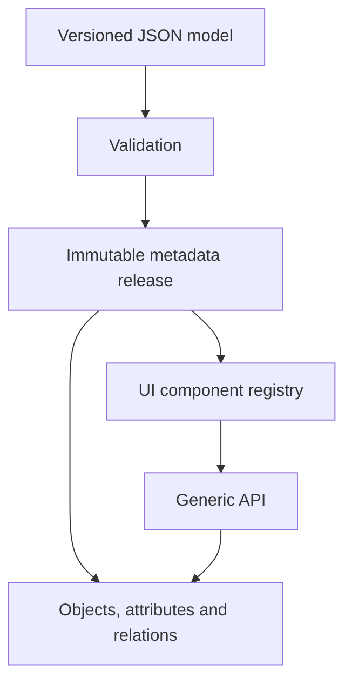
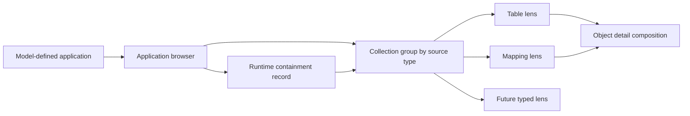

# Architecture

## Core shape

RDM Engine has four layers: model definition, compiled metadata, runtime graph and presentation. The
JSON model is validated and installed as an immutable release. Runtime objects then refer to stable
model keys rather than internal numeric metadata IDs.



## Definition and metadata layer

The model declares:

- Applications
- Global attribute types
- Object types and their attribute bindings
- Forward/reverse relation types
- Allowed source/relation/target combinations
- Views and component configuration

At startup, a canonical hash identifies the model. New content with a new release key/version identity
creates an immutable release and its relational metadata rows; reusing an identity with different
content is rejected. Previous releases remain available for migration planning and audit.

The active release is selected by a singleton database runtime-state row. The configured model file is
bootstrap input: it can install missing content and initialize an empty runtime state, but it is not a
parallel runtime authority. A live-data request reads runtime state once, resolves the selected release
to one immutable parsed model snapshot and uses that release’s metadata throughout the request.
Draft/history requests resolve their own pinned supported definition under ADR-027, rather than using
global current metadata to interpret old content. An in-process
registry may cache snapshots by public release ID and hash; it never decides which release is active.
Definition models are frozen recursively, including nested collections, so cached snapshots cannot be
changed without installing and selecting a different release.

This global selection remains the runtime authority through the pre-production daily-operation and
specialist-workspace releases. Product 0.10 may evolve it into workspace-scoped assignments: a request
must resolve its workspace first, then exactly one immutable release assigned to that workspace.
Staged assignment requires executable data migration, atomic switching, cursor binding to release
identity, protected administration, multi-node propagation and concurrent parser/runtime support for
every permitted schema version. It cannot be implemented as workspace pinning alone.

A draft works under a model version the user chooses without changing which version serves live data.
The draft may be created against, or explicitly moved onto, an installed supported release; its reads,
writes and validation then use that release while live data keeps the active one (ADR-028). A draft
graph interpreted under one release cannot be served under another until it is validated or converted,
so choosing a version is never just a label change: moving a draft onto a release its stored content
does not already satisfy is conversion work, described below. Activation is unchanged: `activate_draft`
merges authored changes onto live data and never alters model selection, so a draft activates only once
its version equals the active release, and any other version is refused with
`workspace_draft_model_release_conflict`.

Model authoring has three explicit stages. Drafts are mutable, versioned database records. Validation,
canonical compilation, semantic diff and compatibility analysis do not persist changes. Installation
creates immutable content-addressed release metadata but leaves runtime selection unchanged.
Activation uses optimistic concurrency on runtime state and is permitted only when stored data is
compatible with the candidate.

Database creation and upgrades run through Alembic. Each revision contains a frozen schema delta or
snapshot and does not import live ORM metadata, so adding a later ORM field cannot change the behavior
of an earlier revision on a fresh database.

## Deployment topology for model administration

Base 0.5 supports mutable model administration only in a single API process. The checked-in container
starts one Uvicorn process and does not set a worker count. `MODEL_ADMIN_MUTATIONS_ENABLED` is disabled
by default and is a deployment guard rather than an authorization system. When enabled, startup must
reject a configured multi-worker topology until cross-process release propagation exists. The runtime
uses Uvicorn's `WEB_CONCURRENCY` setting for this startup guard; the supported administration value is
one.

Within that supported process, immutable release installations are serialized across drafts. The
database uniqueness constraints remain the final identity/hash guard, while process serialization
ensures concurrent identical installation requests retain the documented idempotent response.

Activation commits the database runtime-state change before publishing the new snapshot to the local
registry. If the process cannot refresh that committed selection, readiness is unhealthy and requests
must not fall back to bootstrap content or a guessed cached model. `/health` returns HTTP 503 in that
state until a successful process restart reloads the database-selected release. Read-only release
discovery remains available independently of the mutation flag.

The WP1 migration adopts a legacy database only when it has zero or one active release and every
release key/version identity is unique. Multiple active rows or conflicting historical identities stop
the upgrade before the new schema is applied. The migration does not delete releases, rewrite their
identity or guess which immutable snapshot to preserve.

### Upgrade, backup and rollback operations

The bootstrap model path and the active release are separate operational controls. On startup the
configured JSON is validated and installed when its content is absent. If runtime state already
exists, startup preserves its selected installed release even when the bootstrap file contains a
newer release. Administrators inspect the release catalogue and explicitly activate a compatible
candidate; deployments must never use a bootstrap-file replacement as an implicit publish action.

Before an application upgrade, stop or quiesce writers and take a database-engine-consistent backup.
Keep that backup together with the application image/version and deployment configuration, especially
`DATABASE_URL`, `RDM_MODEL_PATH`, `RDM_CURSOR_SIGNING_KEY`, `MODEL_ADMIN_MUTATIONS_ENABLED` and worker
topology. Run `alembic upgrade head` using the new application before accepting traffic. The startup
path also upgrades to head, but an explicit migration step makes failures observable before service
cutover.

From a source checkout, the explicit migration command is:

```bash
cd backend
.venv/bin/python -m app.cli.database_upgrade
```

The command uses the same configured `DATABASE_URL` as the application. Migration failures are
translated into an operator-facing message containing the sanitized database target, current and
target revisions, reason, recovery steps and escalation details. Startup catches the same condition,
enters maintenance mode and serves `/health` as HTTP `503` without printing a framework traceback.
An interrupted WP4 SQLite migration is retried automatically only when its partial lifecycle tables
are structurally recognizable and empty and every partial active-revision pointer is null. Otherwise
the engine preserves the database and requires backup plus operator review.

For the default SQLite deployment, stop writers and use SQLite's online `.backup` command or copy the
database only while it is closed; retain the database file and application version together. For
PostgreSQL, use the platform's consistent `pg_dump`/snapshot procedure and verify that the restore
includes schema and data. Test restoration before treating either backup as a rollback point.

There are two distinct rollback cases:

- For model content, activate a previously installed release using fresh runtime-state concurrency
  tokens. The same compatibility analysis applies in both directions, so rollback is rejected when
  current stored data would be invalid under the older release.
- For application code or database schema, stop the new deployment and restore the pre-upgrade
  database backup together with the matching older application version. Production rollback must not
  depend on Alembic downgrade scripts or manual edits to immutable release rows; Base 0.5 provides no
  automatic runtime-data migration or transformation executor.

If activation commits but local publication fails, the process becomes unready and refuses
model-dependent requests. Restart the process to load the committed database selection before taking
further action; do not guess the prior selection from the bootstrap file.

## Runtime workspace and object graph

Base 0.6 introduces a global workspace catalogue independently of immutable application models. A
singleton workspace-runtime-state row owns the default key and version. Request scope resolution uses
an explicit known key or that default; it never derives authority by scanning object rows. Retired
workspaces remain addressable for reads but block mutations. Until authentication exists, workspace
administration is controlled by a default-enabled deployment capability and must not be treated as an
authorization boundary.

The live `objects` table contains stable UUID, workspace, application, object type, parent, name,
record version and timestamps. `parent_object_id` supports efficient navigation and path construction.
Together with typed field and relation rows it is authoritative for current data under ADR-026/027.
A workspace revision snapshots a coordinated publication; it is not the authority for subsequent live
edits. Records have no independent publication lifecycle; model-defined availability is ordinary data.

`attribute_values` stores one value per object and attribute type. The declared type selects a physical
column: text, integer, decimal, boolean, date, datetime or JSON. This retains dynamic modelling without
reducing every value to text.

`object_relations` stores typed directed edges. Allowed object-type relationships and cardinality are
validated before insertion. Creating or moving a contained object maintains `parent_object_id` and the
corresponding typed parent relation together.

`relation_set_versions` implements ADR-022 exact-binding relation-set versions for mapping concurrency
(WP-3, delivered 2026-09-12). Each relation write advances the outgoing and incoming sets for its exact
workspace, relation type and endpoint-type binding. Rows are created lazily on first touch; untouched
sets have implicit version 0. Draft-scoped and live-scoped versions are independent; draft deletion
cascades them, and activation merges draft mutation counts into the live version. A mapping replacement
(WP-5, delivered) claims one anchor/direction/binding set and changes its complete zero/one/many edge
state atomically, protecting unmapped and ambiguous rows without allowing another binding of the same
relation type to be replaced accidentally.

The 0.7 plan freezes WP-1–WP-3 (all delivered). WP-4 mapping reads resolve the existing view
configuration under an explicit live/draft model context. They page effective membership in SQL and
batch exact counts with at most 20 target previews per row. Model selection, fields, edges and tokens
share one database snapshot; version-bound target continuation requires refresh after an edge change.
WP-10A makes confirmed live/draft cascade deletion increment both affected directional versions in
the deletion transaction; previews and rejected deletes do not advance them. WP-10B compares complete
immutable-source/live relation identities and versions in touched mutable directional binding sets
before activation applies its delta. Divergence is an actionable `409 version_conflict`; unrelated
live sets survive. Restored source identities and surviving versions count as the same graph even
when a temporary live edge advanced the set counter.

Atomic replacement preserves an existing selected relation identity and validates cardinality in the
actual direction (WP-5). Backend draft version selection validates the complete effective graph and
changes its pin atomically (WP-6), keeping the captured active snapshot identity separate. Browser model transitions
refresh all dependent state under the exact supported pinned model (WP-7/WP-11); unsupported or corrupt
pins block interpretation and writes without substituting the active model. Remaining requirements are described in
[the 0.7 plan](BASE_0_7_IMPLEMENTATION_PLAN.md) and [API.md](API.md); confirmed foundation gaps
belong to conditional WP-10 before acceptance, rather than amendments to frozen package scope.

`audit_events` is an ordered append-only foundation for history and a future change feed.

### Current data, drafts and history

ADR-027 consolidates the accepted authority boundaries:

| Concern | Authority | Write/read behavior |
| --- | --- | --- |
| Current application definition | Database-selected immutable `ModelRelease` | Separate model draft, install and activation lifecycle |
| Current reference data | Live object, typed-field and relation rows | Direct validated writes with record concurrency and audit |
| Coordinated data changes | `WorkspaceDraft*` plus an immutable base | Optional staged records and aggregate draft concurrency |
| Historical data | `WorkspaceRevision*` with pinned model release | Immutable snapshot reads; never a direct restore target |
| Workspace read-only status | Workspace catalogue status | Retired catalogue workspaces remain readable and reject mutation |
| Current publication designation | `Workspace.active_revision_id` | Latest designated publication; clearing it does not remove live data |

Generic object, attribute, relation and translation CRUD is independent of lifecycle. Without a draft,
mutations target live content; with `workspaceDraftId`, they target an effective candidate.
`workspaceRevisionId` selects immutable history and cannot be combined with draft context. Do not add
nested draft-specific record resources or object publication controls. Route-specific concurrency and
workspace inputs are documented in `API.md`.

Draft activation merges only authored creations, updates and removals onto the current live graph.
It checks touched-record versions, preserves unrelated live work, validates the merged result and
commits the new immutable revision, live changes, publication designation and draft removal together.
Any conflict or validation failure publishes nothing and preserves the draft and live data.

**Current-live source contract:** a current-live draft captures a private immutable
`WorkspaceDraftBase*` snapshot at creation, including recent live edits, typed fields, both forms of
containment, independent relations, selected model identity and record versions. It works without a
prior publication and does not mint a public revision merely to start editing. Its base identity is
separate from historical publication lineage. `source: currentLive` selects this base, while
`source: revision` requires the selected revision; omitted source preserves legacy empty/revision
semantics for compatibility.

This capture is implemented and validated on SQLite. PostgreSQL and other dialects return an explicit
unsupported refusal until an equivalent protocol exists. The service restarts its SQLite request transaction as `BEGIN
IMMEDIATE`, so all independent SQLite live/model writers are excluded until the base commits, then
checks the captured active release against the runtime state under that reservation. A chosen draft
pin is separate from this active identity; its complete copied graph must already fit that pin. A busy
database or selection change returns an actionable retry; unsupported dialects are explicitly refused
until an equivalent capture protocol exists. Base rows are removed atomically with draft discard or
activation, while existing nullable-base drafts retain their original source and IDs through upgrade.

Workspace revisions retain derivation and supersession separately. Starting from older history does
not restore the active dataset: untouched newer live content remains. Revision reads resolve the pinned
model before typing values, validating query fields or composing responses. Unsupported or corrupt pins
return structured errors without falling back to the active model.

Model compatibility must examine all authoritative live records, including live-only rows and readable
catalogue-retired scopes. History can be excluded from that population only when historical reads use
the pinned supported model. A current-model switch cannot silently reinterpret an old snapshot.

`20260907_01_workspace_revisions` remains the corrective persistence boundary: it preserves stable
identities, materializes initial history from unambiguous graphs and removes rejected per-object
lifecycle tables. Subsequent storage changes use additive Alembic migrations and the required
bootstrap, preceding-revision, restart and interrupted-migration recovery/refusal tests.

Publication retirement removes only the designation, leaving live data and history available. It is
not consumer withdrawal or catalogue retirement. Revision discovery is newest first through bounded,
deterministic cursor paging. The UI must distinguish the current editable dataset from
an immutable publication snapshot, which can be older than recent live changes.

### Workspace lifecycle orchestration (WP8)

Lifecycle orchestration lives in `app/services/workspace_revisions.py`, its audit seam in
`app/services/workspace_audit.py`, and the workspace read/admin routers. Draft and revision discovery,
whole-graph validation, atomic activation and publication retirement are workspace-scoped operations
that never address individual records.

- **Current draft implementation.** `source: currentLive` captures a private immutable live base;
  `source: revision` records `derivedFromRevisionId`. Both overlay only changed rows and tombstones on
  that immutable base (`effective_draft_membership`). Omitted source remains the compatible empty root
  or historical request form; empty creation is not the normal user workflow. Rename, discard and
  record edits each claim the draft's aggregate version.
- **Draft and history reads in SQL (Base 0.8 S2).** Collection, record, attribute and relation reads
  in a draft or revision context go through `app/services/snapshot_reads.py`: one statement over the
  base rows no draft row replaces plus the non-deleted draft rows, narrowed per arm so indexes apply.
  `snapshot_attribute_values` indexes the JSON values of revision, draft-base and draft objects as
  typed rows (D1), so the object query builder in `services/objects.py` serves live, draft and history
  with the same search, typed filters and sort. A `before_flush` hook in
  `app/services/snapshot_values.py` rewrites an object row's index whenever the ORM writes the row; bulk
  writes outside the ORM maintain it themselves. Validation, activation and draft writes still resolve
  the whole graph through `effective_draft_membership`.
- **Validation.** `POST /api/v1/workspace-drafts/{draftId}/validation` is side-effect-free over the
  effective graph: it validates attributes, containment, ownership, cardinality, ancestor-scoped
  uniqueness and model pinning, and records only a bounded outcome audit event (validity, deduplicated
  error codes and counts), never graph payloads.
- **Atomic activation is a delta-merge.** Activation claims the draft version and the expected active
  revision, computes the draft's delta over its actual base, applies only the created/updated/tombstoned rows onto the **current live** projection
  with per-record and touched mutable relation-set conflict detection, and preserves live-only objects
  and unrelated sets the draft never touched.
  It then re-validates the merged graph, writes one immutable workspace revision snapshot of the merged
  content, retires the previously active revision, deletes the draft and commits in one transaction. Any
  conflict (`409 version_conflict` with per-record `details.conflicts`, including `id_collision` and
  `duplicate_edge`, plus bounded `mapping_set_changed` diagnostics identifying binding/anchor/direction)
  or validation failure (`422 workspace_graph_invalid`) publishes nothing and preserves
  both the draft and the live content.
- **Immutable revisions and history.** Revisions are immutable snapshots. `GET
  /api/v1/workspaces/{workspaceKey}/revisions` and `GET /api/v1/workspace-revisions/{revisionId}`
  expose lineage and bounded history reads; the generic object/attribute/relation routers bind
  `workspaceRevisionId` for immutable snapshot reads. Live cursors bind query/workspace/order and do
  not encode a model or active publication; publication alone does not invalidate them. Draft/history
  cursors bind the selected context and query. They must not be advertised as a frozen live snapshot.
- **Lifecycle audit stays separate.** Workspace lifecycle events use `workspace-draft`,
  `workspace-revision` and `workspace` aggregates with no `AuditEventSubject` rows and bounded identity
  payloads, so a lifecycle action never amplifies audit per object. Record-level draft CRUD keeps its
  own `object-draft` and `relation` aggregates with per-object subjects.
- **Records stay generic.** Objects, typed attributes, containment and relations are ordinary records
  through the canonical object/attribute/relation routers; lifecycle never creates a second CRUD
  dialect, nested draft resources or per-object lifecycle states.

## Why both hierarchy and relations exist

Containment and semantic relationships overlap but serve different access patterns. Parent IDs make
tree navigation and path building efficient. Typed relations preserve meaning, reverse labels and
model constraints. The service layer owns their consistency; clients must not update them separately.

Deletion has two surfaces. Through a draft it removes the record and model-owned dependants from that
draft's candidate graph after an impact preview; it does not rewrite an already published workspace
revision, and the removal becomes visible only when the draft is validated and activated. Directly
(no `workspaceDraftId`) it deletes the live `RdmObject` / `AttributeValue` / `ObjectRelation` rows
physically and immediately, after an impact preview or an explicit cascade for dependants. Neither
surface is ever retroactive: published and historical revision snapshots retain the former object and
relation identities, as does the audit trail. Physical purge of workspace history requires a separately
authorized future retention operation.

## API projection

The API returns attributes by stable keys and typed JSON values. Clients may request relations using
stable relation keys. It never requires arrays of internal attribute or relation IDs.

Collections page with cursors or positions (ADR-030, Base 0.8 S3). Cursors continue after or before a
row, are signed and bound to their endpoint, ordering and effective filters, and never repeat or skip
a row as data changes; a position read jumps to row N and may. Every page carries both cursors, an
anchor that reopens it and, on request, the total and its start index, all from
`services/pagination.py`. Full extraction belongs to asynchronous export or a resumable change feed
rather than an undocumented unbounded page.

## Presentation foundation

ADR-023 keeps the application-facing UI API in repository-owned semantic wrappers. React Aria
Components supplies composite interaction behavior only; feature modules cannot depend on it directly.
RDM owns plain-CSS tokens, layout, visual states and product-specific dismissal, dirty-input and error
behavior. Native HTML remains the first choice for simple controls, and Lucide icons pass through one
accessible wrapper. This boundary permits a future behavior-provider change without altering the
application model or feature contracts.

### Contextual collection composition

ADR-029 separates presentation into context, collection, lens, query and object detail. The application
browser is the navigation spine for arbitrary model-defined applications. It combines virtual
collection entries with the bounded runtime containment records currently available; it is not a
hardcoded Master/System/Translation tree and is not itself a data contract.

For schema 0.5/0.6, a view's source object type defines its collection group. A `table` uses
`objectTypeKey`; a `mappingGrid` uses `fromObjectTypeKey` for outgoing direction and `toObjectTypeKey`
for incoming direction. The frontend groups views with the same source type as lenses and dispatches
each selected lens through the existing typed component registry. This preserves the semantic boundary:
the shared collection workspace owns scope, lens selection and query continuity, while each renderer
owns its data shape, mutations and recovery rules.



Collection query state remains browser-owned and URL-backed. It includes search, typed field filters,
sort where supported, cursor trail and optional containing-object identity. Mapping coverage adds its
configured zero/one/many state filter. The API binds scope and state into opaque cursor semantics, so a
continuation cannot silently traverse another administrative context.

Schema 0.6 does not declare explicit lens groups. The source-type rule is deterministic and backwards
compatible; the engine will add model-language configuration only after real models establish a case
where source type is insufficient. It must not infer workflow meaning from application, object or
relation keys.

The 0.7 browser uses direct-parent scope because that contract already exists for object collections.
Lazy arbitrary-depth traversal, bounded child queries and hierarchy mutation remain the typed product
0.8 hierarchy workspace. Presentation must state direct scope honestly and must not client-filter a
partial tree as though it were complete.

## Scale direction

- Model-derived indexes for searchable and unique attribute types
- Bounded bulk upsert with per-item outcomes
- Batched relation expansion without N+1 database access
- Recursive CTEs or a maintained path representation for large hierarchies
- Asynchronous import/export with streamed storage
- Ordered change feed based on audit sequence

The path builder resolves ancestor chains in level order (one query per depth level rather than one per
object), removing the N+1 traversal for typical hierarchies. Recursive CTEs or a maintained path
representation remain the direction for very deep, high-volume hierarchies.

## Security direction

Authentication and authorization remain deferred through the pre-production 0.9 feature releases.
Product 0.10 introduces OIDC authentication plus model-configurable application, object-type and
operation permissions before replacing the default-enabled workspace-administration posture.
Record-level rules should be introduced only for demonstrated RDM needs.

## Reviewed historical schema replacement (product 0.10)

GAP-02 accepts a warning and confirm-or-cancel migration flow when a history-derived draft is
incompatible with the active definition; GAP-08 keeps data and model drafts separate. ADR-027 therefore
places schema replacement with the existing 0.10 migration/model-assignment capability. Base 0.6 cannot
bypass its model conflict checks or make a schema override available merely because the user confirms.

A migration preview names one workspace and one installed immutable target release (normally the
historical draft’s pinned release), exposes its difference from the current selection, and reports
conversions and potential loss. It migrates current live data toward that target, not the reverse. Confirmation claims that exact reviewed plan and current versions. Execution
validates transformed data and atomically changes data plus the applicable model selection; cancel or
failure preserves the prior usable state and draft. Historical snapshots remain unchanged.

Today's model selection is global, so a workspace action cannot silently change other workspaces'
rules. The future implementation must use the planned workspace assignment boundary and preserve other
workspaces’ assignments and data. Loss confirmation does not waive target-model validity or concurrency checks.

The same preview and confirm steps apply to one draft (ADR-028), run against that draft's own candidate
graph and the live data under it instead of current live data alone: moving a draft onto a release whose
rules its stored content does not already satisfy happens only from a reviewed preview.
