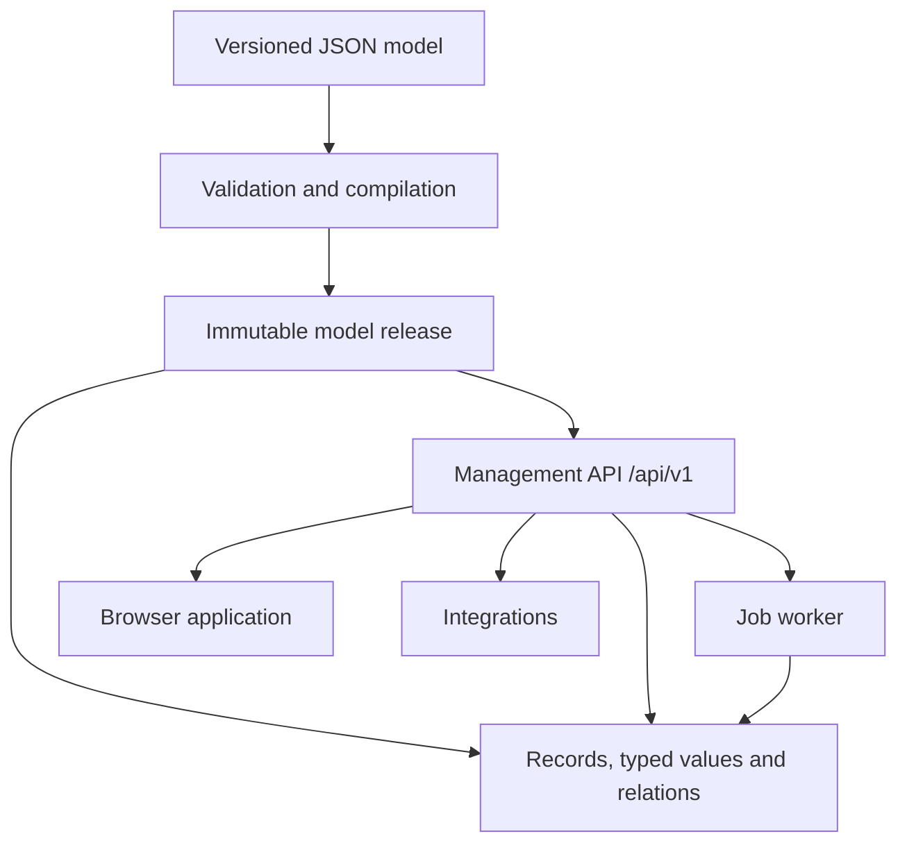
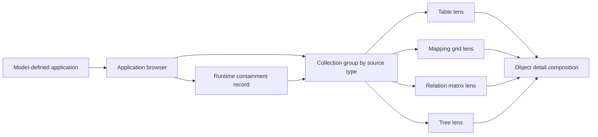

# Architecture

How refiroo is built and why. refiroo is the application; "the engine" in this document is the runtime inside it (see [BRANDING.md](BRANDING.md)). This document describes the system as it is now; when each part
was delivered is in the [changelog](../CHANGELOG.md), the reasoning behind decisions in
[DECISIONS.md](DECISIONS.md), the API contracts in [API.md](API.md), the model language in
[APPLICATION_MODEL.md](APPLICATION_MODEL.md) and configuration and running the engine in
[OPERATIONS.md](OPERATIONS.md).

## Overview

RDM Engine has four layers: model definition, compiled metadata, runtime data and presentation. A
JSON model is validated and installed as an immutable release. Runtime records refer to stable model
keys, never to internal metadata IDs. Every capability is an API operation; the browser application
is one client of that API.

**Technology.** The backend is a Python 3.14 FastAPI service served by Uvicorn. Pydantic 2 defines
the JSON model and the API contracts, SQLAlchemy 2 maps persistence and Alembic owns schema
migrations, on PostgreSQL 17 (ICU root collation, `pg_trgm`, `btree_gin`, `pgcrypto`) through psycopg 3. FastAPI generates the
OpenAPI documents, and a bundled Scalar page renders them at `/docs`. The frontend is a React 19 and
TypeScript single-page application built with Vite, using React Aria Components behind its own
wrappers, Lucide icons and plain CSS. The components ship as Docker images composed by Docker
Compose. The [README](../README.md#technology-stack) lists the full stack, including test and quality
tooling.

## Backend structure

`backend/app` is split into tiers ([record](BACKEND_BOUNDARIES_PLAN.md)):

| Package | Holds | May not import |
| --- | --- | --- |
| `common/` | Paging, signed cursors, JSON encoding, time, JSON pointers, the log and the request observation and metrics (`logs`, `request_observation`, `request_metrics`, `prometheus`), the request gate, secret sealing (`sealing`), background-thread outage reporting (`outage`), route markers, the product's names (`brand`) and the build's commit and tag (`build_reference`) | The model, the engine, any API |
| `models/` | The model contract (`schema.py`), write commands, the persistence schema | The engine, any API |
| `engine/` | The domain: model compilation and releases, records and write rules, change sets, operations, reads, indexes, jobs, workspaces, identity and authorization, mail, events, notifications, imports and sources, moves, proposals and the assistant's tasks, agent access, backups, processes | FastAPI, API schemas |
| `management/` | The management API (`/api/v1`): routes, request and response schemas, presenters, projections, the `/docs` page | The consumer tier |
| `consumer/` | The consumer API (`/api/consumer`): routes that resolve a definition, check its parameters and the workspace, and read through the engine | The management tier |

`tests/test_boundaries.py` enforces the table with no exceptions, no import cycles and no
function-level imports. `main.py` composes the application; `db.py` and `errors.py` are free of
FastAPI.

Inside the engine, every write rule is written once (`engine/records/rules.py`) and reads live data or
a change set through a lookup (`engine/records/context.py`). Where the two contexts word a refusal
differently, the difference is one entry in `engine/records/refusals.py`, pinned by
`tests/test_rule_parity.py`. Every record, relation and attribute-value row is written through
`engine/records/writes.py` (`LiveWrites`, `ChangeSetWrites`).

**Set work runs in the database** (decided 2026-10-03, 0.9 T1). The engine runs on PostgreSQL only.
Work over many rows, such as copying a workspace, merging a change set, checking a rule across a
whole set or filling an index, is done by set statements inside PostgreSQL (`INSERT … SELECT`,
`MERGE`, JSON aggregation, SQL functions where a building block is reused). Python decides and
issues statements; bulk data does not travel through it row by row. Long operations may run as
jobs. Current-live change-set bases and publications are copied inside PostgreSQL: records
with JSON-aggregated values, relationships and the typed index each use `INSERT … SELECT`.
`rdm_value_json` supplies the stored JSON encoding (decimals through `rdm_decimal_text`, which
works on the digit string so every stored scale encodes); a publication copies live data after its delta
is applied. Matrix states and new history cells are copied by set statements in the same transaction.
The publish's whole-graph validation stays in Python, since its rules are written once in `rules.py`;
validation in SQL is deferred until after 1.0.

## Model definition and releases

### What a model declares

- Applications, and the object types and views each one offers
- Global attribute types and each object type's attribute bindings (required, default, read-only,
  unique, unique within an ancestor, ranges)
- Forward/reverse relation types and the allowed source/relation/target combinations, with cardinality
- Containment: which types may stand at the top level and which may contain which
- Views (`table`, `mappingGrid`, `relationMatrix`, `tree`) and detail panels
- An object type's effective period over two of its date attributes (schema 0.8, ADR-038)
- Consumer API definitions (schema 0.9): exposed types and public names, the operations offered,
  fields and their sources, related records, XREF matching, filters, lists, events and a contract
  version

The engine reads the one schema version in the window (0.10; before 1.0 the window is cleaned at every
release, [APPLICATION_MODEL](APPLICATION_MODEL.md#schema-versions-and-the-window)). Definition objects are frozen recursively, so a cached model cannot
change without installing and selecting another release.

**Consumer API definitions have one internal form.** A model document holds its definitions as the
author wrote them, which is also its canonical document and `modelHash`: the syntax of the schema in the
window. A stored release of a schema that left the window is rewritten in place by `engine/model/raising.py`
(a document of schema 0.8 or earlier has its `consumerApis` rewritten from the old internal shape to the
present syntax, by a read-only class of its own there), so no reader carries an older form. Every reader works
on `ConsumerApiDefinition`, the internal form: `engine/model/consumer_definitions.py` expands a definition once
per parsed model (`engine/model/consumer_expansion.py`, every default written out), and `consumer_apis(model)` is
the only way code reads them. The expansion keeps a
map from each internal pointer to the authored one, so the reference rules, which run on the
internal form, and the contract check report at the node the author wrote.
`engine/model/consumer_rendering.py` writes the internal form back as a 0.9 definition with every
default, which `GET /model/consumer-apis/{consumerApi}` answers; expanding it gives the same
definition. Install, draft compile and validation refuse a new 0.8 document with `consumerApis`
(`compile_authored_model`); loading, activating and diffing stored releases never do.

### Releases and runtime selection

A canonical hash identifies model content. New content with a new release key and version becomes an
immutable release with its relational metadata rows; reusing an identity with different content is
refused. Earlier releases stay for comparison, rollback and audit.

Each workspace runs a release of its own (ADR-042): `workspace_models` holds one row per workspace
naming its release and the assignment's version. Different workspaces may run different models, not
only different versions of one. The configured model file is bootstrap input only: it installs
missing content and gives it to every workspace that runs nothing yet (a new database's default
workspace), and is never a second authority. A live request resolves its workspace first
(`workspaceKey`, the context's workspace, the record's for a write naming a record, or the default
workspace), then that workspace's release, to one immutable parsed snapshot it uses throughout
(`engine/model/registry.resolve_model_snapshot`). Change-set and publication requests resolve their
own pinned release (ADR-027) instead of interpreting old content with the current model. An
in-process registry caches one parsed snapshot per release, whichever workspaces run it; it never
decides which release a workspace runs. One parser reads every schema version in the window
([APPLICATION_MODEL](APPLICATION_MODEL.md#schema-versions-and-the-window)), so releases of different
versions are served side by side. A release this process cannot serve (a schema outside the window,
an invalid model, a failed load after activation) makes only the workspaces running it answer
`503 MODEL_REGISTRY_UNAVAILABLE` (D29); the instance is unhealthy only when no workspace can be
served. A workspace's data moves to a release it does not fit through a migration (below); spanning
reads are the cross-type lookup's. Every request reads its workspace's assignment, so a release
switched by any process on the database is served by every other from its next request; a process
parses a release on its first use (D165).

### Model lifecycle

Model authoring has three explicit stages (ADR-016):

1. **Drafts** are mutable, versioned database records with optimistic concurrency. A draft changes
   through recorded operations (ADR-041, `engine/model/authoring/`): a request of typed operations
   is applied all or none to a copy of the draft's JSON document and written as one step of the
   draft's history (`model_draft_operations`, deleted with the draft), each entry with its parameters,
   its inverse and the elements it created, re-keyed and named. A whole-model `PATCH` is recorded as
   one `replaceModel` step. Operations name elements by key; a **reference index**
   (`authoring/references.py`) finds every place in the document that names an element by its
   structure, never by text, so a key change rewrites them and a removal takes them out
   (`authoring/cascade.py`). Every change goes through `authoring/document.py`, which logs how to
   reverse it, so a compound operation's inverse (`restoreElements`) puts back exactly what it
   changed. A draft-only operation is checked against the draft's base release, or the active
   release without one (`authoring/released.py`). A change to an element data holds, or to a released key,
   applies and is marked on its entry with its impact counted in PostgreSQL (`migration`); the draft's
   migration is derived when read from the entries that stand now and the two models
   (`authoring/draft_migration.py`, `GET /model-drafts/{id}/migration`), never stored, and the
   workspace migration carries it (`model/migrations.py`: a moved type's application and parent, a
   relation type's new key, a split's and a list conversion's new records, all set statements in
   PostgreSQL). Installation makes the installed release the draft's base, so a migration read
   afterwards names the release it starts from and the one installed. The server produces the
   layout of new elements (`authoring/layout.py`). A draft may be invalid between steps; the
   compiler's diagnostics are returned with each step and installation still refuses it.
   A client reads the draft's structure as its **outline** (`authoring/outline.py`, `GET
   /model-drafts/{id}/outline`): the containment tree by the rule the layout uses, the bindings, the
   allowed relations and the groups, each element marked against the base release by the same atoms
   the class check reads, and each diagnostic tied to the element its pointer falls in. It reads the
   raw document, so a draft that does not validate is outlined too. The browser's **model editor**
   (`frontend/src/features/model-editor/`) is one client of it: it sends operation steps and reads
   the outline back after each, so no containment or class rule is written in TypeScript. Its
   operations are one descriptor table (`operations.ts`) rendered by one dialog; it lives under
   Settings in `ShellFrame` without a rail (D37). Its **preview** (0.10 A4b) reads the draft compiled
   (`GET /model-drafts/{id}/model`, the model and its placements as the runtime routes serve the
   active one) and renders it with the record screen's own renderers. Their data comes through
   `PreviewDataProvider` and `api/previewClient`: the reads go to the runtime routes, which serve
   the active model, and every other call is refused in the browser before a request, so the preview
   cannot write; reads the active model cannot answer (a new type, a field it lacks) are answered or
   adjusted there. Layout changes are the view verbs (`model-editor/layout.ts`), one step each. Its
   **Consumer APIs** tab (0.10 A4c) edits consumer API definitions by the consumer kinds
   (`authoring/consumer.py`: two whole-definition kinds and four part verbs naming a part by a JSON
   pointer below the definition, the definition re-read as `ConsumerApiDocument` after each); the
   reference index walks the definitions' grammar (`references.consumer_slots`), so `setKey` rewrites
   them. `authoring/consumer_documents.py` serves a draft's definition with its contract against the
   active release and three documents built from the draft by the consumer modules the consumer tier
   uses: the object message's JSON Schema, a message example written from it, and the OpenAPI
   document. A draft also holds one **import profile** (0.10 A5, `model_drafts.profile_json`): a
   second `Document` over it, with identities of its own (a source's `id`, a column binding's
   column), writes into the model document's log with each entry naming its document, so one
   operation's inverse takes back both. The source and mapping kinds (`authoring/mapping.py`) edit it;
   the model kinds carry it with them (`authoring/profile_side.py`): explicit follow code for keys,
   moves, splits, merges, list types and containment, and, in every compound kind's `restoring`, one
   generic prune that turns whatever names an element the model no longer declares into an unmapped
   entry. `engine/sources/draft_profile.py` reads it as the import profile an import takes, checks it
   against the draft's compiled model, queues the dry run after a step that can change the load, and
   saves it as an instance profile at installation. In the browser (0.10 A5b), `useDraftSource`
   reads the profile after every step, follows the file's profiling and the dry run over their job
   event streams, and reads a sheet's columns when it is opened; `model-editor/mapping.ts` reads the
   profile for the source pane and turns a Map to… choice into one request of the mapping kinds
   (with `addAttributeType`, `attachAttribute` and `addSource` before it where needed). The load
   (D81) calls installation, activation, a change set and `POST /imports` with `sourceFileId` in
   turn; there is no combined route.
2. **Validation and compilation** are free of side effects: diagnostics with JSON pointers, canonical
   compilation, a key-based semantic diff, compatibility analysis against stored data and, from schema
   0.8, the consumer contract comparison.
3. **Installation** creates an immutable, content-addressed release and leaves the selection unchanged.
   **Activation** names one workspace, claims its assignment with optimistic concurrency and is
   permitted only when that workspace's stored data fits the candidate; the other workspaces keep
   their releases.

Compatibility examines every authoritative live record of the workspaces it is asked about
(activation: its workspace), including live-only rows of a retired one. Publications are excluded
because they are read under their own pinned release.
Activating a release that declares an effective period over records it would refuse is
`MODEL_MIGRATION_REQUIRED` with their count. A consumer API definition whose contract loses or changes
anything its consumers read needs a higher `contractVersion` (`engine/model/consumer_contract.py`,
C-D17, C-D18); removing a whole definition is a warning.

Activation commits the workspace's new assignment, then loads the release into the process's
registry. If the process cannot load it, the workspaces on that release are unavailable and requests
never fall back to the bootstrap file or a guessed cached model; a restart loads the database's
assignments. Activation also resynchronises that workspace's matrix states and suspends that
workspace's subscriptions the new release cannot serve, and answers the workspace's change sets left
on the release it no longer runs (D26), which cannot publish.

Release installations are serialised by a transaction-level advisory lock taken in
`install_model_release`, across drafts and processes, so a second install of the same model finds the
first's release and answers it idempotently; database uniqueness constraints stay the final identity
guard. Activation needs no lock of its own: its row locks and expected version serialise it (D167).
Startup checks, migrates and installs the bootstrap model under a session-level advisory lock, so
processes starting together on one database take turns (D168). Model administration works with any
number of processes (0.11 N1; see [Deployment topology](#deployment-topology)).

### Change sets on a chosen release

A change set works under a model release the user chooses, without changing which release serves live
data (ADR-028). It is created against, or explicitly moved onto, an installed supported release; its
reads, writes and validation use that release while live data keeps the active one. A graph
interpreted under one release cannot be served under another until it is validated or converted, so
choosing a version is never a label change: moving a change set onto a release its content does not
already satisfy is 0.11 conversion work (see [Directions](#historical-schema-replacement-011)).
Publishing never alters model selection, so a change set is publishable only once its release is the
active one (`CHANGE_SET_MODEL_RELEASE_CONFLICT` otherwise). Unsupported or corrupt pins block reads
and writes instead of substituting the active model.

### Database migrations

Alembic owns the schema. Each revision holds a frozen schema delta and never imports live ORM
metadata, so a later ORM field cannot change an earlier revision. The history starts at one
PostgreSQL baseline (`20261001_01`); each migration runs in one transaction. Startup upgrades to the
latest revision and refuses an unknown one; the operator command and failure handling are in
[OPERATIONS.md](OPERATIONS.md#upgrades).

## Runtime data

### Workspaces

A global workspace catalogue exists independently of model releases (ADR-019, ADR-031). A singleton
workspace runtime-state row holds the default key and its version. A request names a workspace key
or uses the default; authority never comes from scanning record rows. Retired workspaces stay
readable and refuse every runtime write. Workspace administration is a deployment capability until
0.12, not an authorization boundary.

### Records, values and relations

- **`objects`** holds each record's stable UUID, workspace, application, object type, parent, name,
  record version and timestamps. `parent_object_id` serves navigation and path building.
- **`attribute_values`** holds one value per record and attribute type, in the physical column its
  declared type selects: text, integer, decimal, boolean, date, date-time or JSON. Dynamic modelling
  does not reduce values to text.
- **`unique_attribute_values`** holds each live value of an attribute its workspace's release
  declares `unique` once per workspace: the value's row, record, workspace, attribute and the SHA-256 of its
  canonical JSON (`rdm_value_digest`), under a deferred unique constraint (ADR-010, 0.9 J2a). Empty
  text has no row. PostgreSQL keeps it: statement triggers on `attribute_values` add the rows of
  written values under the record's workspace release, the `attribute_values` cascade removes them,
  and a trigger on `workspace_models` adds and removes a workspace's rows as its new release declares
  `unique` on more or fewer attributes (0.11 D28). No code writes it. A move's match by a unique
  attribute seeks it by the carried value's digest.
- **Value indexes are the same for every model** (0.11 D186): one per typed column, never index DDL
  generated from a model, since workspaces on different models share the tables. A unique check or
  key reference compares the value in its typed column and seeks it: live through the value-order
  indexes on (attribute, typed value, record), in a change set through `snapshot_attribute_values`'
  text index and, for numbers, decimals, dates and instants, partial indexes over base and
  change-set rows holding a value of that type. What follows a workspace's model is which rows
  `unique_attribute_values` holds and which values a check looks up. A value is indexed, sorted,
  filtered and checked only when it is stored as a value row (0.11 D190).
- **`object_relations`** holds typed directed edges, checked against the allowed combinations and
  cardinality before they are written.
- **`relation_set_versions`** versions each relation set exactly, per workspace, relation type and
  endpoint-type binding, in both directions (ADR-022). Every relation write advances the sets it
  touches; rows are created on first touch, so an untouched set is version 0. Live and change-set
  versions are independent, and publishing merges a change set's counts into live. A mapping
  replacement claims one anchor, direction and binding and changes its whole zero/one/many state
  atomically, keeping the selected relation's identity, so it can neither leave a gap nor replace
  another binding of the same relation type.
- **`audit_events`** is the ordered, append-only record of every change, read by record history and
  by the change feed (ADR-037). A job's writes name the job as their cause, a publish's the
  publication. Beside the cause, every entry names its actor (`actor_kind` and the person or client):
  the caller the session writes as (ADR-044's writer, so the actor recorded is the caller checked), a
  job step's requester, or `engine`; a flush hook in `records/audit.py` fills it on every entry the
  ORM inserts, and the raw inserts take `audit_actor_of` (0.12 Z4). Names are read through
  `identity/principals`, one statement per kind for a page. Security events (people, groups, roles,
  grants, clients, keys, sign-ins) are entries outside every workspace whose subjects are the
  principals they concern (`identity/security_events`). Every entry that belongs to a workspace
  names it in `workspace_key`, live or made in one of its change sets (a flush hook places an entry
  from its change set or a workspace activation's `workspaceKey`; the raw inserts name it), and a
  record's or relationship's entry names what it changed in `subject` (the type, or relation type
  and ends; 0.12 Z6). An entry that changes live data also has its workspace's `feed_position` and
  the model release it ran under. `reads/changes.py` reads the entries across workspaces, newest
  first on the actor's `(actor, occurred_at, sequence_id)` index, filtered to what the caller may
  browse (`GET /changes`).

Live records, values and relations are the authority for current data (ADR-026, ADR-027). Records have
no lifecycle of their own; model-defined availability is ordinary data.

### Hierarchy and relations

Containment and semantic relationships overlap but serve different access patterns. Parent IDs make
tree navigation and path building efficient; typed relations keep meaning, reverse labels and model
constraints. The engine keeps the two consistent: creating or moving a contained record maintains
`parent_object_id` and the typed parent relation together, and clients never change them separately.
A move beneath the record's own descendant is refused.

A record's type can change inside a change set (ADR-034): the engine derives the possible types and
each value's source from the model, plans the whole operation (`engine/operations/restructuring.py`)
with a preview and a digest, and applies it to the change set. Records keep their IDs; values a new
type has no place for stay in history and are offered back by a later type change.

### Deletion

Deletion has two surfaces. Directly, it deletes the live record, values and relations physically and
at once, after an impact preview or an explicit cascade for owned dependants (ADR-012). In a change set
it removes the record and its owned dependants from the candidate graph, visible only once the change
set is published. Neither is retroactive: publications and the audit log keep the former identities.
Physically purging publications would need a separately authorised retention operation.

One path deletes, for the single `DELETE` and for a batch's delete items alike, live and in a change
set (`engine/records/deletion.py`, 0.9 K2b). A run of deletions is set work: the closures of all its
records are computed in one recursive query into temporary tables, each record belonging to the
earliest item reaching it; each item's impact is counted and digested there and compared with the
token that confirms it; the accepted items' audit entries, relation-set versions and removals (or a
change set's tombstones) are written as set statements. The statements of a run do not grow with its
items or with the size and depth of their impacts.

## Live data, change sets and publications

ADR-027 sets the authority boundaries:

| Concern | Authority | Behaviour |
| --- | --- | --- |
| Current application definition | Database-selected immutable `ModelRelease` | Separate draft, install and activation lifecycle |
| Current reference data | Live record, value and relation rows | Direct validated writes with record concurrency and audit |
| Coordinated data changes | `ChangeSet*` rows over an immutable base | Optional staged records and a change-set-wide version |
| Publications | `Publication*` with a pinned release | Immutable snapshot reads; never a direct restore target |
| Workspace read-only status | Workspace catalogue status | Retired workspaces stay readable and refuse writes |
| Current publication | `Workspace.active_publication_id` | Clearing it removes no data |

**One record API in every context.** Record, value, relation and translation operations are the
same routes in every context: without a change set they target live data; with `changeSetId` they
target the change set's effective graph; `publicationId` selects an immutable publication for reads
and cannot be combined with a change set. There are no nested change-set record resources and no
per-record publication controls.

**Change sets.** `source: currentLive` captures a private immutable base of current live data:
records, values, both forms of containment, independent relations, the selected model identity and
record versions, including edits since the last publication. The capture reads at REPEATABLE READ, so
the base is one snapshot, and holds share locks on the workspace's row and its assignment row, so
neither a retirement nor an activation into the workspace commits while it runs; a change the snapshot cannot hold answers
`409 CHANGE_SET_SNAPSHOT_RETRY`. `source: publication` starts from a chosen publication and records
`derivedFromPublicationId`. Either way the change set stores only changed rows and tombstones over its
base (`effective_change_set_membership`). Rename, discard and record edits each claim the change set's
version. Base rows are removed with the change set.

**Reads in a change set or publication** go through `engine/reads/snapshot_reads.py`: one statement
over the base rows no change-set row replaces plus the change set's own rows. `snapshot_attribute_values`
indexes the JSON values of publication, base and change-set records as typed rows, kept current by an
ORM flush hook (`engine/indexes/snapshot_values.py`; bulk writes maintain it themselves), so one query
builder serves search, typed filters and sort in every context.

**Validation** (`POST /change-sets/{id}/validation`) checks the effective graph without side effects:
values, containment, ownership, cardinality, ancestor-scoped uniqueness, effective periods and the
model pin. It records only a bounded outcome event.

**Publishing is a delta merge.** It claims the change set's version and the expected current
publication, computes the change set's delta over its own base and applies only the created, updated
and removed rows onto **current** live data, checking every touched record's version and every touched
relation set. Live-only records and untouched sets survive. It then validates the merged graph, writes
one immutable publication of it, supersedes the previous current publication, deletes the change set
and commits, all in one transaction. A conflict (`409 VERSION_CONFLICT` with per-record details,
including `ID_COLLISION`, `DUPLICATE_EDGE` and `MAPPING_SET_CHANGED`) or a validation failure
(`422 WORKSPACE_GRAPH_INVALID`) publishes nothing and keeps both the change set and live data.

**Publications** are immutable snapshots, listed newest first with bounded cursor paging. "Derived
from" and "superseded by" are recorded separately, so starting from an earlier publication never
restores the dataset: untouched newer live data remains. Reads resolve the pinned model before typing
values or validating query fields, and an unsupported pin returns a structured error. Withdrawing a
publication removes only the designation; it is neither consumer withdrawal nor workspace retirement.

**Lifecycle audit stays separate.** Change-set, publication and workspace lifecycle events are
aggregate events with bounded identity payloads, never one event per record. Record edits in a change
set keep their own per-record audit. A publish adds one entry per record and relation it changes in
live data (D15, D32), so record history and the change feed see every live change (ADR-037).

## Writes and concurrency

Every write goes through one path: a write unit decides each change with the write rules over a
lookup, then writes what it accepted. A single write is a batch of one through the same code as a
bulk job.

- **Live writes of one workspace serialise; workspaces write in parallel** (PG-D5). The live write
  unit opens with `SELECT … FROM workspaces WHERE key = … FOR NO KEY UPDATE` (`LiveWrites._begin`)
  before it reads what it changes, and holds it to the commit, so every rule checked in code (unique
  values, parent cycles, cardinality, required relations, relation-set versions, stored matrix states)
  reads what the previous write committed. A batch, inline or one background chunk, takes it once for
  all its items. The lock conflicts with publishing (also `FOR NO KEY UPDATE`), a current-live capture
  (`FOR SHARE`), retirement and deletion (`FOR UPDATE`), but not with a key share lock: the one a row
  naming the workspace takes through its foreign key, or the one a change-set write takes.
- **Lock order:** the workspace (whose row also holds the feed counter, 0.9 F1), then a change set,
  then the workspace's assignment row in `workspace_models` (activation for update; a write's commit
  check and a current-live capture shared), then records and their index rows, and a job's row only
  at its chunk's checkpoint. Activation locks the workspace's active subscriptions and, when the
  releases declare different `unique` attributes, the unique values' table before the assignment
  (0.9 R-F2, R-F3). Retirement, default switching and deletion lock the workspace before the
  workspace runtime-state row, and publishing locks the workspace before its change set. The
  assignment is a row of its own, not columns on `workspaces`, so the commit check's share lock never
  waits on the workspace row's update locks (D30). A change-set write takes the workspace's key share lock and then its change-set row
  (`load_change_set(for_update=True)`): retirement and deletion wait for it, and it waits for them and
  is then refused `409 WORKSPACE_RETIRED`; live writes, publishing and other change sets' writes run
  beside it, and writes to one change set serialise on its row. Tested by `test_pg3_concurrency`, each
  invariant raced on two connections, and across two server processes by J03.8, J02.2, J13.8, J14.8,
  J26.5 and a job's item against a live write (0.11 N3).
- **What the database backs, and what the lock holds** (0.11 N3, D184). Constraints back record and
  relation IDs, one relation per type and ends, one value per record and attribute, relation-set
  versions, feed positions, and live `unique` values (`unique_attribute_values`, kept by triggers
  whatever writes the values, checked at commit). Parent cycles, cardinality, required relations, the
  containment edge agreeing with the parent and unique values within a change set are rules checked
  in code; they hold because every write that could break them runs under the workspace's lock, and
  the publish checks the whole graph again. Three modules write record rows in SQL text outside the
  write unit, each under the lock its writes need: deletion (after `LiveWrites` or under the change
  set's lock), a workspace's migration (the workspace `FOR UPDATE`) and a change set's migration (the
  workspace `FOR SHARE`, the change set `FOR UPDATE`). `tests/test_boundaries.py` lists them; a new one
  fails it until it is reviewed for the lock and listed.
- **A write never commits under a release its workspace no longer runs.** A request that resolves a
  workspace's release binds its session to it (each workspace it resolved). Before commit the session
  flushes its rows and rereads each workspace's release under a share lock on its assignment row;
  activation locks that row for update before its compatibility check, so the two cannot interleave
  in one process or across instances. A write that flushed first is seen by the compatibility check;
  a write after activation sees the new release and is refused `409 MODEL_RELEASE_CHANGED` naming the
  workspace, nothing saved. A write in another workspace locks another row. The guard and
  activation lock the assignment row alone and read its release after: under READ COMMITTED, a lock
  that waited for a switch rechecks a joined condition against the release read before the wait,
  and the switched row would drop out of the join (found and fixed in 0.11 N1).
- **A read never answers one release's model over another's data.** A migration and a change set
  moved to another release switch data and release in one transaction. A request that resolved a
  release and did not commit checks, as its session dependency ends and before the answer is sent,
  that each workspace it resolved still runs that release and each change set it read in still pins
  it (`registry.require_unchanged_releases`); otherwise `409 MODEL_RELEASE_CHANGED`, and the client
  reads again. A read that still sees the old release read only the old data, in this process or
  another (D166). A request that committed is not checked: the commit guard checked its write.
- **A write never commits into a workspace deleted or retired after it resolved it.** The same
  commit point rereads the workspace (`404 WORKSPACE_NOT_FOUND`, `409 WORKSPACE_RETIRED`). Workspace
  deletion checks for records, change sets and publications and locks the workspace and the
  workspace runtime-state rows (the assignment row goes with the workspace by `CASCADE`); the
  `workspaces.key` foreign keys (`RESTRICT`) protect every other row naming the workspace,
  and every `ondelete` rule is pinned in `test_foreign_keys`.
- **Decided in memory, written in bulk** (PG-D12–PG-D16). A create or update is decided by the rules
  over a batch lookup (`records/batch_lookup.py`): the records it reads, preloaded per chunk, with the
  items decided before it laid over them. Relation writes are decided the same way
  (`records/relation_writes.py`), and so is a relation-set replacement (`records/relation_sets.py`),
  which the mapping save and a batch's `replaceRelationSet` share; a set version is compared with the
  stored one plus what the chunk's items advanced (0.9 B3, D35). The accepted changes are written together by `records/bulk.py`,
  each kind of row in multi-row statements: a chunk of 500 items costs 30–49 statements, 40–43 for
  relationship items. Because a
  version is compared in memory rather than claimed by a conditional `UPDATE`, a write reads the records
  it changes after taking its lock. A chunk checks its release before writing matrix states, so an
  activation that drops a matrix view cannot deadlock with it. A bulk write failing on a row the rules
  could not see is redone item by item, so only that item is refused. Delete items keep a per-item path.
- **Unique values are held by the database too** (0.9 J2a). The rule refuses a duplicate before it is
  written; the write unit, the single attribute write and the publish's apply then read
  `unique_attribute_values` for the records they wrote (`indexes/unique_values.check`), so a value
  written past the rule is refused with the rule's `409 DUPLICATE_ATTRIBUTE_VALUE` inside the
  transaction, where a batch redoes its items one by one. The constraint is deferred, so values handed
  between records within one write pass; at commit it refuses whatever no check covered. Change sets
  keep the rule alone and meet the constraint when they publish.
- **Optimistic concurrency everywhere else.** Updates carry the record's `expectedVersion`; mapping
  saves carry the relation set's version; change sets, drafts, activation and workspace administration
  carry their own versions. A stale claim is a `409` with the current state.

## Reads and queries

**Paging** (ADR-030). Every collection pages by cursor or by position, from `common/pagination.py`.
Cursors continue after or before a row, are signed (`RDM_CURSOR_SIGNING_KEY`) and bound to their
endpoint, scope, ordering and effective filters, and never repeat or skip a row as data changes; a
position read jumps to row N and may. Every page carries both cursors, an anchor that reopens it and,
on request, the total and its start index. There is no unbounded page: full extraction belongs to
export jobs or the change feed.

A list sorted by an attribute is read in two parts (`object_query.value_order_parts`), in every
context: the records with a value, joined to it and walked through an `(owner, attribute, typed
value, record)` index in value order, then the records without one. Live reads the
`ix_attribute_values_key_*` indexes, a publication its partial publication indexes; a change set's
first part is two arms, its base's records it does not replace and its own records, each joined to
its own values through the base and change-set indexes (`snapshot_reads.object_projection(sort_value=…)`).
`pagination.merged` reads such a part: a page, cursor or seek takes each arm's first rows in its own
order and keeps the first of them all, since PostgreSQL merges a union in index order only when each
arm reads one table; a position reads the union in one statement (0.11 Q3). Ties come by record ID,
the indexes' last column, in every context. `paginate_statement` pages such parts in turn: a page continues from
one into the next and a position skips a whole part by its count; a total counts the list's records
once, without their values. Each part holds its null rank constant, so the keys, cursors and seek
are those of the single statement. A first page, seek or cursor read costs its own rows; a position
deep in the order still walks the index up to it, so it grows with the records listed (0.11 Q3,
D205; stored sort keys holding the parent are in TODO). A consumer list
filtered below a parent or an ancestor reads the container records first and binds them as a list,
as a search reads its candidates, so PostgreSQL plans with their real number.

**Search and order.** Names sort in the database's ICU root collation, case- and accent-aware. Search
uses `pg_trgm` GIN indexes on the live and snapshot value tables and on the name of every record table
(`models/search_index.py`), which narrow candidates; the case-insensitive "contains" predicate still
decides the result, so an index changes speed, never results. The per-type list reads a search's
candidates before it builds its statements (`object_query.search_candidates`): at most 1,000 record
IDs become a list each statement reads by ID, in every arm of a change set's projection; more, or a
phrase too short for a trigram, leaves the statement to match every record, with the value side
bounded inside it (`bounded_match`). A unique-value check and a record reference by key seek through
a value index (`ix_attribute_values_key_text`). Read budgets and the measuring method are in
[POSTGRESQL_BUDGETS.md](POSTGRESQL_BUDGETS.md).

**One query builder per shape, every context.** `engine/reads/object_query.py` builds the per-type
list (search, typed filters, sort, scope by parent or top level) for live data, change sets and
publications alike. On top of it:

- **Cross-type lookup** (`GET /objects`, `engine/reads/object_lookup.py`) lists several or all types
  over built-in fields, with its own cursor scope; model-declared fields are refused with the per-type
  route that answers them.
- **Workspace edge list** (`/workspaces/{key}/relations`, the same list as `/mappings`,
  `management/projections/mapping.py`) lists every relation of any type in one shape.
- **Model-aware query** (`POST /workspaces/{key}/queries/objects`, `engine/reads/model_query.py`) adds
  what query parameters cannot carry, each as a set the record's ID or parent ID must be in:
  `ancestor:<type>` (walking down from the ancestor through containers only) and one `related` hop,
  read once as a set, never per record. Every name is checked against the model first and refused
  with its JSON pointer. `expand` reads related records in one statement per expansion for the page.
  An expansion that names its fields (`select`; every list's relation column does) reads only those
  in that statement: the related records' columns and selected values, and an `ancestor:<type>`
  field through a walk up the parent chain inside it, bounded by the hierarchy's depth. One without
  `select` returns full records, read and rendered for the page in one batch.
- **`asOf`** (ADR-038) is a filter over a declared effective period's two date values, combinable with
  any context; it never selects one. A type without a period refuses it.

**Ancestor paths** are resolved in level order, one query per depth level for the page, reading only
the columns a path shows.

**Stored matrix cell states** (ADR-033). `matrix_cell_states` holds each non-empty relation matrix
cell's counts per owner (live, publication, change-set base, change-set overlay, workspace history)
and matrix shape. `engine/indexes/matrix_states.py` builds missing owners at startup and on
activation, change-set and publication creation, and recomputes touched rows before each commit (an
ORM flush hook plus explicit notes from Core statements). The matrix's state filter reads it, so
filtering to gaps works across the whole list.

## Jobs

Every bulk write, and later every import and export, is a persisted job (ADR-036, `engine/jobs/`):
its parameters, state, progress and one outcome per item, kept for a retention period.

- **Items go through the single-write rules** and are refused with the same codes. Bulk adds
  addressing by unique key, upsert and the `unchanged` outcome, not a second validation path.
- **Two failure policies**, named per request: `atomic` (all or nothing, bounded) and `independent`
  (each item on its own, in order, seeing the items before it).
- **Inline or background**, chosen by the caller, never by size. An inline job runs in the request. A
  background job is stored and run by a worker thread in the API process (`engine/jobs/worker.py`;
  the consumer event deriver and the webhook dispatcher are its siblings, `engine/events/worker.py`
  and `engine/events/dispatcher.py`) in
  chunks: a chunk's writes, outcomes and the job's checkpoint commit in one transaction, so a resumed
  job starts at its first item without an outcome and never repeats or skips one.
- **Lease.** A worker claims a job with `leaseOwner` and `leaseExpiresAt` in a short transaction.
  While it runs a chunk, a heartbeat thread renews the lease every third of `JOB_LEASE_SECONDS` in a
  short session of its own, whatever the step, so a job stays with its worker however long a step
  or a single statement takes; another worker takes it over only once its process stops renewing
  (stopped, frozen, cut off from the database). A chunk, and a long step such as a move's settling,
  does its work without holding the job row, so a cancel request never waits; it locks the row only
  at its checkpoint and rolls back if another worker took the job over. A job of one step (a
  profile, an inference, a dry run, a check) also stops there when a cancel was requested, so it
  writes nothing once asked to stop.
- **Several nodes** share the job table: a claim is one `UPDATE … WHERE` claimable, so two workers
  never both claim; each process's job listener (`LISTEN rdm_job_events`) wakes its workers when any
  process queues or changes a job, so an idle node starts a job queued on a busy one at once.
  Submitting a dry run, an inference, a mapping inference or a profile's check takes an advisory
  lock on its kind and subject (`db.lock_job_subject`), so the stop request it sends to the
  subject's earlier job sees one submitted at the same moment; the lock, the stop and the start
  are one function (`replace_earlier_job`), and every stop request is `request_stop` in
  `engine/jobs/background.py` (queued and running jobs, `CANCELLABLE`; a repeated stop keeps the
  time of the first). The kinds of job are one registry (`engine/jobs/kinds.py`: group, worker,
  step, whether it previews, whether it has rows, its place in the claim order) that the worker's
  dispatch, the groups and the API's kind lists read. An export's partial file is named
  after its worker's lease, so a worker that lost an export never writes or removes the new owner's
  file; it is renamed into place under the job row's lock.
- **A job pins its model release** and fails with `MODEL_RELEASE_CHANGED` when it moves. In a change
  set it holds the change set's version and fails if anyone else writes to it.
- **Idempotency keys** replay a finished job's response and refuse a reused key with a different body.
- **A stale write is refused in one place** (`require_version` and `version_conflict` in
  `app/errors.py`, called under the row lock; a compare-and-set write keeps its `UPDATE … WHERE
  version =` and raises through the same function): `409 VERSION_CONFLICT` with
  `details.currentVersion` beside whatever the write adds (a draft's `operations`, a release's
  status counter, a mapping replacement's targets). Only `CHANGE_SET_VERSION_CONFLICT` and
  `RELATION_SET_VERSION_CONFLICT` stay apart, since they tell two claims in one request apart.
- **Staging is the change set**: a job targets live data or a named change set; there is no separate
  staging store.
- **Exports** (`engine/jobs/exports.py`) run on a second worker thread that claims only `export`
  jobs, so batches and exports never wait for each other. An export is one step, not chunks: it
  reads everything in one `REPEATABLE READ` transaction, so the file is one instant of its context
  and a live export's feed head is a baseline to follow the feed from. The scope's records are
  selected per type through the model query's builders (`plan_model_query`) into a temporary table
  by one statement; depth, parent paths, relationships and required relationships are set
  statements over it; JSON Lines and CSV rows are built by PostgreSQL (`json_build_object`, `COPY`)
  and streamed to the file. XLSX is written as SpreadsheetML straight into its ZIP container
  (`engine/jobs/xlsx.py`), its values extracted as canonical text by PostgreSQL as for CSV and
  typed per cell, row by row.
  A **workbook for people** (`engine/jobs/people.py`, 0.9 J6) shares the snapshot and the scope's
  table; each relationship a column or sheet shows goes into a temporary table with its far records
  and their ancestors, each relation column's cells are one `string_agg` per column, and each sheet
  streams from those through a server-side cursor into `xlsx.Workbook.plain` (one header row, frozen
  and filtered, widths from one `max(length())` statement, hidden columns, cell styles from the
  workbook's style table with the eight type hues). The import profile that reads the workbook back
  is built with its sheets, checked as any profile, and written on a hidden sheet, which
  `engine/imports/readers.carried_profile` finds when an XLSX is imported without one.
  Columns per parent (0.9 J6a) build each row's cells per parent as one JSON value in one grouped
  statement (`people_grid`), so the sheet reads a row by one join; reference lists are each one
  insert from K7's `candidate_ids`, their sheet titles reserved before the sheets whose list rules
  name them are written.
  Cancel requests, the lease and progress go through a short session of the worker's own every
  10,000 rows, because the snapshot cannot see later commits. Files live in `JOB_FILE_DIR`
  (`engine/jobs/files.py`), named after their job; a file is kept only while its job is completed.
- **Imports** (`engine/imports/`, 0.9 J2) run on the batch worker. The file is stored in
  `JOB_FILE_DIR` as `{jobId}.source` before the job is queued. The worker's first step binds it in
  one transaction: a reader streams the rows (openpyxl's read-only mode for XLSX, the standard library
  for CSV and JSON Lines), each bound cell is converted through the attribute registry, and the rows
  are copied into temporary tables. Set statements over those and the context's records
  (`engine/reads/context_sets.py`, shared with the export) then find each row's record by its key or
  give it an ID, reject repeated keys with differing values, resolve every match against the context
  and the file's own rows, order a source's own hierarchy by a recursive query, find related records
  through their relationship and parent, and build the items as JSON. Rejected rows become the job's
  first outcomes and the items its inputs (`INSERT … SELECT`), and from there the import runs as a
  background batch. Inputs and outcomes keep each item's source and row (`source_index`,
  `row_number`), so `GET /jobs/{id}/rows` groups the outcomes by row in one statement. A row's cells
  are all converted, so its refusal names every failing cell; the binding report's cell counts are
  kept while the rows stream and its match counts are one aggregate over the temporary tables, kept
  on the job (`jobs.report`). Profiles (`engine/imports/profiles.py`) are checked against a model
  release with every problem at its JSON pointer.
- **Previews** (`engine/jobs/preview.py`; imports 0.9 J3, batches 0.9 K2): after an import's binding,
  or once a batch sent with `stage: preview` is claimed, the worker runs the first
  `JOB_PREVIEW_MAX_ITEMS` items through `run_items` independently, in one transaction it
  rolls back whole, so records, relationships, matrix states, unique values and change-set versions
  go together and PostgreSQL drops the transaction's notifications; it records no audit entry and
  takes no feed position at all (`audit.trial_run`, 0.10 A3a, D72), since nothing in it reads them;
  a short transaction holding the lease then records the outcomes and the summary, and the job waits
  in `awaiting_confirmation` without a lease, which no worker claims. Confirming (under the job row's
  lock, after the context is checked again) removes the preview's outcomes and queues the job: an
  import's inputs go too and it binds the file again, while a batch keeps its stored items and runs
  them from the first; either way it runs as an execution: one execution path. Cancelling a waiting
  job finishes it in the request; retention expires it like a finished one.
- **Source files and dry runs** (`engine/sources/`, 0.10 A3): a source file belongs to a model draft
  or an import profile (`source_files`, deleted with its owner); its file is `{id}.upload` in
  `JOB_FILE_DIR`, kept while its row exists. A `profile` job reads the file once through the import
  readers and copies every filled cell into `source_file_cells` with its kind, its text and its
  value as the reader gave it (`values.py`); blocks, header rows and column statistics are set
  statements over those cells, stored in `source_file_sheets` and `source_file_columns`. A `dryRun`
  job is an import preview with two differences: its context carries the draft's compiled model in
  place of the active release's (`dry_run.dry_run_context`), and the binding reads the staged cells
  through `StagedFile`, a `TabularFile` over `source_file_cells`, so it is the same binding and the
  same write rules (a draft's new unique attribute is checked by the rule against
  `attribute_values`; the database index of unique values follows the active release only). It
  previews every item, then completes with its summary instead of waiting for confirmation; its stop
  check also stops it once the draft's version moved on.
- **Following a job** (0.9 J1u): a trigger on `jobs` sends `pg_notify('rdm_job_events', id)` when
  a change to a job's state, progress, cancel request or output commits, so every path that changes
  a job is heard and nothing rolled back is. One listener thread per process (`engine/jobs/events.py`)
  holds a psycopg connection that `LISTEN`s and wakes the server-sent event streams following that
  job (`GET /jobs/{id}/events`), which read the job again in a short session of their own. The
  browser keeps one stream per running job its tab started and shows the job's outcome as a
  notification (`features/jobs/`); nothing is polled.

## API projection

The API returns values by stable attribute keys as typed JSON, and relations by stable relation keys;
it never requires internal attribute or relation IDs. Records and relations have stable UUIDs.
Errors share one envelope, `{ "error": { "code", "message", "details" } }`, with a JSON pointer in
`details` where input is at fault.

FastAPI generates the management API's OpenAPI document (`/openapi.json`); its digest and inventories
are locked by backend tests, so a contract change is always deliberate. `GET /docs` renders it with
[Scalar](https://github.com/scalar/scalar) (MIT), followed by each consumer API of the active release
as a further source, built per request (0.9 V2). The Scalar script is pinned and bundled with the engine, so the page works
offline and loads nothing from elsewhere. `GET /api/v1/capabilities` reports the deployment's
capability groups and job limits.

## Presentation

The frontend is a React 19 single-page application written in TypeScript and built with Vite. It talks
to the backend only through the public HTTP API, the same API every other client uses.

ADR-023 keeps the application-facing UI API in repository-owned semantic wrappers. React Aria
Components supplies composite interaction behaviour only; feature modules cannot depend on it
directly. RDM owns plain-CSS tokens, layout, visual states and product-specific dismissal, dirty-input
and error behaviour. Native HTML remains the first choice for simple controls, and Lucide icons pass
through one accessible wrapper. This boundary permits a future behaviour-provider change without
altering the application model or feature contracts. The module layout, as it was built, is in
[FRONTEND_STRUCTURE_REFACTOR.md](FRONTEND_STRUCTURE_REFACTOR.md).

**Import tiers (ADR-046).** `src/` has nine layers; each imports what its row names (the lint rule enforces the `features` and `state` rows):

| Layer | Holds | Imports |
|---|---|---|
| `app` | the shell, the router, the top bar | everything below |
| `features` | one folder per feature (pages, dialogs, the feature's own hooks and text) | `state`, `ui`, `lib`, `model`, `api`, `types`, `routing`, `app`, itself, and its deliberate edges |
| `state` | app-wide state and hooks that know no single feature: the workspace data context, permissions, system capabilities, the signed-in person (`useMe`), the followed job, the inbox, the workspace AI offer, opening a workspace | `api`, `lib`, `model`, `types`, `routing`, `state` |
| `ui` | the RDM-owned components, and the parts several features show (the job outcomes, the workspace field, the change title) | `state`, `lib`, `model`, `api`, `types`, `routing` |
| `lib`, `model` | browser helpers; pure functions over the model and the contracts | `api`, `types` (`model` also `lib`, and `ui` for icon names only) |
| `api`, `types`, `routing` | the HTTP client, the contracts, the route table | each other, and `model` and `lib` as the contracts need |

**One version of each helper and loader (0.17 SR4).** Following a job is `state/useFollowedJob` (a seeded
job, streamed-only callbacks, filters, "done" as a parameter, polls as options); every list of pages is
`lib/everyPage` (optional `signal` and stop predicate) and every workspace list `api/allWorkspaces`; a cached
read is `state/cachedRead` (the signed-in person, the system's static parts); permissions are read through
`state/permissions` (`fetchPermissions`, `holds`); a stale write is recognised by `api/errors`
`isVersionConflict`, and an error answer is parsed by `errorFromResponse`. Numbers and plurals are `lib/count`
(`count`, `plural`, `counted`, the browser's locale), dates `lib/dates`, names of types, relations and fields
`model/lookup` (`typeName` falls back to the key) and `model/outline` for a draft, clipboard `lib/copyText`,
stored preferences `lib/localPreference`, value coercion `lib/coerce`, the nearest scrolling ancestor
`lib/scrollAncestor`, newest release first `model/newestFirst`. A second copy of any of these is a defect.

**One component for each element (0.17 SR5).** A write with its conflict and error notices is `ui/useGuardedWrite`
and `ui/ActionNotices` (the wording is SR-D2's); discarding unsaved input is `lib/confirmDiscard` through `Modal`'s
`requestClose` and `CancelButton`; the activation verdict's migration block is `ui/ActivationParts`
(`ActivationVerdict`); a job's progress is `ui/JobProgress`; a saved flash is `ui/useFlashSaved` with `ui/FlagCell`
(Undo is `toast.withUndo`); an edit in place is `ui/EditInPlace` (`useInPlaceEdit`, `useFocusReturn`); the list of
active and deactivated entities is `ui/EntityListPage`; a new workspace's fields are `ui/NewWorkspaceFields`; a
workspace choice is `ui/WorkspaceField`; a person picker is `security/PickDialog`; a search box is `ui/SearchField`
(the checklists and the filter menu included); a preview gone out of date is `ui/StalePreviewDialog` over
`ui/ConfirmDialog` (a second action, and `dismissable={false}` for a dialog whose actions are its only choices); a
migration's outcome cards are `ui/MigrationRows` `outcomeCardsOf`; a count or role pill is `ui/StatusPill` (sizes
`compact` and `small`, tone `plain`); a ruled table of a settings page is `ui/SettingsTable`; bulk dialogs take
their policy by verb from `BulkJobDialog`; repeated words are `lib/words`. A second copy of any of these is a defect.

SR2 moved parts several features show (`NewMoveDialog`, `AddWorkbookDialog`, `JobNotifications`, `ImportOutcome`,
`MigrationRows`, `OutcomeCards`, `MoveRowsTable`) into `ui/`, and SR5 added `ActivationParts`, `EntityListPage`
and `JobProgress`. They **stay in `ui/`**: ADR-046 already names `ui/` as the home of "the parts several features
show" (this section's table), `ui/` imports only `state`, `lib`, `model`, `api`, `types` and `routing` (the lint
rule that holds it passes with each of them there), and a part with two or more features as users has no feature
to own it. No new layer is needed. ADR-023's "generic wrappers" describes what `ui/` began as, not a limit on it.

**One stylesheet rule for each look (0.17 SR6).** A popover's surface, its colour and 1px border, is `.popover`
(`components.css`), which the popover's own class follows in the markup (`ControlPopover`, `Selection`, `ActionMenu`,
`AnchoredMenu`, `SearchMenu`, `MultiSelect`, `InfoHint`, `CellReveal`, `FloatingCellEditor`, the editor's anchored
popovers (`OperationDialog`, `ReadingAsks`), the workspace search results, the canvas line popover and find list); each keeps its corner, shadow, width and padding, and a popover with a
stronger edge sets `border-color`. A pill or chip takes its corner from `--pill-radius`, and a chip coloured by hue reads
the `[data-hue]` convention (`--hue-fill`, `--hue-ink`, `--hue-marker`); no stylesheet writes `999px`. The chips that
filter a list are `.filter-chips` (one rule, `settings-family.css`) holding `.filter-chip` (a toggle, pressed or not)
and `.filter-chip-applied` (the matrix's applied filter). A look several classes wrote alike is one rule: `.truncate`,
`.list-reset` and `.wrap-row` (`base.css`, used in the markup beside the class that needs more); the quiet line of a
note, a count or an empty list's text is one grouped rule, and `.empty-state` stays the card an empty page draws. A type size that is the
same in every theme reads the `--text-*` step (`--text-xs`, `--text-sm`, `--text-md`); the other `--fs-*` steps stay
because a theme moves them apart. Every `z-index` is a `--z-*` token (`tokens.css`), in the order and with the ties the
stylesheets had; padding, margins and gaps that equal a step read `--space-*`. A bare selector is defined once: a
second definition of it in another stylesheet is a defect (contextual and media rules differ and stay; the one
exception is `.dialog`, whose animation must follow the shorthand that sits between its two rules). A class with no use
in the markup, the tests or a built name is deleted.

A part used by several features lives in the lowest layer its own imports allow; a part that is one
feature's own and shown by another stays where it is, as a **deliberate edge**. The deliberate edges
are `workbook-canvas` to `model-editor` (the canvas is a second view of the model editor) and to
`workspaces` (it starts a workspace); `model-admin` to `model-editor` (a model's pages open the editor
and reuse its dialogs); `model-editor` to `objects` (a type's preview draws the real collection
views); `moves` to `model-editor` (its editor shows the editor's history) and to `objects` (its
selection uses the list filter bar); `settings` to `jobs` (Settings › Jobs hosts the job pages and
dialogs) and to `security` (the account and agent pages show its roles and clients); `jobs` and
`workspaces` to `security` (they show its access list); `home` to `workspaces` (the workbook start
action). They run one way, so features form no cycle, and `src/types/` has none either.

`frontend/eslint.config.js` holds the rule: a `no-restricted-imports` block per feature forbids
`@/features/*` except its own folder and its edges (the table `FEATURE_EDGES` at the top of the file,
the one place an edge is added, with its reason), another per lower layer forbids `@/features/*`, and
`state` also forbids `@/ui` and `@/app`. No exception list exists; `npm run lint` fails on a new
feature-to-feature import. It is the frontend counterpart of the backend tiers that
`tests/test_boundaries.py` enforces.

The URL is the route (`routing/routes.ts`). Every route renders in one frame, `app/ShellFrame`
(skip link, top bar, resizable rail that moves into the navigation drawer below 760px, main
content), under one top bar, `app/TopBar` (product mark to home, the applications as tabs,
Settings, the account; U-D14). Application routes fill it in `AppShell`: the workspace switcher
above the collection and hierarchy browser in the rail, and the data-context band (live, change
set or publication) above the content. Below 760px (0.10 N1) the top bar shows no application tabs
in any area, the rail's workspace switcher is left out, and the band is one line whose workspace,
application and data context each open their choice in a popover, reusing `WorkspaceSelector`,
`ApplicationButtons` (the top bar's tabs) and the band's own switch; `lib/hooks/useMediaQuery`
holds the width check the drawer and the band share. Settings routes (`/settings/…`) fill it in `SettingsShell`,
with no workspace or data context: no application is current and Settings reads as the current tab, the rail holds the settings
navigation, and each page is a `SettingsLayout`. From Settings, the tab of the application last
looked at returns to that route of the session, another application's tab to its last collection
or default view. Addresses the settings area replaced (`/models`, `/workspaces`) parse to their settings
routes, and the router's first-load `replaceState` rewrites them. Per-browser preferences (theme,
the default table density, a view's own display) are kept in local storage.

### Contextual collection composition

ADR-029 separates presentation into context, collection, lens, query and object detail. The application
browser is the navigation spine for arbitrary model-defined applications. It combines virtual
collection entries with the bounded runtime containment records currently available; it is not a
hardcoded Master/System/Translation tree and is not itself a data contract.

A view's source object type defines its collection group. A `table` uses `objectTypeKey`; a
`mappingGrid` uses `fromObjectTypeKey` for outgoing direction and `toObjectTypeKey` for incoming
direction; a `relationMatrix` uses its `rowObjectTypeKey`; a `tree` uses its first
`rootObjectTypeKeys` entry. The frontend (`model/collections.ts`) groups views with the same source
type as lenses of one collection and opens the application's `defaultView` when it is in the group,
otherwise its first table, otherwise its first view. Each selected lens is dispatched through the typed
component registry. The shared collection workspace owns scope, lens selection and query continuity,
while each renderer owns its data shape, mutations and recovery rules.

Collection query state is browser-owned and URL-backed: search, typed field filters, sort where
supported, one scroll `anchor` cursor and optional containing-object identity. Mapping coverage adds its
zero/one/many state filter, and the relation matrix its cell state filter. The API binds scope and state
into opaque cursors, so a continuation cannot silently traverse another context.

Long lists are drawn by row number (ADR-030, revised in 0.11 X6). `lib/hooks/useCursorWindow` holds
the data: budget pages read with cursors toward the view, at most `WINDOW_ROWS` rows, the furthest
forgotten first, and one position read where a far move rests. `ui/ScrollWindow` sizes the scroll
space from the total, so every row has its place before its data arrives, and draws only the rows on
screen and a screen either side, between two `WindowSpacer`s; a row not held is a
`WindowPlaceholder`. `@tanstack/react-virtual` decides the range and measures the drawn rows, which
wrap and so differ in height, correcting the scroll position when a row above the view changes
height; a forgotten row keeps its measured height. Each surface draws the range in its own markup.
The record tree is not one long list: its groups draw their held rows.

The model does not declare explicit lens groups (through schema 0.8). The source-type rule is
deterministic; model-language configuration is added only after real models show where source type is
insufficient. Presentation must not infer workflow meaning from application, object or relation keys.

Hierarchies load lazily, one bounded branch at a time. The sidebar record tree pages each root type's
top-level records in its own group and, when a record expands, each child type separately by
`parentObjectId`. The tree lens reuses it for a view's root and node types and adds the view's actions:
create child, rename, set availability and move (also by drag and drop), with move targets from the
parent-candidates API. In a change set it also restructures through the change set's restructurings
API, with a preview. Records under a record at any depth are read through the `ancestor:<type>`
criterion, never by walking a loaded tree, and presentation must not client-filter a partial tree as
though it were complete.

## Deployment topology

Operation groups are exposed per process by capability settings read at startup (ADR-031): a disabled
group's routes are not registered, and `GET /api/v1/capabilities` reports the effective values. They
are deployment limits; 0.12 authorization will work within them. The settings are listed in
[OPERATIONS.md](OPERATIONS.md#capability-groups).

Because capabilities are per process, several instances can share one database with different exposure,
for example an internal administration instance and a public instance with both administration
groups off, each with any worker count (0.11 N1):

- **A switch reaches every process without a restart.** Every request reads its workspace's release
  from `workspace_models` and caches parsed models by release identity, so another process serves a
  newly activated or migrated release from its next request (D165).
- **Writes and reads are safe across processes:** the commit-time release and workspace rechecks and
  the workspace lock (see [Writes and concurrency](#writes-and-concurrency)) hold across processes, and
  the read guard refuses a read whose release switched while it ran (D166).
- **Installation and startup take database locks** (D167, D168), so processes install, migrate and
  bootstrap one at a time.
- **A stalled process releases its locks** (0.11 N3, D182). Every pooled connection carries
  `idle_in_transaction_session_timeout` from `DATABASE_IDLE_TRANSACTION_TIMEOUT`, so the database
  ends a transaction left idle by a frozen or cut-off process and the writes waiting for its locks go
  on. The startup lock's connection, idle in its transaction while the migration runs, carries none.
  The resumed process sees SQLSTATE `25P03` when it reads the server's notice first: a request
  answers `503 DATABASE_UNAVAILABLE` (`transactionEnded`). When its next statement meets the closed
  socket first, the reset discards the notice and the error is a lost connection (`unreachable`).
  Either way a job's step is rolled back and left to its lease rather than failed.
- **Instances must share `RDM_CURSOR_SIGNING_KEY`** when one client's requests can reach different
  instances, and `JOB_FILE_DIR` on shared storage.

- **Each process reports itself through the database** (0.11 O1, D192). A request reaches one
  process, while what a process cannot serve (a release outside its schema window, one that does not
  validate, one withdrawn after a failed load) and its threads, pool and counters are known only
  inside it. Each process's heartbeat thread (`engine/processes/heartbeat.py`) upserts its
  `engine_processes` row every `PROCESS_HEARTBEAT_SECONDS`, once before it serves and then on its
  interval; a clean stop deletes it. The readiness and process reads and `/metrics` read every
  process from those rows and refresh the asking process's own first, so one request or scrape
  answers for every worker and node. A row three heartbeats old is `silent` and no longer counts
  against a workspace. `/health` stays this process's readiness and `/health/live` its liveness
  (D191).
- **Every request is named, counted and timed once** by an ASGI middleware
  (`common/request_observation.py`, D194–D196): its `X-Request-Id`, the matched route's template
  (never the path), one access line, and the process's counters (`common/request_metrics.py`),
  which the heartbeat reports. The log is configured once at startup (`common/logs.py`), as text or
  JSON lines, for the engine's and uvicorn's loggers.
- **A restored backup is checked by the engine, outside a request** (0.11 O2, D198–D200).
  `app.cli.restore_check` runs `engine/backups/rehearsal.py` against a copy the operator restored:
  `db.prepare_database` prepares the copy as startup prepares the configured database (the same
  checks and migrations, each refusal with a code), a `ModelRegistry` of its own resolves each
  active workspace of the copy as the first process on it would, and grouped statements count each
  workspace's rows. The result goes to the instance's `backup_rehearsals`, never to the copy. A copy
  that is the instance's own database is recognised by the server listing the check's instance
  session in it, whatever the URLs say.

Still per process: the startup readiness and a release withdrawn after a failed load, each now
reported to the others (above).

## Directions

### Scale

Delivered: bounded collections at any size with cursor and position paging, trigram search indexes,
value indexes for unique and keyed lookups that seek a value of any type, live and in a change set
(0.11 Q2), connection pool settings (0.11 Q1), bulk writes decided in memory and written in
multi-row statements, set-based relation hops and expansions, and stored matrix states. Next, in
0.11: precomputed sort keys for attribute and ancestor sorts over very large parents, and recursive
queries or a maintained path for very deep hierarchies.

### Change feed and consumer API (0.9)

The audit log is the ordered source of the change feed and of consumer events (ADR-037).
- **Positions.** Every live change takes a gapless per-workspace feed position from
  `workspaces.feed_position`, incremented under the workspace row lock the live write unit already
  holds (`records/feed.py`).
- **Recording.** The write unit records the audit entries: `LiveWrites.record`/`record_all` give
  them positions, and `ChangeSetWrites` records the same calls with the workspace but without a
  position (`feed=False`). So a change-set edit can never take one; the feed and the deriver read
  positions, never `workspace_key` alone.
- **Publishing.** A publish compares each authored row with live (`publish.publish_entries`). It
  records what changed, with the publication as cause, then its `published` entry, whose position
  is the publication's.
- **What an entry carries.** Identity and changed keys, never values. A containment relation is its
  record's parent and has no entry of its own; a record's entry names its parent, and its previous
  one when it moved (`feed.object_subject`, C-D95). `feed.changed_names` reads the changed names
  from a live entry (which holds values) and a publish entry (which holds names) alike.
- **Reading.** The feed is read by position (`reads/feed.py`, `GET /workspaces/{key}/feed`), with
  filtered pages scanning a bounded range.
- **Retention.** Entries older than `FEED_RETENTION_DAYS` expire from the feed, not from the audit
  log. The floor is the first entry within the period, found in one probe of
  `ix_audit_events_feed_time`, and never passes the active publication's position. Without an active
  publication nothing expires, so an expired reader always has a baseline to re-read (D40).
- **Consumer reads.** The consumer API is a separate read-only tier (`consumer/`) generated from the
  model's consumer API definitions ([CONSUMER_API.md](CONSUMER_API.md)). It reads live data from the
  active release's definition, never a change set. Every read finds its records in its own way (get
  by ID by the object ID, lists by parent and position, XREF and batch resolve by score), then composes the shared
  object in one place,
  `engine/reads/consumer_objects.py`, for a set of IDs with a fixed number of statements: one for the
  records and their values, one per projection, and for the ancestors one recursive walk by ID and
  one read of the walked records by their list (a single statement misestimated the walk, C14b).
  Field resolution and projection shapes come from `engine/model/consumer_contract.py`, the module
  the contract check uses. The router refuses an operation the definition does not offer
  (`OPERATION_NOT_OFFERED`) before it reads anything. XREF (`engine/reads/consumer_xref.py`) scores at read time in one
  statement built from the definition's `match`. The terms of every lookup are one relation
  `(item, term)` bound as arrays; a rule's exact matches of every term are read through a `LATERAL`
  over the `lower(name)` and `lower(text_value)` indexes (revision `20261005_01`), and its contains
  matches by one select per term with the pattern bound, so PostgreSQL plans each probe on its
  pattern (names through a trigram index holding the workspace and type beside the trigrams,
  `btree_gin`, revision `20261005_02`); every read is bounded at 10,001 rows. The same reads count
  each lookup's
  matched records, refusing one matching more than 10,000; no consumer index is maintained (C-D34).
  A single best match (`expect=one`) is sought with the exact rules first, and only the lookups
  they leave unsettled read contains matches (C-D52). Batch resolve
  (`engine/reads/consumer_resolve.py`) is that lookup for many items: grouped by their parameters,
  each group resolves in a fixed number of statements whatever its size, and single XREF is a
  batch of one (C-D51). The definition's parameters are one
  filter (`engine/reads/consumer_parameters.py`) that every read applies: XREF applies it to the
  scored objects, and a `scoresFrom` parameter's predicate to the related records promotion reads
  (C-D42, C-D43). The tier checks its query parameters against the definition itself, so
  the management API's unknown-parameter check leaves its routes alone.
- **Consumer events** (`engine/events/`, 0.9 C10). A deriver thread in the API process, beside the
  job worker, turns each workspace's feed into the events the definitions declare: once a second it
  compares each workspace's feed position with its row in `consumer_event_checkpoints` and derives
  a page of up to 500 entries (`deriver.derive_page`) in one REPEATABLE READ transaction holding
  that row `FOR UPDATE SKIP LOCKED`. It takes no workspace lock, so a write never waits for it, and
  two processes never derive one range. `plan.py` reads from a definition alone, once per release,
  which objects each kind of change reaches and which of their outputs change (C-D82); the page's
  entries become rows of that plan in Python, and one `INSERT … SELECT` per definition finds the
  reached objects in the database (children, descendants by a recursive query, relation owners),
  merges what one position does to one object, keeps what each event takes and writes
  `consumer_events`, committed with the checkpoint. An entry is derived under its own release
  (C-D88), its reach read from live data as the deriver finds it (C-D89). Events store no values;
  the pull feed (`reads/consumer_events.py`) reads each object's identity, and with the full
  payload the object itself through `ConsumerObjects`, in the read's one snapshot. The hourly sweep
  deletes events below the feed's retention floor (`reads/feed.retention_floor`); the audit log is
  never pruned.
- **Consumer subscriptions** (`engine/events/subscriptions.py`, `subscription_rules.py`,
  `webhook_urls.py`, 0.9 C11). Rows of `consumer_subscriptions`, deployment data outside any model
  release, managed through `management/routers/consumer_subscriptions.py`, which `create_app`
  mounts only with `CONSUMER_SUBSCRIPTIONS_ENABLED`. Create, edit and resume run one set of checks
  against the active release (`subscription_rules.definition_findings`), the filter values
  (`reads/consumer_parameters.unmatched_values`, the candidates a read would find), the URL's
  form and the workspace. Each change claims the row's version under `FOR UPDATE`. Two hooks
  run in the transactions that cause them: `activate_model_release` calls
  `suspend_left_behind`, which checks every active subscription against the release being
  activated and suspends the ones it cannot serve in one `UPDATE … FROM VALUES`, and retiring a
  workspace suspends its subscriptions with one `UPDATE`; `subscription_rules` imports only the
  model and the table, so neither caller imports the reads. A workspace with subscriptions cannot
  be deleted (the foreign key restricts; the catalogue refuses first). The acknowledged position and
  ordinal say where delivery continues; positions are checked as the pull feed's
  (`reads/consumer_events.check_after`). A signing key is sealed (`common/sealing.py`, AES-256-GCM,
  the subscription's ID as associated data) under `SECRETS_ENCRYPTION_KEY`, which the
  database never holds. A rotation (`subscriptions.rotate_secret`, 0.12 K1) seals a new key and moves
  the old one to `previous_signing_key` with the end of its overlap; `signing_secrets` is every key
  signing at a moment (the current, then the previous one until the overlap ends) and `delivery.headers`
  signs with each, so the dispatcher and a manual resend sign alike and a retry is signed with the keys
  in play at its attempt. Subscription changes write no audit entry: the audit log is the outbox of
  data changes. `engine/identity/resealing.py` re-seals every sealed column (each kind names its
  table, its context and the identity a refusal shows) under a new key in one transaction, after
  opening them all; `cli/reseal_secrets` is its command.
- **Webhook dispatcher** (`engine/events/dispatcher.py`, `delivery.py`, `webhook_client.py`, 0.9
  C12). A third thread in the API process, built only with `CONSUMER_SUBSCRIPTIONS_ENABLED` and
  started where the model is served. Once a second it claims up to four active subscriptions that
  are due and have a pending batch or derived events after their acknowledged position: one
  `UPDATE … WHERE sequence_id IN (SELECT … FOR UPDATE SKIP LOCKED)` sets `lease_owner` and a 60 s
  `lease_expires_at`, least recently handled first, so several processes share the work and each
  subscription is handled by one at a time; four sender threads send them, so a slow receiver
  delays only its own subscription. One step per subscription checks, before sending, that its next
  events have not expired and its filter values still match a record, suspending it otherwise. It then reads the next events through the pull feed's read
  (`reads/consumer_events.event_page`, which also bounds a read by an end key), at most the
  subscription's `max_events_per_batch`, cuts the batch at 1 MiB measured in the subscription's
  format, and commits it as pending (`pending_delivery_id`, `pending_position`,
  `pending_ordinal`) before sending, so a crash retries the same batch under the same ID; a retry
  reads the range again and composes its objects anew. A batch is one request, written by
  `delivery.RequestFormat`: an RDM JSON envelope, or CloudEvents (one structured event, or a
  batched array), whose attributes come from the subscription and the event alone. No transaction is
  open during a request, and no row lock: the row is locked only to record the outcome, under the
  lease. A `2xx` moves the acknowledged key; a failure records `attempts`, `failing_since`,
  `last_error` and `next_attempt_at` (`delivery.retry_wait`), and suspends after 24 hours. Delivery
  state never changes `version`. The client (`webhook_client.post`, standard library) resolves the
  host once, refuses link-local and unexpected loopback addresses, connects to the checked address
  with the host name for TLS, follows no redirect and reads at most 4 KiB of the answer. The
  signing keys are unsealed for each send and not kept.
- **Delivery log** (`engine/events/delivery_log.py`, 0.9 U5a). The dispatcher writes it as it
  works, each step a fixed number of statements: when a batch is committed as pending, its
  `consumer_webhook_requests` row (`queued`) with its events, as the pull feed has them, in
  `consumer_webhook_request_events` (one multi-row insert); in the lease renewal before each send,
  the request's body and `sending`, and a `consumer_webhook_attempts` row with its start (the
  dispatcher's clock); after the answer, the attempt's completion (start plus the monotonic
  duration), status, error and up to 4 KiB of the answer, and the request's `succeeded` or
  `retrying`. `clear_delivery` marks a dropped batch's unfinished requests `dropped`; giving up
  marks them `failed`. Each dispatcher deletes entries older than
  `CONSUMER_WEBHOOK_LOG_RETENTION_DAYS` at most hourly, by one `DELETE` that keeps a batch still
  pending; events and attempts follow by `CASCADE`, as the whole log does when its subscription is
  deleted. A resend by hand (`engine/events/resend.py`) runs in the API request, not the
  dispatcher: it logs a request of its own (`resend_of`), commits, sends one attempt with no
  transaction open and logs the answer; it takes no lease and touches no delivery state.
- **Outages in the background threads** (`common/outage.OutageLog`, 0.9 C12). The job worker, the
  deriver and the dispatcher retry a failed round every 2 s. A database that cannot be reached
  (`database_unreachable`: a lost or refused connection, SQLSTATE class 08 or 57P01–57P03) is one
  plain ERROR line with the traceback at DEBUG, then a WARNING a minute, then an INFO line when it
  answers again; any other exception keeps its traceback at ERROR.

### Domain extension

MDM-lite and small product catalogues are reached only through generic capabilities composed in a
model (ADR-032). The architecture keeps room for retired-ID redirects, per-value provenance, derived
values, redaction within immutable history, keyed inbound upsert and additive value types; see
[composable domains](COMPOSABLE_DOMAINS.md#doors-to-keep-open).

### Security (0.12)

Designed, delivered by the 0.12 packages ([ADR-043](DECISIONS.md#adr-043--identity-and-tokens-issued-by-the-engine),
[ADR-044](DECISIONS.md#adr-044--authorization-action-groups-roles-and-grants),
[ADR-045](DECISIONS.md#adr-045--change-set-publication-approvals); contract in
[API.md § Security](API.md#security-product-012-designed)). The engine issues OAuth 2.0 JWT access
tokens for the browser, the management API and the consumer APIs; no API keys and no credential in a
URL. Permissions are **runtime data**, not part of a model release: roles made of action groups,
granted to users, groups and clients at the instance or in a workspace, managed through the API and
Settings › People and access. Grants refer to the model's applications and record types as data and narrow
writes only. Webhook signing-key rotation and approvals of change-set publication belong to the same
release. Record-level rules come only for demonstrated needs.

A request's path through the checks:

1. **Authentication** (delivered by I1), in the dependency every management router is registered
   with (`MANAGEMENT_DEPENDENCIES`, `authenticated`) and its counterpart on the consumer router, both
   calling `engine/identity/authentication.py`: the token's key by `kid` and its principal are read
   in one statement, then its ES256 signature, expiry, issuer and audience are checked and the
   principal must be active. A person's token carries its session (`sid`, I2), read in the same
   statement: an ended or lapsed session refuses it. Public keys are cached per process; whether a key
   is retired is read on every request, so "rotate now" applies at once everywhere. The same
   statement reads the authorization generation (Z1, D278).
2. **The principal's permissions** (`engine/authorization/permissions.py`): its grants, direct and
   through its groups, read in one statement and kept per process by database, principal and
   generation. PostgreSQL triggers raise the generation whenever a grant, role, a role's groups, a
   group, a membership or a principal's `active` changes, so every process reads them again on the
   next request; no listener, and a change made by SQL counts too. A grant naming a consumer API
   instead of a role is kept apart, as (workspace, consumer API) pairs (Z3).
3. **The consumer check** (`consumer/router.py`, `_authenticated`, Z3, D306–D309): after the
   token, the workspace the request reads is resolved (its own `404`); a `consumer` token then
   needs a grant of the path's consumer API there, and a `management` token, accepted only on the
   index (D266), needs Browse there. A consumer API's OpenAPI document needs no token (D412). Both run before the definition is
   resolved. The index lists a consumer caller's granted APIs only.
4. **The route check** (`management/access.py`): every operation declares `requires(action,
   at=…)`; the declaration names where the workspace comes from (the path, the query's context, a
   change set, publication, record, relation, job or subscription the request names, the body, the
   instance, any scope). One dependency of every management router resolves it with the engine's
   lookups (an unknown resource answers its own `404`), checks the action's groups (for record
   writes, the live or change-set group the request's `changeSetId` picks) and refuses with `403
   FORBIDDEN` before the handler runs. The declaration is published per operation in the OpenAPI
   document (`x-action`), and the contract test refuses an operation without one. Lists filter with
   the same permissions as conditions on their own statement (`engine/authorization/visibility.py`).
5. **The write-unit check** (Z2, `engine/authorization/writes.py`): the route check puts the
   caller's **writer** on the session (their permissions, the groups the route allowed and its
   action); the worker puts a job's requester's there before each step
   (`engine/authorization/requesters.py`), refusing the step when the requester was deactivated or
   lost the group. The write unit (`LiveWrites`, `ChangeSetWrites`) asks what the writer may write
   in its workspace, once per writer and workspace, and every method that adds, claims or removes
   rows tests the distinct record types it is handed (a relationship's end types, read in one
   statement when not in hand) before writing; a publication is tested in two set statements over
   the change set's rows first. The batch lookup tests each decided item the same way, so a batch,
   an import or a move refuses that item alone. A writer holding the group unnarrowed reads
   nothing. A session with no writer writes nothing (`WRITER_UNKNOWN`); only tests and seeds,
   which call the engine directly, give their sessions the engine's own writer
   (`tests/engine_writer.py`). A workspace's and a change set's migrations write in SQL outside the
   unit and are Model release work, which is not narrowed.

The deployment capability flags stay outside both (ADR-031): an unregistered route never reaches
them.

**One implementation of the browser's sign-in** (I5, D415): the rules (is this authorization request
one the engine serves, what a password leads to, what a second step accepts) are
`engine/identity/browser_sign_in.py`, returning outcomes. Two presentations call them and only
translate: the engine's HTML pages (`management/routers/oauth.py`, HTML from
`management/sign_in_pages.py`), kept for outside web clients, and the JSON routes of the application's
own sign-in screen (`management/routers/oauth_app.py`: `/oauth/sign-in/options`, `/password`,
`/second-factor`, with the passkey ceremonies and a provider's redirects shared). Both end with the
same one-time code at an address of the application, which exchanges it with its PKCE verifier. The
JSON routes are left out of the OpenAPI document, like the pages.

**How a person gets a token** (I2): the browser application, before it renders, renews its session
from the `HttpOnly` refresh cookie (`api/session.ts`), or shows its own sign-in screen
(`features/sign-in/SignInScreen.tsx`, I5) with a PKCE challenge; the engine's page
(`management/routers/oauth.py`, HTML from `management/sign_in_pages.py`) serves the same request for
outside clients. The sign-in checks the password (`engine/identity/sign_in.py`, slowed per account and address) and
redirects back with a one-time code; the code and its verifier start a session
(`engine/identity/sessions.py`) whose refresh tokens are each used once. The access token lives in
the page's memory; tabs renew one at a time under a Web Lock, and a `401` renews once and repeats the
request. The job stream and downloads are read with `fetch`, since `EventSource` and links cannot send
the header.

**Through a sign-in provider** (I3): the page's "Continue with" button opens
`/oauth/providers/{key}/start` with the browser's own request. `engine/identity/provider_sign_in.py`
keeps the sign-in in `provider_sign_ins` (the state's and a browser cookie's hashes, the nonce, the
engine's PKCE verifier and the browser's request), so any process finishes it, and sends the browser
to the provider. Its return to `/oauth/providers/{key}/callback` exchanges the code, checks the ID
token (`engine/identity/provider_client.py`, which reaches the provider through the webhook client's
checked connection and keeps its discovery document and keys for an hour), finds the person by
`user_identities` (provider and `sub`) or creates them, sets their memberships in the provider's
groups (`user_groups` with a provider and claim value), and ends as the password form does: a
one-time code whose session records the provider's key in `signed_in_with`. Providers' settings and
the local sign-in switch are in `engine/identity/providers.py`, the client secret sealed like the
signing keys. While local sign-in is off, the password check accepts only `users.local_kept`.
A first sign-in takes the token's e-mail address (the sign-in name) only when `_believed` allows it: an address the
token calls unverified never is, and one that does not say is taken only from a provider whose `emails_trusted`
is on (default off; migration `20261203_01` set every existing provider on), as a provider may let people set
their own address (R17-F20); otherwise the sign-in ends as `email_unverified`.

**Signing out of a provider** (I4a): the app signs out by navigating to `GET /oauth/sign-out`, since
only a navigation can take the browser to the provider. The engine ends the session from its
refresh cookie (`engine/identity/provider_sign_in.py`) and, when the session's provider has
`sign_out_of_provider` and the session held the provider's ID token, redirects to the provider's
`end_session_endpoint` with `id_token_hint` and the provider's `signed-out` address; the return
redirects to the address the browser left from, kept in a short cookie and checked against the
browser's origins. The ID token reaches the session sealed (`SECRETS_ENCRYPTION_KEY`) through the
sign-in's one-time code (`authorization_codes.provider_id_token`, `user_sessions.provider_id_token`)
and is cleared when the session ends. Moving a provider identity onto another person
(`engine/identity/links.py`) is two updates, `user_identities` and the provider-group memberships,
and the other person's deactivation, in one transaction.

**A second factor** (I4b): `engine/identity/second_factor.py`. The secret of an authenticator app is
sealed (`user_second_factors`, with the last time step accepted, so a code works once), its recovery
codes are HMAC-SHA-256 hashes under `SECRETS_ENCRYPTION_KEY` (`user_recovery_codes`; a leaked table
cannot be searched offline), and `segno` supplies the QR code's modules, which
the module draws as an inline SVG, so the sign-in page needs no script. A right password does not
end the sign-in when `required_step` finds a second factor or the requirement: `sign_in_steps` keeps
the sign-in (a token's hash, the stage `code`, `setup` or `codes`, the browser's request; five
minutes, used once) and the page's form carries only the token; `/oauth/second-factor` finishes it.
The password's own success is not logged and does not clear the account's count of failures until
the whole sign-in is done (`sign_in.complete`), so codes after a known password are slowed like
passwords (D271). Provider sign-ins never reach it.

**Passkeys** (I4c): `engine/identity/passkeys.py` on `webauthn` (py_webauthn). The relying party is
`PUBLIC_URL`'s host and origin, so both ceremonies run on the engine's own pages: **Add a passkey**
(`/oauth/passkeys/new`, the person's session read from the `oauth_refresh` cookie without renewing it)
and the sign-in page. The browser's calls need script, which is one file of the engine's own,
`management/passkey.js`, served at `/oauth/passkey.js`; `sign_in_pages` adds `script-src 'self'` and
the `<script src>` only to a page that offers a passkey, and the script decides nothing: it converts
the options and answers and posts them to the ceremony endpoints, which verify. A ceremony's
challenge lives in `sign_in_steps` (stage `passkey-add`, `passkey-in`, or a password's `code` step
for the second step; `user_id` is empty while a passkey alone is used before anyone is known), so any
process finishes it. User verification is required and the credential discoverable, so a passkey
alone is possession and the device's own check. `user_passkeys` holds the credential ID, the public
key and the signature counter, never a private key.

**Mail** (M1): `engine/mail/`. `settings.py` is the one saved SMTP connection (`mail_settings`, a row
or none; the password sealed under `SECRETS_ENCRYPTION_KEY`, its saving a security event), `smtp.py`
hands one message to the server (`smtplib`, the certificate verified, every failure a `MailError`
naming what failed and whether trying again can help) and `templates.py` writes the
messages (D421): each is multipart, the plain text first and then a branded HTML part (`html.py`, one
layout, every value escaped) whose mascot and wordmark are inline `cid:` images from `mail/brand/`, never
loaded from the application's address. A message is queued by `outbox.enqueue` in the caller's transaction, so a link made
and its mail commit together, and its text and HTML are sealed together (`mail_outbox.body`, `outbox.pack`/`unpack`; the images are added when `smtp.build` sends) and erased when the message
is finished. `sender.py` is a thread in each process, as the event deriver and the webhook
dispatcher are: it leases due messages with `FOR UPDATE SKIP LOCKED`, retries with a doubling delay
(30 seconds to an hour), fails an address refused for good at once and anything else after 24 hours,
and shares one server-wide failure (connection, TLS, login) among the messages it holds instead of
waiting out a timeout for each. A person's one-time link is the first producer (SP3, `links.py`): `resets.create_link` makes the link, and
`before_commit` queues the message in the same transaction, after `check` has refused a missing address
without replacing the earlier link. Every message names the product through `templates.product` (the model's own name, refiroo for a default one), so no caller words it. `links.request_reset` is the second (I6): the asks are counted under `reset-` kinds of
`sign_in_failures` (`sign_in.seconds_to_wait`/`record_failure` take a scope), whatever the typed name matches,
before any account is looked up, so the answer reveals nothing. Security notices are the fourth (0.17 SM1, `mail/security_notice.py`): the identity operations that change a person's sign-in (`resets.py` for a changed or reset password, `second_factor.py`, `passkeys.py`) call `notify`, which queues one message from `templates.security_change` in the transaction of the change; it carries no code or link that signs in, a person cannot switch it off, and it queues nothing without mail settings or an address, so mail never holds a change back. The failed-sign-in counter is keyed by the e-mail address, case-folded (`sign_in_failures` kind `account`, and `address` for the caller; with the reset scope the `reset-` kinds), the address being the sign-in name since 0.17 EM1. No other route queues mail; the test messages are the things sent from a
request, because their answer is the point. `resealing.py` covers the password and the queued text. Inbox notices are the third producer (M2, D432): `notifications/mailing.py` `queue_notices`, which `MailSender.run_once` calls before it claims, enqueues one message per unread, unhandled notice of a person with `users.notice_mail_since` set and marks it `notifications.mailed_at` in one transaction, so a notice is mailed once.

**The e-mail template (0.17 MT1).** `mail/mail_template.py` and the one-row table `mail_template` hold the
instance's template: Markdown with `{{content}}` (exactly once), `{{product_name}}`, `{{instance_url}}`,
`{{recipient_name}}` and `{{logo}}`, and an uploaded logo (PNG, JPEG or SVG without script, at most 512 KB). It is applied when a
message is queued (`outbox.enqueue` calls `mail_template.apply`, so the sealed body is already wrapped) around the
message's own heading, text and button; the Markdown is converted with raw HTML, images and links other than
http, https and mailto switched off. The logo is attached inline (`cid:`) when the message is sent
(`sender.py`: `_logo` reads the copy a message was rendered with). A message keeps the logo it was rendered with by the SHA-256 of its bytes: `mail_logos` holds one copy per digest, `mail_outbox.logo_digest` and `mail_template.logo_digest` refer to it (`keep_logo`, `logo_by_digest`; `prune_logos` deletes the copies no saved template and no pending message refers to; migration `20261203_01`, R17-F22), so a changed logo does not change a message already waiting; a message queued before then has no digest and is sent with the saved logo. With no row the engine's own layout (`html.layout`) is used; reset deletes the row.
The routes are `/mail-template` with `/logo`, `/preview` and `/test` (`routers/mail.py`, action
`mail-template.manage`, held by Operations at the instance). The row is part of the database and of its backup.

### Further 0.17 mechanisms

- **A webhook to a private address (RF6).** `engine/events/webhook_urls.py` `address_refusal` is the one rule:
  an address that is, or whose host name resolves to, a loopback, private, shared or otherwise non-public
  address (NAT64 forms of them included) is refused when a subscription is saved (`400 INVALID_WEBHOOK_URL`)
  and again by the dispatcher when it sends (`webhook_client.py`, `address` in the delivery log), unless
  `WEBHOOK_PRIVATE_ADDRESSES_ALLOWED` is on; link-local addresses (cloud metadata) are refused whatever it says.
  Checking at send time too means an existing subscription, or a host name later pointed at a private address, is held as well.
- **The caller address behind `web` (RF4).** The engine believes the forwarded address only from the
  addresses in `FORWARDED_ALLOW_IPS` (Uvicorn's setting; default the compose network's private ranges), never
  from every address; the sign-in throttle counts per that address.
- **The content security policy (RF4).** Each surface sends the policy it needs: `web` for the application
  (`frontend/nginx/snippets/csp-app.inc.template`), the engine for its sign-in pages (`sign_in_pages.py`), the
  guide (`guide_site.py`) and the API reference (`reference/`); none allows script from outside the
  engine's origin, an inline script is by hash or an own file, and `web` adds only `frame-ancestors 'none'`.
  The table is in [OPERATIONS](OPERATIONS.md#deploying).
- **Managed sign-in (SA1).** `users.sign_in_managed` (migration `20261129_01`, default off) marks a person whose
  sign-in an administrator manages, such as an account several people share. `engine/identity/managed.py`
  is the one rule: every own-credential operation (password, second factor, passkeys, ending sessions other than
  the held one) calls `refuse` first and answers `403 SIGN_IN_MANAGED`; what an administrator does for the person
  (a reset link, removing a factor or passkey, ending sessions) never asks it. The API shows it as `signInManaged` on
  the person and on `/me`, which the application reads to hide the actions.
- **A workspace from a workbook (PL4).** `engine/workspaces/from_workbook.py` `create_from_workbook` is one
  transaction over the existing steps: the model draft a workbook made is installed as a release, a workspace
  is created on it (`assign_new_workspace`) and the workbook's stored file is queued as an ordinary import job
  into the workspace's live data (`submit_import`). It adds no data path of its own (`POST /workspaces/from-workbook`,
  answered `202` with the job).
- **The canvas of a draft (PL3b, CE1).** `engine/model/canvas.py` keeps what the workbook canvas needs in
  `model_drafts.canvas_json` (migration `20261202_01`): card positions, folded cards and the chosen scope
  (`model`, `changed` or `workbook`). It is the draft's own, not part of its model, version, history, undo or any
  release, so moving a card never changes `expectedVersion`. Positions and folds are merged by card key (two editors
  moving different cards do not overwrite each other; at most 500 cards); the scope is replaced. Routes:
  `GET`/`PATCH /model-drafts/{id}/canvas`.
- **No username (EM1).** The e-mail address is the sign-in name, unique ignoring case
  (`ux_users_email`, `ck_users_active_email` for an active person); migration `20261128_01` drops
  `users.username`, taking an address-shaped username as the e-mail where one was missing and stopping,
  changing nothing, when an active person has none or two share an address (see OPERATIONS, Upgrades). Past
  security events keep the username they recorded.

### AI proposals (0.16)

One provider serves every feature that asks a language model for a proposal (`engine/proposals/`,
0.16 AP1). `registry.py` resolves `AI_PROVIDER` once at start into an `AiConfiguration` on
`app.state.ai` and on the job worker's settings: the provider (`claude.py` and `openai_compatible.py`
over `httpx`, a factory, or none), the send-level policy, the confidence floor and whether content is
kept; a setting that cannot work refuses the start. Three rules hold the boundary:

- **One reader of data** (`context.py`): a feature builds what is sent through it, and a value is
  read only when `AI_SEND_LEVEL` allows it, so nothing above the level is even loaded. A feature
  needing more than the level is not offered.
- **One caller of the provider** (`calls.ask`): it sends the request, checks the answer against the
  feature's Pydantic answer model (an answer out of shape is a failed call, never read in part) and
  writes one `ai_calls` row per call. A job records the call in a session and transaction of its own,
  so a cancelled job keeps the record of what it spent; kept content is emptied in one statement
  once its days are up.
- **Proposals, not writes:** a feature turns the answer into the steps or changes a person already
  edits; a failure is a warning on the feature and its deterministic result stands. There is no
  route that sends free text to a provider: asking is an option of the feature's own route
  (`management/ai.py`), allowed by the action group Use AI proposals, which no route declares as its
  action (`FEATURE_GROUPS`).

A proposal that carries `evidence.origin` (`kind: ai`, provider, model, prompt version, confidence,
reason) has it copied into the applied step's origin as `proposedBy`.

Mapping targets (AP2, `proposals/mapping_selection.py`, `mapping_job.py`, `mapping_targets.py`) are a
job of kind `aiProposal`. Its first step selects the view's unmapped sources in the change set's
context and their candidates in one `INSERT … SELECT` into the job's inputs: the eligible targets are
those of the grid's candidate search (`engine/reads/mapping_scope.MappingScope`, which the mapping
reads share), the whole list when at most 100 (stored once with the job), else each source's 20 closest
by `pg_trgm` similarity. Each later step takes 25 sources, commits before asking the provider (no
transaction waits on it), then decides the chosen targets as set replacements over a change-set batch
lookup under each source's set version from binding, writes them through the write unit and sets their
`origin` (`ChangeSetWrites.set_origins`, one statement). Short refs replace IDs in the prompt; an answer
naming a target outside the source's candidates is dropped. With `AI_CONTEXT_TOKENS` (a small local
model's window) a step takes only the sources whose call fits half of it, estimated from the text
(`mapping_targets.sized`), and binding gives each source its closest candidates when the whole list
would not fit with one source; a source with no candidate is not sent. Provenance is a nullable `origin` on
`change_set_relations` and `change_set_objects` (migration `20261118_01`), read by coverage and copied
into the publication's relation audit event, where record history answers it.

The assistant (`engine/tasks/`) is a task, `ai_tasks` (migration `20261119_01`): the person's words, the
reading, the proposal, the latest check, the notes shown to the person, the result and the job it waits
for, with a `version` every change claims. It calls no provider: `AI_AGENT_COMMAND` alone turns it on
(`tasks/agent.enabled`), and `AI_PROVIDER` serves mapping targets only. The workbook is the task's own
source file (`source_files.task_id`, deleted with the task by cascade). The Claude Code session's code is the
package `tasks/agent/`, one module per concern: `sandbox` (the operating-system user and its slots and gates,
the environment and credentials that reach the session, its command), `files` (the task's folder and files),
`words` (every prompt and refusal text), `run` (one turn: progress read from the stream, ending the process
group, recording a turn or an interruption) and `outcome` (what the session reached: the proposal landed, the
installed release, the change set, the recovery of a load, and the entry points `start`, `said` and
`accepted`). Each module imports only those before it in that order, and `__init__` names what the rest of
the engine uses. A task's work is jobs of kind
`aiTask`, one phase each (`job.py`), never holding a transaction while the session runs and checking for a
cancel while it does:

- **read**: the job profiles the file (`sources/profiling`), then `workbook.py` reads it against the
  workspace with set statements over the staged cells and the live records (`reading.py`; `translations.py`,
  `placement.py` and `catalog.py` serve it). A stored import profile of the workspace's model that fits the
  file (`profile_reading.py`: the profile check's column comparison, `sources/profile_check.compare_columns`)
  is followed first. If that profile reads the file as well as the engine's own match does
  (`design_job.saved_layout_fits`), the task takes the engine's path below; otherwise a session starts.
  A task given words and no file starts the session at once.
- **session** (`agent/`, the `run` and `outcome` modules): one Claude Code process of the assistant worker, in a folder of the task's own
  that is kept for its next turn. It is given the words, the workbook, the workspace's model and the
  OpenAPI document, and works through the API under a client of its own (`ai_tasks.client_id`, kind
  `session`) whose grants are made per turn from what the person holds in the workspace (Browse, Work in
  change sets, Bulk and import, and model authoring and installation if held) and ended with the turn. Its
  tools, its folder and the network it reaches are fixed by the engine (`_safeguards`), and the engine's
  environment is not passed to it. In a container (`AI_AGENT_SANDBOX=container`) the operating-system sandbox is off
  and its folder and network rules are inert, so the network and folder parts of `--settings` are not sent (and the
  task's folder path stays off the command line); the boundary is the separate user: each turn takes one user of a
  pool (`assistant-1` to `assistant-N`, the image's `ASSISTANT_USERS`) by an exclusive lock, so two sessions at once
  are two users, and each task's folder is a gate that is open only to that user for the length of the turn, with a
  reset of the user's processes and files before and after (0.17 RF4, RF5). It builds a model draft and checks every row with the draft's dry run,
  then writes `proposal.json`. `_proposal_landed` shows the proposal from the draft and the dry run, not
  from the session's account: the outline (`_shape`), the checks the engine makes whatever the session
  said (`_left_out`, `_beside_held`), the questions. A proposal that names a draft another task holds fails
  the task, and the engine refuses a session a write to such a draft (`store.refuse_draft_of_another_task`,
  called by the route guard), so one task's end cannot delete a draft another person reviews. The
  person's words and acceptance resume the same session (`said`, `accepted`); on acceptance it installs
  one release without activating it and makes a change set on it. It is never given publishing,
  approving or activating. What a session's changes carry as `origin` is stamped by a `before_flush` listener in
  `records/proposed.py`; a submission by a session is recorded as the asker. The worker's sweep removes an
  expired task's folder and Claude Code's transcript with it. Each turn writes one `ai_calls` row.
- **load of a session** (`agent.accepted`): the change set must belong to the workspace and hold changes,
  else the task fails. The engine then saves the profile of the load (`_saved_profile`): the profile
  definitions of the change set's completed import jobs whose file hash is the task's workbook, joined,
  checked against the release the change set runs and saved as that release's profile (`imports.profiles.
  save_for_release`), so the same layout loaded next month takes the saved-layout path. It saves none, and
  says why in `result.profileNotSaved`, when no import read the workbook, when the import read it through
  a profile already saved, or when a source has no key. Releases the task's client installed that no
  workspace or change set runs are retired (`retire_unused_releases`), and its client is retired.
- **saved layout** (`design_job.py`): the engine's own proposal with no AI. A sheet the file the profile
  read before also had, and the profile does not read, was left out on purpose and does not stop the fit;
  a sheet that file did not have sends the task to a session. The summary gives the profile's own figures.
  `matching.py` finds the differences from the stored records, which become the person's questions; after the person
  accepts, `draft_plan.py` writes the working copy of the workbook, a `dryRun` job (`taskId` and `draftId`
  in its parameters) checks every row against the draft, and the worker, once it recorded the dry run
  (`sources/dry_run.py` knows nothing of tasks), calls `tasks.job.checked`. `queue_load` installs and
  activates the draft as the next release when it changed the model, imports the working copy into a new
  change set (`imports/submit`, `onExisting: overwrite`) and saves the profile the person asked for.
  `changes.py` lists a page of the records a check would change, reading what the load would write from
  the staged cells through the check's profile and the draft's model. A check's `summary.skipped` counts
  rows skipped for an empty key, apart from `refused`; `draftChanged` says the draft moved after that dry run.

A source key may span several attributes (`SourceKey.attributeTypeKeys`): `binding.py` stages the
combination of each row as a JSON object of the attribute values, finds the stored record in SQL over the
import's temporary tables, in live data and in a change set alike, and refuses a row whose combination two
records hold (`KEY_AMBIGUOUS`). It lives in a profile's JSON, so no migration.

### Agent access (0.16)

`/mcp` (`management/routers/mcp.py`) is the MCP SDK's stateless Streamable HTTP transport behind a token check, in the same process and mounted only with `MCP_ENABLED`, so any process serves any request. Tokens gain the audience `agent`; each request authenticates as any other, so a revocation applies on the next call.

Two rules keep an assistant from ever holding more. An agent client (`oauth_clients.kind`) is issued only `agent` tokens, at the token endpoint rather than route by route. A person's session started for an assistant (`user_sessions.agent_application_id`) renews only for that assistant and issues only `agent`, while a browser session never does. On this audience a caller's permissions are cut to the `agent` role's groups after the cache (`Permissions.within_agent_ceiling`).

An assistant's session differs from a browser's in two ways (`engine/identity/sessions.py`). A refresh token it was given renews it even when already used, since several windows of one assistant share one sign-in and each renews on its own; the session never ends as `reused`, and `renew` locks the session's row so concurrent renewals take turns. A spent token is accepted only while `issued_at` plus the days without use is in the future (AS-D4); later it is refused as `invalid_grant` and the session is left as it is. The remaining risk: a copy of a spent token used inside that window renews the session and is not detected. The worker's hourly sweep (`sessions.prune_refresh_tokens`, one statement) deletes the tokens of ended sessions and an assistant's spent tokens past that window. Its limits are days, not the browser's hours: one row, `agent_access_settings` (30 days without a renewal and 90 in all by default, edited on the Agent access page, a security event of the aggregate `agent-access-settings`), read by `sessions.start` and by each `renew`.

Assistants are public OAuth clients in `agent_applications` (`engine/agent_access/applications.py`). Tools are a registry (`management/mcp_tools.py`) naming the action group each needs and calling what its route calls. Each call is a row in `agent_calls`, outside the audit trail since reads write no audit entry; the rate limit is a count over those rows, so it holds across processes.

AG2's reads: `engine/agent_access/lookup.py` generates a tool per distinct consumer API definition the caller may read, grouping equal definitions across workspaces, and reads through the routes' functions and `engine/reads/consumer_request.py`, the parameter check moved out of the route. The curated tools share functions split from their routes (`live_object`, `live_relation_page`, `live_object_history`). `_run` records each call in a session of its own, as a tool's read may hold a snapshot, and halves a page until the answer fits `MCP_ANSWER_BYTES`.

AG3's writes (AG-D26 to AG-D32): a tool that writes declares the action it runs as (`Tool.writes`). `_run` then sets the writer the routes' checks set (`set_writer`: the ceiling's permissions, group `change-sets`, that action, the principal), never allows a withdrawal, and runs the tool once without `_fitted`'s halving, as the engine's write functions commit themselves and a size refusal after a commit would report a saved change as refused. The tools call route bodies split out for the purpose (`new_change_set`, `validated_change_set`, `change_set_object_created` and the like, as `workspace_page` was), so route and tool run one function. Every tool naming a change set goes through `_own_change_set`, which finds it only among those the caller's own principal created (`created_by`) and where it holds Work in change sets; any other is `CHANGE_SET_NOT_FOUND`. `_run` also sets two things on the session: `set_agent_origin` (`records/proposed.py`), which stamps `origin = {kind: "agent", application, proposedBy}` (`AgentOrigin`, beside `ProposalOrigin`) on the change-set rows written during the call and is read before a task's origin, so AP-D32's stamp has one place; and `set_channel` (`records/audit.py`), which writes `audit_events.channel` = `mcp` (migration `20261120_04`) for every entry the ORM inserts during the call. A refused call is reported as `CODE: message` and the details as JSON, on every tool. The `agent` role's ceiling is unchanged, so no approve, publish, `bulk`, model or deletion route is reachable on this audience.

The SDK stays on 1.x: 2.x needs `httpx2`, which Starlette's test client then prefers, changing the whole test harness.

### Summaries of facts and notification digests (0.16 AO1 to AO3)

An account of a model change (`engine/proposals/impact_summary.py`, AO1) and of what changed in a period
(`history_account.py`, AO2) share `summaries.py`: the engine writes the facts (a fact's ID derives from its
kind, code and path), the provider is sent at most `FACT_LIMIT` per kind with each kind's true total and no
record value, and it only words them. An answer is checked as every proposal is: a statement citing no fact that
exists is dropped and counted. The route reads, ends its transaction, asks and writes the call record, so none is held
while the provider answers. The words are kept an hour in `ai_summaries` under the hash of everything asked, so the
same request on another process makes no call. AO2's facts are set statements in PostgreSQL over the whole period
and count live data (entries with a feed position), never rows loaded into Python; names go to the provider only at
send level `values`.

Digests need no AI (`engine/notifications/mailing.py`, migration `20261123_01`). Each kind is mailed at once, in
the digest (`users.notice_mail_kinds_digest`) or not at all; `queue_digests` runs in the mail sender's round and locks the
person's row `FOR UPDATE SKIP LOCKED`, moving `notice_digest_due_at` in the same commit so two processes make one
digest. Following a workspace (`following.py`, `workspace_followers`) puts a `change-set.published` notice in the inbox
of each follower who still holds Browse, in the publication's transaction, with one `INSERT … SELECT`.

### Workspace migrations (0.11 V1)

A migration (`engine/model/migrations.py`) is a background job of one workspace naming a target
installed release. Its plan is decided from the two models alone: each (application, type) pair's
new type and application or the reason its records are lost (a type mapping keeps a renamed type's
records), each attribute's target attribute and value type, each relationship pair kept or not. The
plan goes into temporary tables, and every record, relationship and value of the workspace is
classified against it in a few set statements: a value converted by `rdm_convert_value` (a SQL
function, migration `20261019_01`) or lost, a record reclassified or lost with what it contains, a
relationship kept or lost, a containment edge with no place refused. Those rows are the job's items.

The preview then applies the migration under a savepoint and checks the migrated data against the
target with the compatibility analysis, the target compared with itself stripped of the rules to
check: those new or changed in the target (as activation checks) and those over what the migration
changed (converted attributes, types with changed values, types records were reclassified into,
relation types it removed relationships of). A rule the workspace's release holds unchanged over
untouched data was checked when the data was written and is not checked again, which keeps the
check proportional to the change. A scoped uniqueness rule's count climbs from the rule's targets to
the first ancestor of the scope's type only (a check of every rule over 100,000 records: 5.8 s). The analysis lists the records behind each count (its `listing` hook). The savepoint is rolled back and the refusals, which pass
through the process because nothing else crosses a rollback, are written as items. **While it runs the preview
holds the live rows it changed** (0.11 R, R-F7, decided by the user 2026-10-22): it takes no
workspace lock, so other writes go on, but a write to a record it converted waits until the preview
ends, the workspace's later writes queue behind that one, and a write that locked a record first can
deadlock with it; PostgreSQL then fails one side (the write's `500`, or the preview's `JOB_FAILED`),
nothing is lost and either can be run again. A preview over private copies of the workspace's rows,
which would hold nothing live, is in TODO. Confirmation binds
the assignment version and the workspace's feed position the preview read. The execution holds the
workspace row and its assignment (the lock order of activation; the unique values' table, when the
two releases differ in `unique` attributes, only just before the switch, 0.11 R, R-F6), recomputes the items, writes an
audit entry with a feed position for every changed record and relationship, applies the statements,
checks the target's rules again and switches the assignment through activation's own tail
(`releases.switch_workspace_release`: matrix states rebuilt for the workspace's live owner,
subscriptions suspended, change sets left behind, the `activated` event), all in one transaction.

### Historical schema replacement (0.11)

GAP-02 accepts a warning and confirm-or-cancel migration when a change set started from a publication is
incompatible with the active definition; GAP-08 keeps change sets and model drafts separate. ADR-027
therefore places schema replacement with the 0.11 migration and model-assignment capability: today's
activation cannot be bypassed by a confirmation.

A migration preview names one workspace and one installed target release (normally the pinned release
of a change set started from a publication), shows its difference from the current selection, and
reports conversions and potential loss. It migrates current live data toward that target. Confirmation
claims that exact reviewed plan and current versions; execution validates the transformed data and
atomically changes data and the applicable model selection; cancel or failure keeps the prior state and
the change set. Publications are unchanged. Because model selection is global today, the implementation
must use the planned workspace assignment boundary and leave other workspaces' assignments and data
untouched. Loss confirmation never waives target-model validity or concurrency checks.

Delivered in 0.11 V2: the migration names the change set and its target is the change set's
release. Its preview merges the change set over the migrated data inside the same savepoint
(`publish.publication_findings`, the merge collecting its conflicts instead of refusing) and lists
what would stop the publication as refused items. Confirmation also binds the change set's version
and the workspace's active publication. The execution claims the change set after the workspace row
and before the assignment (the documented lock order), migrates, switches the assignment and
publishes through `publish.apply_publication`, the publication's steps without their commit, in the
one transaction; its feed entries follow the migration's.

The same preview and confirmation apply to one change set (ADR-028), run against that change set's own
candidate graph and the live data under it: moving a change set onto a release its content does not
already satisfy happens only from a reviewed preview.

Delivered in 0.11 V3 (`engine/model/change_set_migrations.py`): the target is the release the change
set's workspace runs. The job is a `migration` naming the change set (`parameters.moves`), and the
worker hands it to that module. It loads V1's plan (`migrations.load_plan`) into the same temporary
tables and fills its own from the change set's rows, the old base's rows they name, and live data, in
set statements: each row's fate, each value's conversion (`rdm_convert_value` over the rows' JSON),
and the conflicts. A record or relationship the change set changed conflicts when live data differs
from its old base converted by the plan, compared as JSON in one statement, because the workspace's
migration raised the versions of the records it converted without changing anything else. The move
converts the rows, keeps each row's distance from its base version over the live version, captures
live data as the change set's new base (`copy_live`, as starting a change set does), drops the old
private base, rebuilds the change set's typed value index from its JSON
(`snapshot_values.reindex_change_set`, two set statements) and its matrix states
(`matrix_states.record_change_set`), and validates the moved change set with its own whole-graph
check (`graph_diagnostics`, publishing's recorded exception). The preview does this under a savepoint
and rolls it back, holding the change set's row meanwhile, so writes to the change set wait for it
(R-F7). The execution holds the workspace row in share mode, which keeps live writes
(they take its feed positions) out until it commits, then the change set row, and writes nothing
live.

Delivered in 0.11 X1 (`engine/moves/`): a **model mapping** (`model_mappings`) says what each
element of a source model becomes in a target model. Its definition is a JSON document changed only
by the operation kinds of `mapping_kinds.py` through the draft editor's `Document`, so each kind's
inverse is the logged reversal of what it changed. Drafts and mappings share one history
(`engine/model/authoring/history.py`): an `Owner` says how to lock its subject, apply operations,
write it back and store its entries (`model_draft_operations`, `model_mapping_operations`), and the
steps, undo, redo, dependants and version conflicts are the same code. A mapping is checked against
two releases its definition names; `mapping_check.py` reads it against those releases, or the ones
two workspaces run, for its problems and coverage, from model metadata only (`sides.Side`). The
inference (`mapping_inference.py`, a job of kind `mappingInference`) scores every pair of types and
of relationships between mapped types from their keys, names, attributes and parents, and from what
the two workspaces' records share, read for every pair of types in one statement; its proposals are
stored per mapping with stable IDs and applied as steps of origin `proposal`, their status read from
the mapping rather than stored.

Delivered in 0.11 X2: a **move's dry run** is a job of kind `move` with an import's phases
(`move_job.py`). Its binding (`move_binding.py`) compiles the mapping into a few small temporary
tables and decides every selected record (`selection.py`: types through the model query, a subtree,
IDs) in set statements: its mapped type and values (value maps, `rdm_convert_value`, defaults), its
target record (found by its counterpart, derived in PostgreSQL by `rdm_counterpart`, else by the
mapping's match, else created under the counterpart ID), its parent and its relationships, then
orders the records so a parent and the record a required relationship comes from are created first.
Rows the mapping decides are the job's outcomes at once; the others wait as inputs holding batch
items, which the next step runs through the batch path against the target's live data, as an
import's preview does, and rolls back, so a refusal is the target's own rule and code. Two loops walk
the source's hierarchy once per level; the statements per move do not grow with its records.

Delivered in 0.11 X3: the dry run **waits for confirmation** (`stage: preview`), or the move goes on
at once (`stage: execute`). Confirming (`move_load.confirm_move`) checks again the mapping's version,
both workspaces and the releases the dry run ran under, and leaves the job waiting on a refusal. The
worker then **loads the stored items**, the source as the dry run read it, in chunks through the
batch path into a **new change set of the target** that the load's first step opens over current
live data (`lifecycle.open_job_change_set`: the base copied under share locks on the workspace and
its release assignment, in the job's transaction). Never live data: the target's feed and consumers
see the records only when that change set publishes. Each chunk writes, in its transaction, the
**origin** of every record it created into `record_origins` (record ID → source workspace and
record, the job), one `INSERT … SELECT` from the inputs; the table has no foreign keys, since a row
precedes the record's publication and outlives a discarded change set, and every lookup joins a
record that exists. The binding reads origins first: a record whose chain of origins (one recursive
query) reaches a record of the target updates it (`updateOriginal`), and one whose original is gone
is created again under the original's ID while that ID is free. A record's history names a move's
origin on the entries the move caused (`moves/origins.py`). With `mode: move`, the load's last step
opens a **change set of the source** that deletes every selected record that loaded and has not
changed since it was read, deepest first, through the batch path's delete with each record's own
relationships (`own_links`, as a load deleting what its file no longer names): a record that a
record staying depends on is refused and kept. That change set names the copy's change set
(`change_sets.waits_for_change_set_id`), and publishing it is refused until the copy is published
(`MOVE_COPY_NOT_PUBLISHED`).
