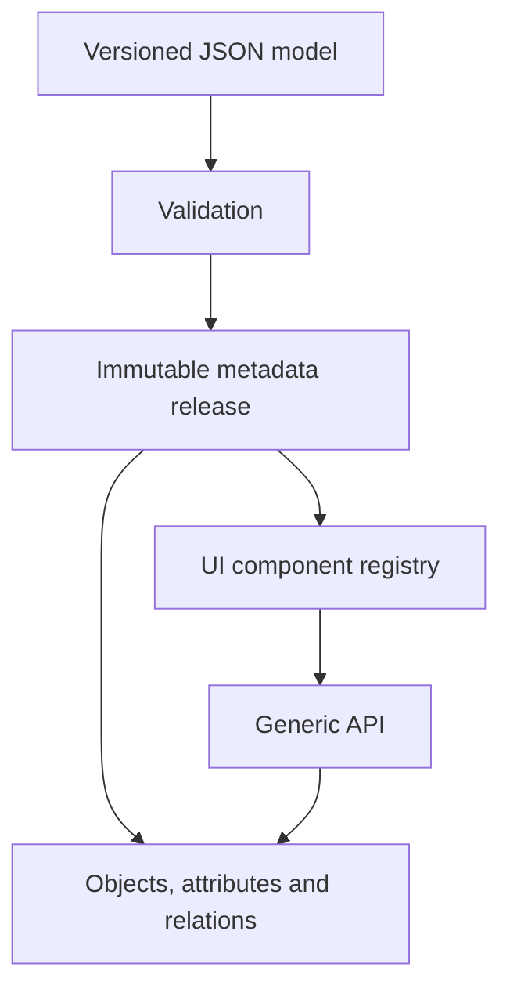

# Architecture

## Core shape

RDM Engine has four layers: model definition, compiled metadata, runtime graph and presentation. The
JSON model is validated and installed as an immutable release. Runtime objects then refer to stable
model keys rather than internal numeric metadata IDs.



## Definition and metadata layer

The model declares:

- Applications
- Global attribute types
- Object types and their attribute bindings
- Forward/reverse relation types
- Allowed source/relation/target combinations
- Views and component configuration

At startup, a canonical hash identifies the model. New content with a new release key/version identity
creates an immutable release and its relational metadata rows; reusing an identity with different
content is rejected. Previous releases remain available for migration planning and audit.

The active release is selected by a singleton database runtime-state row. The configured model file is
bootstrap input: it can install missing content and initialize an empty runtime state, but it is not a
parallel runtime authority. A request reads runtime state once, resolves the selected release to one
immutable parsed model snapshot and uses that release's metadata throughout the request. An in-process
registry may cache snapshots by public release ID and hash; it never decides which release is active.
Definition models are frozen recursively, including nested collections, so cached snapshots cannot be
changed without installing and selecting a different release.

Model authoring has three explicit stages. Drafts are mutable, versioned database records. Validation,
canonical compilation, semantic diff and compatibility analysis do not persist changes. Installation
creates immutable content-addressed release metadata but leaves runtime selection unchanged.
Activation uses optimistic concurrency on runtime state and is permitted only when stored data is
compatible with the candidate.

Database creation and upgrades run through Alembic. Each revision contains a frozen schema delta or
snapshot and does not import live ORM metadata, so adding a later ORM field cannot change the behavior
of an earlier revision on a fresh database.

## Deployment topology for model administration

Base 0.5 supports mutable model administration only in a single API process. The checked-in container
starts one Uvicorn process and does not set a worker count. `MODEL_ADMIN_MUTATIONS_ENABLED` is disabled
by default and is a deployment guard rather than an authorization system. When enabled, startup must
reject a configured multi-worker topology until cross-process release propagation exists. The runtime
uses Uvicorn's `WEB_CONCURRENCY` setting for this startup guard; the supported administration value is
one.

Within that supported process, immutable release installations are serialized across drafts. The
database uniqueness constraints remain the final identity/hash guard, while process serialization
ensures concurrent identical installation requests retain the documented idempotent response.

Activation commits the database runtime-state change before publishing the new snapshot to the local
registry. If the process cannot refresh that committed selection, readiness is unhealthy and requests
must not fall back to bootstrap content or a guessed cached model. `/health` returns HTTP 503 in that
state until a successful process restart reloads the database-selected release. Read-only release
discovery remains available independently of the mutation flag.

The WP1 migration adopts a legacy database only when it has zero or one active release and every
release key/version identity is unique. Multiple active rows or conflicting historical identities stop
the upgrade before the new schema is applied. The migration does not delete releases, rewrite their
identity or guess which immutable snapshot to preserve.

### Upgrade, backup and rollback operations

The bootstrap model path and the active release are separate operational controls. On startup the
configured JSON is validated and installed when its content is absent. If runtime state already
exists, startup preserves its selected installed release even when the bootstrap file contains a
newer release. Administrators inspect the release catalogue and explicitly activate a compatible
candidate; deployments must never use a bootstrap-file replacement as an implicit publish action.

Before an application upgrade, stop or quiesce writers and take a database-engine-consistent backup.
Keep that backup together with the application image/version and deployment configuration, especially
`DATABASE_URL`, `RDM_MODEL_PATH`, `RDM_CURSOR_SIGNING_KEY`, `MODEL_ADMIN_MUTATIONS_ENABLED` and worker
topology. Run `alembic upgrade head` using the new application before accepting traffic. The startup
path also upgrades to head, but an explicit migration step makes failures observable before service
cutover.

From a source checkout, the explicit migration command is:

```bash
cd backend
.venv/bin/python -m alembic upgrade head
```

For the default SQLite deployment, stop writers and use SQLite's online `.backup` command or copy the
database only while it is closed; retain the database file and application version together. For
PostgreSQL, use the platform's consistent `pg_dump`/snapshot procedure and verify that the restore
includes schema and data. Test restoration before treating either backup as a rollback point.

There are two distinct rollback cases:

- For model content, activate a previously installed release using fresh runtime-state concurrency
  tokens. The same compatibility analysis applies in both directions, so rollback is rejected when
  current stored data would be invalid under the older release.
- For application code or database schema, stop the new deployment and restore the pre-upgrade
  database backup together with the matching older application version. Production rollback must not
  depend on Alembic downgrade scripts or manual edits to immutable release rows; Base 0.5 provides no
  automatic runtime-data migration or transformation executor.

If activation commits but local publication fails, the process becomes unready and refuses
model-dependent requests. Restart the process to load the committed database selection before taking
further action; do not guess the prior selection from the bootstrap file.

## Runtime object graph

`objects` contains stable UUID, workspace, application, object type, parent, state, name, version and
timestamps. `parent_object_id` is the primary containment hierarchy used for efficient navigation and
path construction.

`attribute_values` stores one value per object and attribute type. The declared type selects a physical
column: text, integer, decimal, boolean, date, datetime or JSON. This retains dynamic modelling without
reducing every value to text.

`object_relations` stores typed directed edges. Allowed object-type relationships and cardinality are
validated before insertion. Creating or moving a contained object maintains `parent_object_id` and the
corresponding typed parent relation together.

`audit_events` is an ordered append-only foundation for history and a future change feed.

## Why both hierarchy and relations exist

Containment and semantic relationships overlap but serve different access patterns. Parent IDs make
tree navigation and path building efficient. Typed relations preserve meaning, reverse labels and
model constraints. The service layer owns their consistency; clients must not update them separately.

Object deletion follows the same boundary. A normal delete never removes dependencies implicitly: it
returns a structured cascade impact report. An explicitly confirmed cascade walks containment and
model-defined PK→FK ownership edges, removes incident associations, writes audit events and deletes the
resulting object set in one transaction.

## API projection

The API returns attributes by stable keys and typed JSON values. Clients may request relations using
stable relation keys. It never requires arrays of internal attribute or relation IDs.

Cursor pagination is used throughout. Cursor tokens are signed and bound to their endpoint, ordering
and effective filters. Full extraction belongs to asynchronous export or a resumable change feed
rather than an undocumented unbounded page.

## Scale direction

- Model-derived indexes for searchable and unique attribute types
- Bounded bulk upsert with per-item outcomes
- Batched relation expansion without N+1 database access
- Recursive CTEs or a maintained path representation for large hierarchies
- Asynchronous import/export with streamed storage
- Ordered change feed based on audit sequence

The path builder resolves ancestor chains in level order (one query per depth level rather than one per
object), removing the N+1 traversal for typical hierarchies. Recursive CTEs or a maintained path
representation remain the direction for very deep, high-volume hierarchies.

## Security direction

Authentication and authorization remain outside model 0.2. The expected design is OIDC authentication
plus model-configurable application, object-type and operation permissions. Record-level rules should
be introduced only for demonstrated RDM needs.
