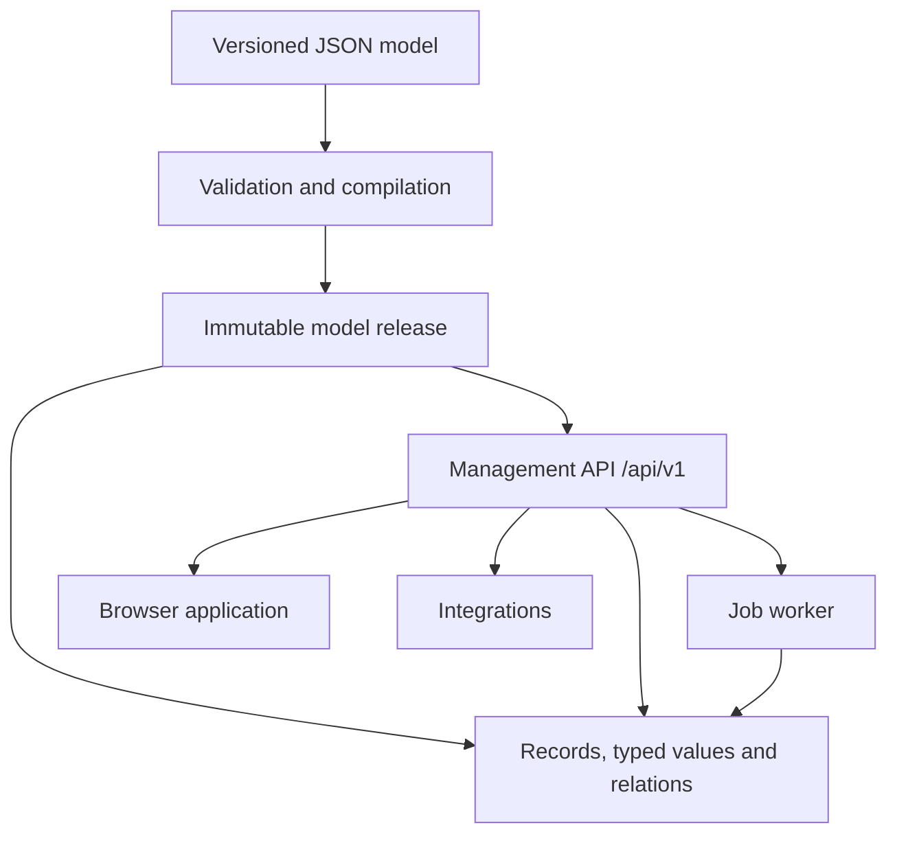
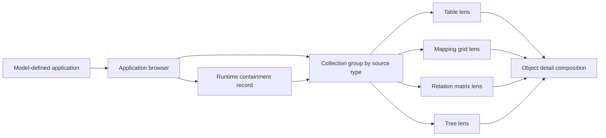

# Architecture

How RDM Engine is built and why. This document describes the system as it is now; when each part
was delivered is in the [changelog](../CHANGELOG.md), the reasoning behind decisions in
[DECISIONS.md](DECISIONS.md), the API contracts in [API.md](API.md), the model language in
[APPLICATION_MODEL.md](APPLICATION_MODEL.md) and configuration and running the engine in
[OPERATIONS.md](OPERATIONS.md).

## Overview

RDM Engine has four layers: model definition, compiled metadata, runtime data and presentation. A
JSON model is validated and installed as an immutable release. Runtime records refer to stable model
keys, never to internal metadata IDs. Every capability is an API operation; the browser application
is one client of that API.

**Technology.** The backend is a Python 3.14 FastAPI service served by Uvicorn. Pydantic 2 defines
the JSON model and the API contracts, SQLAlchemy 2 maps persistence and Alembic owns schema
migrations, on PostgreSQL 17 (ICU root collation, `pg_trgm`, `btree_gin`) through psycopg 3. FastAPI generates the
OpenAPI documents, and a bundled Scalar page renders them at `/docs`. The frontend is a React 19 and
TypeScript single-page application built with Vite, using React Aria Components behind its own
wrappers, Lucide icons and plain CSS. The components ship as Docker images composed by Docker
Compose. The [README](../README.md#technology-stack) lists the full stack, including test and quality
tooling.

## Backend structure

`backend/app` is split into tiers ([record](BACKEND_BOUNDARIES_PLAN.md)):

| Package | Holds | May not import |
| --- | --- | --- |
| `common/` | Paging, signed cursors, JSON encoding, time, JSON pointers | The model, the engine, any API |
| `models/` | The model contract (`schema.py`), write commands, the persistence schema | The engine, any API |
| `engine/` | The domain: model compilation and releases, records and write rules, change sets, operations, reads, indexes, jobs, workspaces | FastAPI, API schemas |
| `management/` | The management API (`/api/v1`): routes, request and response schemas, presenters, projections, the `/docs` page | The consumer tier |
| `consumer/` | The consumer API (`/api/consumer`): routes that resolve a definition, check its parameters and the workspace, and read through the engine | The management tier |

`tests/test_boundaries.py` enforces the table with no exceptions, no import cycles and no
function-level imports. `main.py` composes the application; `db.py` and `errors.py` are free of
FastAPI.

Inside the engine, every write rule is written once (`engine/records/rules.py`) and reads live data or
a change set through a lookup (`engine/records/context.py`). Where the two contexts word a refusal
differently, the difference is one entry in `engine/records/refusals.py`, pinned by
`tests/test_rule_parity.py`. Every record, relation and attribute-value row is written through
`engine/records/writes.py` (`LiveWrites`, `ChangeSetWrites`).

**Set work runs in the database** (decided 2026-10-03, 0.9 T1). The engine runs on PostgreSQL only.
Work over many rows, such as copying a workspace, merging a change set, checking a rule across a
whole set or filling an index, is done by set statements inside PostgreSQL (`INSERT … SELECT`,
`MERGE`, JSON aggregation, SQL functions where a building block is reused). Python decides and
issues statements; bulk data does not travel through it row by row. Long operations may run as
jobs. Current-live change-set bases and publications are copied inside PostgreSQL: records
with JSON-aggregated values, relationships and the typed index each use `INSERT … SELECT`.
`rdm_value_json` supplies the stored JSON encoding (decimals through `rdm_decimal_text`, which
works on the digit string so every stored scale encodes); a publication copies live data after its delta
is applied. Matrix states and new history cells are copied by set statements in the same transaction.
The publish's whole-graph validation stays in Python, since its rules are written once in `rules.py`;
validation in SQL is deferred until after 1.0.

## Model definition and releases

### What a model declares

- Applications, and the object types and views each one offers
- Global attribute types and each object type's attribute bindings (required, default, read-only,
  unique, unique within an ancestor, ranges)
- Forward/reverse relation types and the allowed source/relation/target combinations, with cardinality
- Containment: which types may stand at the top level and which may contain which
- Views (`table`, `mappingGrid`, `relationMatrix`, `tree`) and detail panels
- An object type's effective period over two of its date attributes (schema 0.8, ADR-038)
- Consumer API definitions (schema 0.8): exposed types and public names, fields and their sources,
  projections, parameters, lists and a contract version

The engine reads schema versions 0.5 to 0.8; `python -m app.cli.model_schema_upgrade` transitions an
older installed model offline. Definition objects are frozen recursively, so a cached model cannot
change without installing and selecting another release.

### Releases and runtime selection

A canonical hash identifies model content. New content with a new release key and version becomes an
immutable release with its relational metadata rows; reusing an identity with different content is
refused. Earlier releases stay for comparison, rollback and audit.

The active release is selected by a singleton runtime-state row (`model_runtime_state`). The
configured model file is bootstrap input only: it installs missing content and initialises an empty
runtime state, and is never a second authority. A live request reads the runtime state once, resolves
the selected release to one immutable parsed snapshot and uses it throughout. Change-set and
publication requests resolve their own pinned release (ADR-027) instead of interpreting old content
with the current model. An in-process registry caches snapshots by release ID and hash; it never
decides which release is active.

Model selection is global. 0.11 may introduce workspace-scoped assignments: a request would resolve
its workspace first, then the one release assigned to it. That needs executable data migration,
atomic switching, cursors bound to release identity, protected administration, multi-node propagation
and parsers for every permitted schema version; it cannot be workspace pinning alone.

### Model lifecycle

Model authoring has three explicit stages (ADR-016):

1. **Drafts** are mutable, versioned database records with optimistic concurrency.
2. **Validation and compilation** are free of side effects: diagnostics with JSON pointers, canonical
   compilation, a key-based semantic diff, compatibility analysis against stored data and, from schema
   0.8, the consumer contract comparison.
3. **Installation** creates an immutable, content-addressed release and leaves the selection unchanged.
   **Activation** claims the runtime state with optimistic concurrency and is permitted only when
   stored data fits the candidate.

Compatibility examines every authoritative live record, including live-only rows and retired
workspaces. Publications are excluded because they are read under their own pinned release.
Activating a release that declares an effective period over records it would refuse is
`MODEL_MIGRATION_REQUIRED` with their count. A consumer API definition whose contract loses or changes
anything its consumers read needs a higher `contractVersion` (`engine/model/consumer_contract.py`,
C-D17, C-D18); removing a whole definition is a warning.

Activation commits the runtime-state change before publishing the new snapshot to the process's
registry. If the process cannot refresh to the committed selection, readiness is unhealthy and
requests never fall back to the bootstrap file or a guessed cached model; a restart loads the database
selection.

Within one process, release installations are serialised across drafts, and database uniqueness
constraints are the final identity guard, so concurrent identical installs keep their idempotent
response. Model mutations are therefore supported in one API process only (see
[Deployment topology](#deployment-topology)).

### Change sets on a chosen release

A change set works under a model release the user chooses, without changing which release serves live
data (ADR-028). It is created against, or explicitly moved onto, an installed supported release; its
reads, writes and validation use that release while live data keeps the active one. A graph
interpreted under one release cannot be served under another until it is validated or converted, so
choosing a version is never a label change: moving a change set onto a release its content does not
already satisfy is 0.11 conversion work (see [Directions](#historical-schema-replacement-011)).
Publishing never alters model selection, so a change set is publishable only once its release is the
active one (`CHANGE_SET_MODEL_RELEASE_CONFLICT` otherwise). Unsupported or corrupt pins block reads
and writes instead of substituting the active model.

### Database migrations

Alembic owns the schema. Each revision holds a frozen schema delta and never imports live ORM
metadata, so a later ORM field cannot change an earlier revision. The history starts at one
PostgreSQL baseline (`20261001_01`); each migration runs in one transaction. Startup upgrades to the
latest revision and refuses an unknown one; the operator command and failure handling are in
[OPERATIONS.md](OPERATIONS.md#upgrades).

## Runtime data

### Workspaces

A global workspace catalogue exists independently of model releases (ADR-019, ADR-031). A singleton
workspace runtime-state row holds the default key and its version. A request names a workspace key
or uses the default; authority never comes from scanning record rows. Retired workspaces stay
readable and refuse every runtime write. Workspace administration is a deployment capability until
0.12, not an authorization boundary.

### Records, values and relations

- **`objects`** holds each record's stable UUID, workspace, application, object type, parent, name,
  record version and timestamps. `parent_object_id` serves navigation and path building.
- **`attribute_values`** holds one value per record and attribute type, in the physical column its
  declared type selects: text, integer, decimal, boolean, date, date-time or JSON. Dynamic modelling
  does not reduce values to text.
- **`object_relations`** holds typed directed edges, checked against the allowed combinations and
  cardinality before they are written.
- **`relation_set_versions`** versions each relation set exactly, per workspace, relation type and
  endpoint-type binding, in both directions (ADR-022). Every relation write advances the sets it
  touches; rows are created on first touch, so an untouched set is version 0. Live and change-set
  versions are independent, and publishing merges a change set's counts into live. A mapping
  replacement claims one anchor, direction and binding and changes its whole zero/one/many state
  atomically, keeping the selected relation's identity, so it can neither leave a gap nor replace
  another binding of the same relation type.
- **`audit_events`** is the ordered, append-only record of every change, read by record history and
  by the change feed (ADR-037). A job's writes name the job as their cause, a publish's the
  publication. An entry that changes live data has its workspace's `feed_position`, the model release
  it ran under and `feed_subject` (the type, or relation type and ends, the feed names).

Live records, values and relations are the authority for current data (ADR-026, ADR-027). Records have
no lifecycle of their own; model-defined availability is ordinary data.

### Hierarchy and relations

Containment and semantic relationships overlap but serve different access patterns. Parent IDs make
tree navigation and path building efficient; typed relations keep meaning, reverse labels and model
constraints. The engine keeps the two consistent: creating or moving a contained record maintains
`parent_object_id` and the typed parent relation together, and clients never change them separately.
A move beneath the record's own descendant is refused.

A record's type can change inside a change set (ADR-034): the engine derives the possible types and
each value's source from the model, plans the whole operation (`engine/operations/restructuring.py`)
with a preview and a digest, and applies it to the change set. Records keep their IDs; values a new
type has no place for stay in history and are offered back by a later type change.

### Deletion

Deletion has two surfaces. Directly, it deletes the live record, values and relations physically and
at once, after an impact preview or an explicit cascade for owned dependants (ADR-012). In a change set
it removes the record and its owned dependants from the candidate graph, visible only once the change
set is published. Neither is retroactive: publications and the audit log keep the former identities.
Physically purging publications would need a separately authorised retention operation.

## Live data, change sets and publications

ADR-027 sets the authority boundaries:

| Concern | Authority | Behaviour |
| --- | --- | --- |
| Current application definition | Database-selected immutable `ModelRelease` | Separate draft, install and activation lifecycle |
| Current reference data | Live record, value and relation rows | Direct validated writes with record concurrency and audit |
| Coordinated data changes | `ChangeSet*` rows over an immutable base | Optional staged records and a change-set-wide version |
| Publications | `Publication*` with a pinned release | Immutable snapshot reads; never a direct restore target |
| Workspace read-only status | Workspace catalogue status | Retired workspaces stay readable and refuse writes |
| Current publication | `Workspace.active_publication_id` | Clearing it removes no data |

**One record API in every context.** Record, value, relation and translation operations are the
same routes in every context: without a change set they target live data; with `changeSetId` they
target the change set's effective graph; `publicationId` selects an immutable publication for reads
and cannot be combined with a change set. There are no nested change-set record resources and no
per-record publication controls.

**Change sets.** `source: currentLive` captures a private immutable base of current live data:
records, values, both forms of containment, independent relations, the selected model identity and
record versions, including edits since the last publication. The capture reads at REPEATABLE READ, so
the base is one snapshot, and holds share locks on the workspace and runtime-state rows, so neither a
retirement nor an activation commits while it runs; a change the snapshot cannot hold answers
`409 CHANGE_SET_SNAPSHOT_RETRY`. `source: publication` starts from a chosen publication and records
`derivedFromPublicationId`. Either way the change set stores only changed rows and tombstones over its
base (`effective_change_set_membership`). Rename, discard and record edits each claim the change set's
version. Base rows are removed with the change set.

**Reads in a change set or publication** go through `engine/reads/snapshot_reads.py`: one statement
over the base rows no change-set row replaces plus the change set's own rows. `snapshot_attribute_values`
indexes the JSON values of publication, base and change-set records as typed rows, kept current by an
ORM flush hook (`engine/indexes/snapshot_values.py`; bulk writes maintain it themselves), so one query
builder serves search, typed filters and sort in every context.

**Validation** (`POST /change-sets/{id}/validation`) checks the effective graph without side effects:
values, containment, ownership, cardinality, ancestor-scoped uniqueness, effective periods and the
model pin. It records only a bounded outcome event.

**Publishing is a delta merge.** It claims the change set's version and the expected current
publication, computes the change set's delta over its own base and applies only the created, updated
and removed rows onto **current** live data, checking every touched record's version and every touched
relation set. Live-only records and untouched sets survive. It then validates the merged graph, writes
one immutable publication of it, supersedes the previous current publication, deletes the change set
and commits, all in one transaction. A conflict (`409 VERSION_CONFLICT` with per-record details,
including `ID_COLLISION`, `DUPLICATE_EDGE` and `MAPPING_SET_CHANGED`) or a validation failure
(`422 WORKSPACE_GRAPH_INVALID`) publishes nothing and keeps both the change set and live data.

**Publications** are immutable snapshots, listed newest first with bounded cursor paging. "Derived
from" and "superseded by" are recorded separately, so starting from an earlier publication never
restores the dataset: untouched newer live data remains. Reads resolve the pinned model before typing
values or validating query fields, and an unsupported pin returns a structured error. Withdrawing a
publication removes only the designation; it is neither consumer withdrawal nor workspace retirement.

**Lifecycle audit stays separate.** Change-set, publication and workspace lifecycle events are
aggregate events with bounded identity payloads, never one event per record. Record edits in a change
set keep their own per-record audit. A publish adds one entry per record and relation it changes in
live data (D15, D32), so record history and the change feed see every live change (ADR-037).

## Writes and concurrency

Every write goes through one path: a write unit decides each change with the write rules over a
lookup, then writes what it accepted. A single write is a batch of one through the same code as a
bulk job.

- **Live writes of one workspace serialise; workspaces write in parallel** (PG-D5). The live write
  unit opens with `SELECT … FROM workspaces WHERE key = … FOR NO KEY UPDATE` (`LiveWrites._begin`)
  before it reads what it changes, and holds it to the commit, so every rule checked in code (unique
  values, parent cycles, cardinality, required relations, relation-set versions, stored matrix states)
  reads what the previous write committed. A batch, inline or one background chunk, takes it once for
  all its items. The lock conflicts with publishing (also `FOR NO KEY UPDATE`), a current-live capture
  (`FOR SHARE`), retirement and deletion (`FOR UPDATE`), but not with a key share lock: the one a row
  naming the workspace takes through its foreign key, or the one a change-set write takes.
- **Lock order:** the workspace (whose row also holds the feed counter, 0.9 F1), then a change set,
  then the runtime-state row (activation,
  retirement and default switching for update; a write's commit check shared), then records and their
  index rows, and a job's row only at its chunk's checkpoint. Retirement, default switching and
  deletion lock the workspace before the runtime state, and publishing locks the workspace before its
  change set. A change-set write takes the workspace's key share lock and then its change-set row
  (`load_change_set(for_update=True)`): retirement and deletion wait for it, and it waits for them and
  is then refused `409 WORKSPACE_RETIRED`; live writes, publishing and other change sets' writes run
  beside it, and writes to one change set serialise on its row. Tested by `test_pg3_concurrency`, each
  invariant raced on two connections.
- **A write never commits under a release that is no longer active.** A request that resolves the
  active release binds its session to it. Before commit the session flushes its rows and rereads the
  active release under a share lock on the runtime-state row; activation locks that row for update
  before its compatibility check, so the two cannot interleave in one process or across instances. A
  write that flushed first is seen by the compatibility check; a write after activation sees the new
  release and is refused `409 MODEL_RELEASE_CHANGED`, nothing saved.
- **A write never commits into a workspace deleted or retired after it resolved it.** The same
  commit point rereads the workspace (`404 WORKSPACE_NOT_FOUND`, `409 WORKSPACE_RETIRED`). Workspace
  deletion checks for records, change sets and publications and locks the workspace and runtime-state
  rows; the `workspaces.key` foreign keys (`RESTRICT`) protect every other row naming the workspace,
  and every `ondelete` rule is pinned in `test_foreign_keys`.
- **Decided in memory, written in bulk** (PG-D12–PG-D16). A create or update is decided by the rules
  over a batch lookup (`records/batch_lookup.py`): the records it reads, preloaded per chunk, with the
  items decided before it laid over them. Relation writes are decided the same way
  (`records/relation_writes.py`), and so is a relation-set replacement (`records/relation_sets.py`),
  which the mapping save and a batch's `replaceRelationSet` share; a set version is compared with the
  stored one plus what the chunk's items advanced (0.9 B3, D35). The accepted changes are written together by `records/bulk.py`,
  each kind of row in multi-row statements: a chunk of 500 items costs 30–49 statements, 40–43 for
  relationship items. Because a
  version is compared in memory rather than claimed by a conditional `UPDATE`, a write reads the records
  it changes after taking its lock. A chunk checks its release before writing matrix states, so an
  activation that drops a matrix view cannot deadlock with it. A bulk write failing on a row the rules
  could not see is redone item by item, so only that item is refused. Delete items keep a per-item path.
- **Optimistic concurrency everywhere else.** Updates carry the record's `expectedVersion`; mapping
  saves carry the relation set's version; change sets, drafts, activation and workspace administration
  carry their own versions. A stale claim is a `409` with the current state.

## Reads and queries

**Paging** (ADR-030). Every collection pages by cursor or by position, from `common/pagination.py`.
Cursors continue after or before a row, are signed (`RDM_CURSOR_SIGNING_KEY`) and bound to their
endpoint, scope, ordering and effective filters, and never repeat or skip a row as data changes; a
position read jumps to row N and may. Every page carries both cursors, an anchor that reopens it and,
on request, the total and its start index. There is no unbounded page: full extraction belongs to
export jobs or the change feed.

A live list sorted by an attribute is read in two parts (`object_query._value_order_parts`): the
records with a value, joined to it and walked through an `(attribute, typed value, record)` index in
value order, then the records without one. `paginate_statement` pages such parts in turn: a page
continues from one into the next, a position skips a whole part by its count and a total adds them.
Each part holds its null rank constant, so the keys, cursors and seek are those of the single
statement. Change-set and publication lists keep one statement until C6 (0.9 D47). A consumer list
filtered below a parent or an ancestor reads the container records first and binds them as a list,
as a search reads its candidates, so PostgreSQL plans with their real number.

**Search and order.** Names sort in the database's ICU root collation, case- and accent-aware. Search
uses `pg_trgm` GIN indexes on the live and snapshot value tables and on the name of every record table
(`models/search_index.py`), which narrow candidates; the case-insensitive "contains" predicate still
decides the result, so an index changes speed, never results. The per-type list reads a search's
candidates before it builds its statements (`object_query.search_candidates`): at most 1,000 record
IDs become a list each statement reads by ID, in every arm of a change set's projection; more, or a
phrase too short for a trigram, leaves the statement to match every record, with the value side
bounded inside it (`bounded_match`). A unique-value check and a record reference by key seek through
a value index (`ix_attribute_values_key_text`). Read budgets and the measuring method are in
[POSTGRESQL_BUDGETS.md](POSTGRESQL_BUDGETS.md).

**One query builder per shape, every context.** `engine/reads/object_query.py` builds the per-type
list (search, typed filters, sort, scope by parent or top level) for live data, change sets and
publications alike. On top of it:

- **Cross-type lookup** (`GET /objects`, `engine/reads/object_lookup.py`) lists several or all types
  over built-in fields, with its own cursor scope; model-declared fields are refused with the per-type
  route that answers them.
- **Workspace edge list** (`/workspaces/{key}/relations`, the same list as `/mappings`,
  `management/projections/mapping.py`) lists every relation of any type in one shape.
- **Model-aware query** (`POST /workspaces/{key}/queries/objects`, `engine/reads/model_query.py`) adds
  what query parameters cannot carry, each as a set the record's ID or parent ID must be in:
  `ancestor:<type>` (walking down from the ancestor through containers only) and one `related` hop,
  read once as a set, never per record. Every name is checked against the model first and refused
  with its JSON pointer. `expand` reads related records in one statement per expansion for the page.
- **`asOf`** (ADR-038) is a filter over a declared effective period's two date values, combinable with
  any context; it never selects one. A type without a period refuses it.

**Ancestor paths** are resolved in level order, one query per depth level for the page, reading only
the columns a path shows.

**Stored matrix cell states** (ADR-033). `matrix_cell_states` holds each non-empty relation matrix
cell's counts per owner (live, publication, change-set base, change-set overlay, workspace history)
and matrix shape. `engine/indexes/matrix_states.py` builds missing owners at startup and on
activation, change-set and publication creation, and recomputes touched rows before each commit (an
ORM flush hook plus explicit notes from Core statements). The matrix's state filter reads it, so
filtering to gaps works across the whole list.

## Jobs

Every bulk write, and later every import and export, is a persisted job (ADR-036, `engine/jobs/`):
its parameters, state, progress and one outcome per item, kept for a retention period.

- **Items go through the single-write rules** and are refused with the same codes. Bulk adds
  addressing by unique key, upsert and the `unchanged` outcome, not a second validation path.
- **Two failure policies**, named per request: `atomic` (all or nothing, bounded) and `independent`
  (each item on its own, in order, seeing the items before it).
- **Inline or background**, chosen by the caller, never by size. An inline job runs in the request. A
  background job is stored and run by a worker thread in the API process (`engine/jobs/worker.py`) in
  chunks: a chunk's writes, outcomes and the job's checkpoint commit in one transaction, so a resumed
  job starts at its first item without an outcome and never repeats or skips one.
- **Lease.** A worker claims a job with `leaseOwner` and `leaseExpiresAt` in a short transaction and
  renews the lease with each chunk. A chunk does not hold the job row while it applies items, so a
  cancel request never waits; it locks the row only at its checkpoint and rolls back if another worker
  took the job over. The lease lets 0.11 run workers on several nodes without a contract change.
- **A job pins its model release** and fails with `MODEL_RELEASE_CHANGED` when it moves. In a change
  set it holds the change set's version and fails if anyone else writes to it.
- **Idempotency keys** replay a finished job's response and refuse a reused key with a different body.
- **Staging is the change set**: a job targets live data or a named change set; there is no separate
  staging store.

## API projection

The API returns values by stable attribute keys as typed JSON, and relations by stable relation keys;
it never requires internal attribute or relation IDs. Records and relations have stable UUIDs.
Errors share one envelope, `{ "error": { "code", "message", "details" } }`, with a JSON pointer in
`details` where input is at fault.

FastAPI generates the management API's OpenAPI document (`/openapi.json`); its digest and inventories
are locked by backend tests, so a contract change is always deliberate. `GET /docs` renders it with
[Scalar](https://github.com/scalar/scalar) (MIT), followed by each consumer API of the active release
as a further source, built per request (0.9 V2). The Scalar script is pinned and bundled with the engine, so the page works
offline and loads nothing from elsewhere. `GET /api/v1/capabilities` reports the deployment's
capability groups and job limits.

## Presentation

The frontend is a React 19 single-page application written in TypeScript and built with Vite. It talks
to the backend only through the public HTTP API, the same API every other client uses.

ADR-023 keeps the application-facing UI API in repository-owned semantic wrappers. React Aria
Components supplies composite interaction behaviour only; feature modules cannot depend on it
directly. RDM owns plain-CSS tokens, layout, visual states and product-specific dismissal, dirty-input
and error behaviour. Native HTML remains the first choice for simple controls, and Lucide icons pass
through one accessible wrapper. This boundary permits a future behaviour-provider change without
altering the application model or feature contracts. The module layout is in
[FRONTEND_STRUCTURE_REFACTOR.md](FRONTEND_STRUCTURE_REFACTOR.md).

### Contextual collection composition

ADR-029 separates presentation into context, collection, lens, query and object detail. The application
browser is the navigation spine for arbitrary model-defined applications. It combines virtual
collection entries with the bounded runtime containment records currently available; it is not a
hardcoded Master/System/Translation tree and is not itself a data contract.

A view's source object type defines its collection group. A `table` uses `objectTypeKey`; a
`mappingGrid` uses `fromObjectTypeKey` for outgoing direction and `toObjectTypeKey` for incoming
direction; a `relationMatrix` uses its `rowObjectTypeKey`; a `tree` uses its first
`rootObjectTypeKeys` entry. The frontend (`model/collections.ts`) groups views with the same source
type as lenses of one collection and opens the application's `defaultView` when it is in the group,
otherwise its first table, otherwise its first view. Each selected lens is dispatched through the typed
component registry. The shared collection workspace owns scope, lens selection and query continuity,
while each renderer owns its data shape, mutations and recovery rules.

Collection query state is browser-owned and URL-backed: search, typed field filters, sort where
supported, one scroll `anchor` cursor and optional containing-object identity. Mapping coverage adds its
zero/one/many state filter, and the relation matrix its cell state filter. The API binds scope and state
into opaque cursors, so a continuation cannot silently traverse another context.

The model does not declare explicit lens groups (through schema 0.8). The source-type rule is
deterministic; model-language configuration is added only after real models show where source type is
insufficient. Presentation must not infer workflow meaning from application, object or relation keys.

Hierarchies load lazily, one bounded branch at a time. The sidebar record tree pages each root type's
top-level records in its own group and, when a record expands, each child type separately by
`parentObjectId`. The tree lens reuses it for a view's root and node types and adds the view's actions:
create child, rename, set availability and move (also by drag and drop), with move targets from the
parent-candidates API. In a change set it also restructures through the change set's restructurings
API, with a preview. Records under a record at any depth are read through the `ancestor:<type>`
criterion, never by walking a loaded tree, and presentation must not client-filter a partial tree as
though it were complete.

## Deployment topology

Operation groups are exposed per process by capability settings read at startup (ADR-031): a disabled
group's routes are not registered, and `GET /api/v1/capabilities` reports the effective values. They
are deployment limits; 0.12 authorization will work within them. The settings are listed in
[OPERATIONS.md](OPERATIONS.md#capability-groups).

Because capabilities are per process, several instances can share one database with different exposure,
for example an internal administration instance with one process and a public instance with both
administration groups off and any worker count. What holds today:

- **Activation reaches other instances without a restart.** Every request reads the selected release
  from the runtime state and caches parsed models by release identity, so another instance serves a
  newly activated release from its next request.
- **Writes are safe across instances:** the commit-time release and workspace rechecks and the
  workspace lock (see [Writes and concurrency](#writes-and-concurrency)) hold across processes.
- **Instances must share `RDM_CURSOR_SIGNING_KEY`** when one client's requests can reach different
  instances.

Open caveats before this is a supported topology:

- **The publication guard is per process.** It keeps local requests from resolving the release between
  activation's commit and this process's registry refresh. A read already in flight on another instance
  answers from the release it resolved; writes are protected by the commit-time recheck.
- **The single-process rule for model administration is checked per instance.** Startup refuses model
  administration with several workers, but cannot detect a second instance with it enabled on the same
  database.
- **Split deployment has no composed test.** The 0.11 multi-node work makes it supported, including
  workers on several nodes through the job lease.

## Directions

### Scale

Delivered: bounded collections at any size with cursor and position paging, trigram search indexes,
value indexes for unique and keyed lookups, bulk writes decided in memory and written in multi-row
statements, set-based relation hops and expansions, and stored matrix states. Next, in 0.11: the volume
fixture at full scale, connection pool sizing, model-derived indexes including non-text unique values,
precomputed sort keys for attribute and ancestor sorts over very large parents, and recursive queries or
a maintained path for very deep hierarchies.

### Change feed and consumer API (0.9)

The audit log is the ordered source of the change feed and, later, consumer events (ADR-037).
- **Positions.** Every live change takes a gapless per-workspace feed position from
  `workspaces.feed_position`, incremented under the workspace row lock the live write unit already
  holds (`records/feed.py`).
- **Recording.** The write unit records the audit entries: `LiveWrites.record`/`record_all` give
  them positions, and `ChangeSetWrites` records the same calls without any. So a change-set edit
  can never take one.
- **Publishing.** A publish compares each authored row with live (`publish.publish_entries`). It
  records what changed, with the publication as cause, then its `published` entry, whose position
  is the publication's.
- **What an entry carries.** Identity and changed keys, never values. A containment relation is its
  record's parent and has no entry of its own.
- **Reading.** The feed is read by position (`reads/feed.py`, `GET /workspaces/{key}/feed`), with
  filtered pages scanning a bounded range.
- **Retention.** Entries older than `FEED_RETENTION_DAYS` expire from the feed, not from the audit
  log. The floor is the first entry within the period, found in one probe of
  `ix_audit_events_feed_time`, and never passes the active publication's position. Without an active
  publication nothing expires, so an expired reader always has a baseline to re-read (D40).
- **Consumer reads.** The consumer API is a separate read-only tier (`consumer/`) generated from the
  model's consumer API definitions ([CONSUMER_API.md](CONSUMER_API.md)). It reads live data from the
  active release's definition, never a change set. Every read finds its records in its own way (get
  by ID by the object ID, lists by parent and position, XREF and batch resolve by score), then composes the shared
  object in one place,
  `engine/reads/consumer_objects.py`, for a set of IDs with a fixed number of statements: one for the
  records and their values, one per projection, and for the ancestors one recursive walk by ID and
  one read of the walked records by their list (a single statement misestimated the walk, C14b).
  Field resolution and projection shapes come from `engine/model/consumer_contract.py`, the module
  the contract check uses. XREF (`engine/reads/consumer_xref.py`) scores at read time in one
  statement built from the definition's `match`. The terms of every lookup are one relation
  `(item, term)` bound as arrays; a rule's exact matches of every term are read through a `LATERAL`
  over the `lower(name)` and `lower(text_value)` indexes (revision `20261005_01`), and its contains
  matches by one select per term with the pattern bound, so PostgreSQL plans each probe on its
  pattern (names through a trigram index holding the workspace and type beside the trigrams,
  `btree_gin`, revision `20261005_02`); every read is bounded at 10,001 rows. The same reads count
  each lookup's
  matched records, refusing one matching more than 10,000; no consumer index is maintained (C-D34).
  A single best match (`expect=one`) is sought with the exact rules first, and only the lookups
  they leave unsettled read contains matches (C-D52). Batch resolve
  (`engine/reads/consumer_resolve.py`) is that lookup for many items: grouped by their parameters,
  each group resolves in a fixed number of statements whatever its size, and single XREF is a
  batch of one (C-D51). The definition's parameters are one
  filter (`engine/reads/consumer_parameters.py`) that every read applies: XREF applies it to the
  scored objects, and a `scoresFrom` parameter's predicate to the related records promotion reads
  (C-D42, C-D43). The tier checks its query parameters against the definition itself, so
  the management API's unknown-parameter check leaves its routes alone.

### Domain extension

MDM-lite and small product catalogues are reached only through generic capabilities composed in a
model (ADR-032). The architecture keeps room for retired-ID redirects, per-value provenance, derived
values, redaction within immutable history, keyed inbound upsert and additive value types; see
[composable domains](COMPOSABLE_DOMAINS.md#doors-to-keep-open).

### Security (0.12)

Authentication and authorization are deferred to the 0.12 security release: OAuth 2.0 with
engine-issued JWT access tokens for the backend, frontend and consumer APIs, model-configurable
application, object-type and operation permissions, HMAC-signed webhooks and UI administration of
clients and subscriptions, replacing the default-enabled workspace administration. No API keys, and no
credential in a URL. Record-level rules come only for demonstrated needs.

### Historical schema replacement (0.11)

GAP-02 accepts a warning and confirm-or-cancel migration when a change set started from a publication is
incompatible with the active definition; GAP-08 keeps change sets and model drafts separate. ADR-027
therefore places schema replacement with the 0.11 migration and model-assignment capability: today's
activation cannot be bypassed by a confirmation.

A migration preview names one workspace and one installed target release (normally the pinned release
of a change set started from a publication), shows its difference from the current selection, and
reports conversions and potential loss. It migrates current live data toward that target. Confirmation
claims that exact reviewed plan and current versions; execution validates the transformed data and
atomically changes data and the applicable model selection; cancel or failure keeps the prior state and
the change set. Publications are unchanged. Because model selection is global today, the implementation
must use the planned workspace assignment boundary and leave other workspaces' assignments and data
untouched. Loss confirmation never waives target-model validity or concurrency checks.

The same preview and confirmation apply to one change set (ADR-028), run against that change set's own
candidate graph and the live data under it: moving a change set onto a release its content does not
already satisfy happens only from a reviewed preview.
