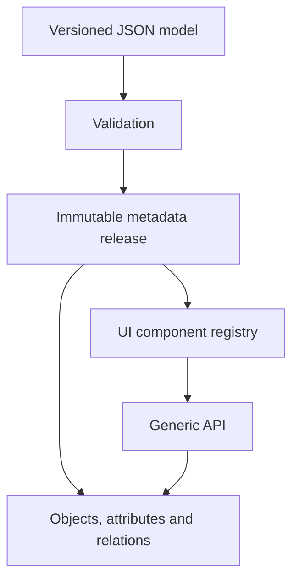

# Architecture

## Core shape

RDM Engine has four layers: model definition, compiled metadata, runtime graph and presentation. The
JSON model is validated and installed as an immutable release. Runtime objects then refer to stable
model keys rather than internal numeric metadata IDs.

## Definition and metadata layer

The model declares:

- Applications
- Global attribute types
- Object types and their attribute bindings
- Forward/reverse relation types
- Allowed source/relation/target combinations
- Views and component configuration

At startup, a canonical hash identifies the model. A new hash creates a new immutable release and its
relational metadata rows. Previous releases remain available for migration planning and audit.

Database creation and upgrades run through Alembic. Each revision contains a frozen schema delta or
snapshot and does not import live ORM metadata, so adding a later ORM field cannot change the behavior
of an earlier revision on a fresh database.

## Runtime object graph

`objects` contains stable UUID, workspace, application, object type, parent, state, name, version and
timestamps. `parent_object_id` is the primary containment hierarchy used for efficient navigation and
path construction.

`attribute_values` stores one value per object and attribute type. The declared type selects a physical
column: text, integer, decimal, boolean, date, datetime or JSON. This retains dynamic modelling without
reducing every value to text.

`object_relations` stores typed directed edges. Allowed object-type relationships and cardinality are
validated before insertion. Creating or moving a contained object maintains `parent_object_id` and the
corresponding typed parent relation together.

`audit_events` is an ordered append-only foundation for history and a future change feed.

## Why both hierarchy and relations exist

Containment and semantic relationships overlap but serve different access patterns. Parent IDs make
tree navigation and path building efficient. Typed relations preserve meaning, reverse labels and
model constraints. The service layer owns their consistency; clients must not update them separately.

Object deletion follows the same boundary. A normal delete never removes dependencies implicitly: it
returns a structured cascade impact report. An explicitly confirmed cascade walks containment and
model-defined PK→FK ownership edges, removes incident associations, writes audit events and deletes the
resulting object set in one transaction.

## API projection

The API returns attributes by stable keys and typed JSON values. Clients may request relations using
stable relation keys. It never requires arrays of internal attribute or relation IDs.

Cursor pagination is used throughout. Full extraction belongs to asynchronous export or a resumable
change feed rather than an undocumented unbounded page.

## Scale direction

- Model-derived indexes for searchable and unique attribute types
- Bounded bulk upsert with per-item outcomes
- Batched relation expansion without N+1 database access
- Recursive CTEs or a maintained path representation for large hierarchies
- Asynchronous import/export with streamed storage
- Ordered change feed based on audit sequence

The path builder resolves ancestor chains in level order (one query per depth level rather than one per
object), removing the N+1 traversal for typical hierarchies. Recursive CTEs or a maintained path
representation remain the direction for very deep, high-volume hierarchies.

## Security direction

Authentication and authorization remain outside model 0.2. The expected design is OIDC authentication
plus model-configurable application, object-type and operation permissions. Record-level rules should
be introduced only for demonstrated RDM needs.
