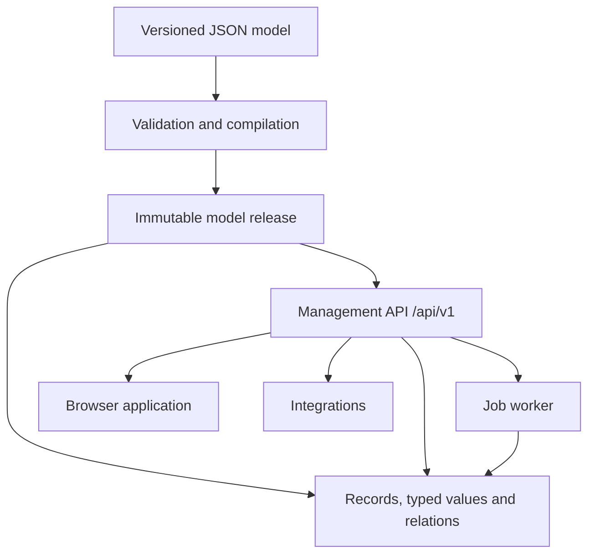
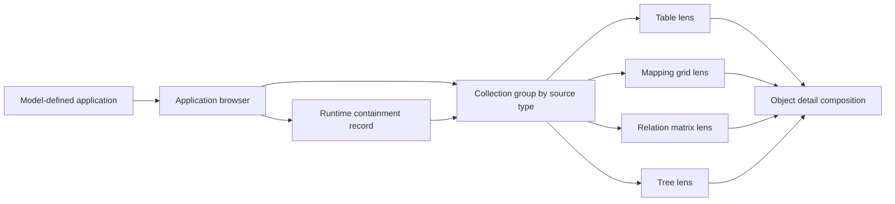

# Architecture

How RDM Engine is built and why. This document describes the system as it is now; when each part
was delivered is in the [changelog](../CHANGELOG.md), the reasoning behind decisions in
[DECISIONS.md](DECISIONS.md), the API contracts in [API.md](API.md), the model language in
[APPLICATION_MODEL.md](APPLICATION_MODEL.md) and configuration and running the engine in
[OPERATIONS.md](OPERATIONS.md).

## Overview

RDM Engine has four layers: model definition, compiled metadata, runtime data and presentation. A
JSON model is validated and installed as an immutable release. Runtime records refer to stable model
keys, never to internal metadata IDs. Every capability is an API operation; the browser application
is one client of that API.

**Technology.** The backend is a Python 3.14 FastAPI service served by Uvicorn. Pydantic 2 defines
the JSON model and the API contracts, SQLAlchemy 2 maps persistence and Alembic owns schema
migrations, on PostgreSQL 17 (ICU root collation, `pg_trgm`, `btree_gin`) through psycopg 3. FastAPI generates the
OpenAPI documents, and a bundled Scalar page renders them at `/docs`. The frontend is a React 19 and
TypeScript single-page application built with Vite, using React Aria Components behind its own
wrappers, Lucide icons and plain CSS. The components ship as Docker images composed by Docker
Compose. The [README](../README.md#technology-stack) lists the full stack, including test and quality
tooling.

## Backend structure

`backend/app` is split into tiers ([record](BACKEND_BOUNDARIES_PLAN.md)):

| Package | Holds | May not import |
| --- | --- | --- |
| `common/` | Paging, signed cursors, JSON encoding, time, JSON pointers | The model, the engine, any API |
| `models/` | The model contract (`schema.py`), write commands, the persistence schema | The engine, any API |
| `engine/` | The domain: model compilation and releases, records and write rules, change sets, operations, reads, indexes, jobs, workspaces | FastAPI, API schemas |
| `management/` | The management API (`/api/v1`): routes, request and response schemas, presenters, projections, the `/docs` page | The consumer tier |
| `consumer/` | The consumer API (`/api/consumer`): routes that resolve a definition, check its parameters and the workspace, and read through the engine | The management tier |

`tests/test_boundaries.py` enforces the table with no exceptions, no import cycles and no
function-level imports. `main.py` composes the application; `db.py` and `errors.py` are free of
FastAPI.

Inside the engine, every write rule is written once (`engine/records/rules.py`) and reads live data or
a change set through a lookup (`engine/records/context.py`). Where the two contexts word a refusal
differently, the difference is one entry in `engine/records/refusals.py`, pinned by
`tests/test_rule_parity.py`. Every record, relation and attribute-value row is written through
`engine/records/writes.py` (`LiveWrites`, `ChangeSetWrites`).

**Set work runs in the database** (decided 2026-10-03, 0.9 T1). The engine runs on PostgreSQL only.
Work over many rows, such as copying a workspace, merging a change set, checking a rule across a
whole set or filling an index, is done by set statements inside PostgreSQL (`INSERT … SELECT`,
`MERGE`, JSON aggregation, SQL functions where a building block is reused). Python decides and
issues statements; bulk data does not travel through it row by row. Long operations may run as
jobs. Current-live change-set bases and publications are copied inside PostgreSQL: records
with JSON-aggregated values, relationships and the typed index each use `INSERT … SELECT`.
`rdm_value_json` supplies the stored JSON encoding (decimals through `rdm_decimal_text`, which
works on the digit string so every stored scale encodes); a publication copies live data after its delta
is applied. Matrix states and new history cells are copied by set statements in the same transaction.
The publish's whole-graph validation stays in Python, since its rules are written once in `rules.py`;
validation in SQL is deferred until after 1.0.

## Model definition and releases

### What a model declares

- Applications, and the object types and views each one offers
- Global attribute types and each object type's attribute bindings (required, default, read-only,
  unique, unique within an ancestor, ranges)
- Forward/reverse relation types and the allowed source/relation/target combinations, with cardinality
- Containment: which types may stand at the top level and which may contain which
- Views (`table`, `mappingGrid`, `relationMatrix`, `tree`) and detail panels
- An object type's effective period over two of its date attributes (schema 0.8, ADR-038)
- Consumer API definitions (schema 0.9): exposed types and public names, the operations offered,
  fields and their sources, related records, XREF matching, filters, lists, events and a contract
  version

The engine reads schema versions 0.5 to 0.9; `python -m app.cli.model_schema_upgrade` transitions an
older installed model offline. Definition objects are frozen recursively, so a cached model cannot
change without installing and selecting another release.

**Consumer API definitions have one internal form.** A model document holds its definitions as the
author wrote them, which is also its canonical document and `modelHash`: schema 0.9's syntax, or a
stored 0.8 release's own shape (`engine/model/consumer_legacy.py` reads such a document with its own
classes, so its hash holds). Every reader works on `ConsumerApiDefinition`, the internal form:
`engine/model/consumer_definitions.py` expands a 0.9 definition once per parsed model
(`engine/model/consumer_expansion.py`, every default written out) and takes a 0.8 one as it is, every
operation offered, and `consumer_apis(model)` is the only way code reads them. The expansion keeps a
map from each internal pointer to the authored one, so the reference rules, which run on the
internal form, and the contract check report at the node the author wrote.
`engine/model/consumer_rendering.py` writes the internal form back as a 0.9 definition with every
default, which `GET /model/consumer-apis/{consumerApi}` answers; expanding it gives the same
definition. Install, draft compile and validation refuse a new 0.8 document with `consumerApis`
(`compile_authored_model`); loading, activating and diffing stored releases never do.

### Releases and runtime selection

A canonical hash identifies model content. New content with a new release key and version becomes an
immutable release with its relational metadata rows; reusing an identity with different content is
refused. Earlier releases stay for comparison, rollback and audit.

Each workspace runs a release of its own (ADR-042): `workspace_models` holds one row per workspace
naming its release and the assignment's version. Different workspaces may run different models, not
only different versions of one. The configured model file is bootstrap input only: it installs
missing content and gives it to every workspace that runs nothing yet (a new database's default
workspace), and is never a second authority. A live request resolves its workspace first
(`workspaceKey`, the context's workspace, the record's for a write naming a record, or the default
workspace), then that workspace's release, to one immutable parsed snapshot it uses throughout
(`engine/model/registry.resolve_model_snapshot`). Change-set and publication requests resolve their
own pinned release (ADR-027) instead of interpreting old content with the current model. An
in-process registry caches one parsed snapshot per release, whichever workspaces run it; it never
decides which release a workspace runs. A release this process cannot serve (an unsupported schema,
an invalid model, a failed load after activation) makes only the workspaces running it answer
`503 MODEL_REGISTRY_UNAVAILABLE` (D29); the instance is unhealthy only when no workspace can be
served. A workspace's data moves to a release it does not fit through a migration (below); spanning
reads are the cross-type lookup's; multi-node propagation follows in 0.11's later packages.

### Model lifecycle

Model authoring has three explicit stages (ADR-016):

1. **Drafts** are mutable, versioned database records with optimistic concurrency. A draft changes
   through recorded operations (ADR-041, `engine/model/authoring/`): a request of typed operations
   is applied all or none to a copy of the draft's JSON document and written as one step of the
   draft's history (`model_draft_operations`, deleted with the draft), each entry with its parameters,
   its inverse and the elements it created, re-keyed and named. A whole-model `PATCH` is recorded as
   one `replaceModel` step. Operations name elements by key; a **reference index**
   (`authoring/references.py`) finds every place in the document that names an element by its
   structure, never by text, so a key change rewrites them and a removal takes them out
   (`authoring/cascade.py`). Every change goes through `authoring/document.py`, which logs how to
   reverse it, so a compound operation's inverse (`restoreElements`) puts back exactly what it
   changed. A draft-only operation is checked against the draft's base release, or the active
   release without one (`authoring/released.py`), and refused with its impact counted in
   PostgreSQL; installation makes the installed release the draft's base. The server produces the
   layout of new elements (`authoring/layout.py`). A draft may be invalid between steps; the
   compiler's diagnostics are returned with each step and installation still refuses it.
   A client reads the draft's structure as its **outline** (`authoring/outline.py`, `GET
   /model-drafts/{id}/outline`): the containment tree by the rule the layout uses, the bindings, the
   allowed relations and the groups, each element marked against the base release by the same atoms
   the class check reads, and each diagnostic tied to the element its pointer falls in. It reads the
   raw document, so a draft that does not validate is outlined too. The browser's **model editor**
   (`frontend/src/features/model-editor/`) is one client of it: it sends operation steps and reads
   the outline back after each, so no containment or class rule is written in TypeScript. Its
   operations are one descriptor table (`operations.ts`) rendered by one dialog; it lives under
   Settings in `ShellFrame` without a rail (D37). Its **preview** (0.10 A4b) reads the draft compiled
   (`GET /model-drafts/{id}/model`, the model and its placements as the runtime routes serve the
   active one) and renders it with the record screen's own renderers. Their data comes through
   `PreviewDataProvider` and `api/previewClient`: the reads go to the runtime routes, which serve
   the active model, and every other call is refused in the browser before a request, so the preview
   cannot write; reads the active model cannot answer (a new type, a field it lacks) are answered or
   adjusted there. Layout changes are the view verbs (`model-editor/layout.ts`), one step each. Its
   **Consumer APIs** tab (0.10 A4c) edits consumer API definitions by the consumer kinds
   (`authoring/consumer.py`: two whole-definition kinds and four part verbs naming a part by a JSON
   pointer below the definition, the definition re-read as `ConsumerApiDocument` after each); the
   reference index walks the definitions' grammar (`references.consumer_slots`), so `setKey` rewrites
   them. `authoring/consumer_documents.py` serves a draft's definition with its contract against the
   active release and three documents built from the draft by the consumer modules the consumer tier
   uses: the object message's JSON Schema, a message example written from it, and the OpenAPI
   document. A draft also holds one **import profile** (0.10 A5, `model_drafts.profile_json`): a
   second `Document` over it, with identities of its own (a source's `id`, a column binding's
   column), writes into the model document's log with each entry naming its document, so one
   operation's inverse takes back both. The source and mapping kinds (`authoring/mapping.py`) edit it;
   the model kinds carry it with them (`authoring/profile_side.py`): explicit follow code for keys,
   moves, splits, merges, list types and containment, and, in every compound kind's `restoring`, one
   generic prune that turns whatever names an element the model no longer declares into an unmapped
   entry. `engine/sources/draft_profile.py` reads it as the import profile an import takes, checks it
   against the draft's compiled model, queues the dry run after a step that can change the load, and
   saves it as an instance profile at installation. In the browser (0.10 A5b), `useDraftSource`
   reads the profile after every step, follows the file's profiling and the dry run over their job
   event streams, and reads a sheet's columns when it is opened; `model-editor/mapping.ts` reads the
   profile for the source pane and turns a Map to… choice into one request of the mapping kinds
   (with `addAttributeType`, `attachAttribute` and `addSource` before it where needed). The load
   (D81) calls installation, activation, a change set and `POST /imports` with `sourceFileId` in
   turn; there is no combined route.
2. **Validation and compilation** are free of side effects: diagnostics with JSON pointers, canonical
   compilation, a key-based semantic diff, compatibility analysis against stored data and, from schema
   0.8, the consumer contract comparison.
3. **Installation** creates an immutable, content-addressed release and leaves the selection unchanged.
   **Activation** names one workspace, claims its assignment with optimistic concurrency and is
   permitted only when that workspace's stored data fits the candidate; the other workspaces keep
   their releases.

Compatibility examines every authoritative live record of the workspaces it is asked about
(activation: its workspace), including live-only rows of a retired one. Publications are excluded
because they are read under their own pinned release.
Activating a release that declares an effective period over records it would refuse is
`MODEL_MIGRATION_REQUIRED` with their count. A consumer API definition whose contract loses or changes
anything its consumers read needs a higher `contractVersion` (`engine/model/consumer_contract.py`,
C-D17, C-D18); removing a whole definition is a warning.

Activation commits the workspace's new assignment, then loads the release into the process's
registry. If the process cannot load it, the workspaces on that release are unavailable and requests
never fall back to the bootstrap file or a guessed cached model; a restart loads the database's
assignments. Activation also resynchronises that workspace's matrix states and suspends that
workspace's subscriptions the new release cannot serve, and answers the workspace's change sets left
on the release it no longer runs (D26), which cannot publish.

Within one process, release installations are serialised across drafts, and database uniqueness
constraints are the final identity guard, so concurrent identical installs keep their idempotent
response. Model mutations are therefore supported in one API process only (see
[Deployment topology](#deployment-topology)).

### Change sets on a chosen release

A change set works under a model release the user chooses, without changing which release serves live
data (ADR-028). It is created against, or explicitly moved onto, an installed supported release; its
reads, writes and validation use that release while live data keeps the active one. A graph
interpreted under one release cannot be served under another until it is validated or converted, so
choosing a version is never a label change: moving a change set onto a release its content does not
already satisfy is 0.11 conversion work (see [Directions](#historical-schema-replacement-011)).
Publishing never alters model selection, so a change set is publishable only once its release is the
active one (`CHANGE_SET_MODEL_RELEASE_CONFLICT` otherwise). Unsupported or corrupt pins block reads
and writes instead of substituting the active model.

### Database migrations

Alembic owns the schema. Each revision holds a frozen schema delta and never imports live ORM
metadata, so a later ORM field cannot change an earlier revision. The history starts at one
PostgreSQL baseline (`20261001_01`); each migration runs in one transaction. Startup upgrades to the
latest revision and refuses an unknown one; the operator command and failure handling are in
[OPERATIONS.md](OPERATIONS.md#upgrades).

## Runtime data

### Workspaces

A global workspace catalogue exists independently of model releases (ADR-019, ADR-031). A singleton
workspace runtime-state row holds the default key and its version. A request names a workspace key
or uses the default; authority never comes from scanning record rows. Retired workspaces stay
readable and refuse every runtime write. Workspace administration is a deployment capability until
0.12, not an authorization boundary.

### Records, values and relations

- **`objects`** holds each record's stable UUID, workspace, application, object type, parent, name,
  record version and timestamps. `parent_object_id` serves navigation and path building.
- **`attribute_values`** holds one value per record and attribute type, in the physical column its
  declared type selects: text, integer, decimal, boolean, date, date-time or JSON. Dynamic modelling
  does not reduce values to text.
- **`unique_attribute_values`** holds each live value of an attribute its workspace's release
  declares `unique` once per workspace: the value's row, record, workspace, attribute and the SHA-256 of its
  canonical JSON (`rdm_value_digest`), under a deferred unique constraint (ADR-010, 0.9 J2a). Empty
  text has no row. PostgreSQL keeps it: statement triggers on `attribute_values` add the rows of
  written values under the record's workspace release, the `attribute_values` cascade removes them,
  and a trigger on `workspace_models` adds and removes a workspace's rows as its new release declares
  `unique` on more or fewer attributes (0.11 D28). No code writes it.
- **`object_relations`** holds typed directed edges, checked against the allowed combinations and
  cardinality before they are written.
- **`relation_set_versions`** versions each relation set exactly, per workspace, relation type and
  endpoint-type binding, in both directions (ADR-022). Every relation write advances the sets it
  touches; rows are created on first touch, so an untouched set is version 0. Live and change-set
  versions are independent, and publishing merges a change set's counts into live. A mapping
  replacement claims one anchor, direction and binding and changes its whole zero/one/many state
  atomically, keeping the selected relation's identity, so it can neither leave a gap nor replace
  another binding of the same relation type.
- **`audit_events`** is the ordered, append-only record of every change, read by record history and
  by the change feed (ADR-037). A job's writes name the job as their cause, a publish's the
  publication. An entry that changes live data has its workspace's `feed_position`, the model release
  it ran under and `feed_subject` (the type, or relation type and ends, the feed names).

Live records, values and relations are the authority for current data (ADR-026, ADR-027). Records have
no lifecycle of their own; model-defined availability is ordinary data.

### Hierarchy and relations

Containment and semantic relationships overlap but serve different access patterns. Parent IDs make
tree navigation and path building efficient; typed relations keep meaning, reverse labels and model
constraints. The engine keeps the two consistent: creating or moving a contained record maintains
`parent_object_id` and the typed parent relation together, and clients never change them separately.
A move beneath the record's own descendant is refused.

A record's type can change inside a change set (ADR-034): the engine derives the possible types and
each value's source from the model, plans the whole operation (`engine/operations/restructuring.py`)
with a preview and a digest, and applies it to the change set. Records keep their IDs; values a new
type has no place for stay in history and are offered back by a later type change.

### Deletion

Deletion has two surfaces. Directly, it deletes the live record, values and relations physically and
at once, after an impact preview or an explicit cascade for owned dependants (ADR-012). In a change set
it removes the record and its owned dependants from the candidate graph, visible only once the change
set is published. Neither is retroactive: publications and the audit log keep the former identities.
Physically purging publications would need a separately authorised retention operation.

One path deletes, for the single `DELETE` and for a batch's delete items alike, live and in a change
set (`engine/records/deletion.py`, 0.9 K2b). A run of deletions is set work: the closures of all its
records are computed in one recursive query into temporary tables, each record belonging to the
earliest item reaching it; each item's impact is counted and digested there and compared with the
token that confirms it; the accepted items' audit entries, relation-set versions and removals (or a
change set's tombstones) are written as set statements. The statements of a run do not grow with its
items or with the size and depth of their impacts.

## Live data, change sets and publications

ADR-027 sets the authority boundaries:

| Concern | Authority | Behaviour |
| --- | --- | --- |
| Current application definition | Database-selected immutable `ModelRelease` | Separate draft, install and activation lifecycle |
| Current reference data | Live record, value and relation rows | Direct validated writes with record concurrency and audit |
| Coordinated data changes | `ChangeSet*` rows over an immutable base | Optional staged records and a change-set-wide version |
| Publications | `Publication*` with a pinned release | Immutable snapshot reads; never a direct restore target |
| Workspace read-only status | Workspace catalogue status | Retired workspaces stay readable and refuse writes |
| Current publication | `Workspace.active_publication_id` | Clearing it removes no data |

**One record API in every context.** Record, value, relation and translation operations are the
same routes in every context: without a change set they target live data; with `changeSetId` they
target the change set's effective graph; `publicationId` selects an immutable publication for reads
and cannot be combined with a change set. There are no nested change-set record resources and no
per-record publication controls.

**Change sets.** `source: currentLive` captures a private immutable base of current live data:
records, values, both forms of containment, independent relations, the selected model identity and
record versions, including edits since the last publication. The capture reads at REPEATABLE READ, so
the base is one snapshot, and holds share locks on the workspace's row and its assignment row, so
neither a retirement nor an activation into the workspace commits while it runs; a change the snapshot cannot hold answers
`409 CHANGE_SET_SNAPSHOT_RETRY`. `source: publication` starts from a chosen publication and records
`derivedFromPublicationId`. Either way the change set stores only changed rows and tombstones over its
base (`effective_change_set_membership`). Rename, discard and record edits each claim the change set's
version. Base rows are removed with the change set.

**Reads in a change set or publication** go through `engine/reads/snapshot_reads.py`: one statement
over the base rows no change-set row replaces plus the change set's own rows. `snapshot_attribute_values`
indexes the JSON values of publication, base and change-set records as typed rows, kept current by an
ORM flush hook (`engine/indexes/snapshot_values.py`; bulk writes maintain it themselves), so one query
builder serves search, typed filters and sort in every context.

**Validation** (`POST /change-sets/{id}/validation`) checks the effective graph without side effects:
values, containment, ownership, cardinality, ancestor-scoped uniqueness, effective periods and the
model pin. It records only a bounded outcome event.

**Publishing is a delta merge.** It claims the change set's version and the expected current
publication, computes the change set's delta over its own base and applies only the created, updated
and removed rows onto **current** live data, checking every touched record's version and every touched
relation set. Live-only records and untouched sets survive. It then validates the merged graph, writes
one immutable publication of it, supersedes the previous current publication, deletes the change set
and commits, all in one transaction. A conflict (`409 VERSION_CONFLICT` with per-record details,
including `ID_COLLISION`, `DUPLICATE_EDGE` and `MAPPING_SET_CHANGED`) or a validation failure
(`422 WORKSPACE_GRAPH_INVALID`) publishes nothing and keeps both the change set and live data.

**Publications** are immutable snapshots, listed newest first with bounded cursor paging. "Derived
from" and "superseded by" are recorded separately, so starting from an earlier publication never
restores the dataset: untouched newer live data remains. Reads resolve the pinned model before typing
values or validating query fields, and an unsupported pin returns a structured error. Withdrawing a
publication removes only the designation; it is neither consumer withdrawal nor workspace retirement.

**Lifecycle audit stays separate.** Change-set, publication and workspace lifecycle events are
aggregate events with bounded identity payloads, never one event per record. Record edits in a change
set keep their own per-record audit. A publish adds one entry per record and relation it changes in
live data (D15, D32), so record history and the change feed see every live change (ADR-037).

## Writes and concurrency

Every write goes through one path: a write unit decides each change with the write rules over a
lookup, then writes what it accepted. A single write is a batch of one through the same code as a
bulk job.

- **Live writes of one workspace serialise; workspaces write in parallel** (PG-D5). The live write
  unit opens with `SELECT … FROM workspaces WHERE key = … FOR NO KEY UPDATE` (`LiveWrites._begin`)
  before it reads what it changes, and holds it to the commit, so every rule checked in code (unique
  values, parent cycles, cardinality, required relations, relation-set versions, stored matrix states)
  reads what the previous write committed. A batch, inline or one background chunk, takes it once for
  all its items. The lock conflicts with publishing (also `FOR NO KEY UPDATE`), a current-live capture
  (`FOR SHARE`), retirement and deletion (`FOR UPDATE`), but not with a key share lock: the one a row
  naming the workspace takes through its foreign key, or the one a change-set write takes.
- **Lock order:** the workspace (whose row also holds the feed counter, 0.9 F1), then a change set,
  then the workspace's assignment row in `workspace_models` (activation for update; a write's commit
  check and a current-live capture shared), then records and their index rows, and a job's row only
  at its chunk's checkpoint. Activation locks the workspace's active subscriptions and, when the
  releases declare different `unique` attributes, the unique values' table before the assignment
  (0.9 R-F2, R-F3). Retirement, default switching and deletion lock the workspace before the
  workspace runtime-state row, and publishing locks the workspace before its change set. The
  assignment is a row of its own, not columns on `workspaces`, so the commit check's share lock never
  waits on the workspace row's update locks (D30). A change-set write takes the workspace's key share lock and then its change-set row
  (`load_change_set(for_update=True)`): retirement and deletion wait for it, and it waits for them and
  is then refused `409 WORKSPACE_RETIRED`; live writes, publishing and other change sets' writes run
  beside it, and writes to one change set serialise on its row. Tested by `test_pg3_concurrency`, each
  invariant raced on two connections.
- **A write never commits under a release its workspace no longer runs.** A request that resolves a
  workspace's release binds its session to it (each workspace it resolved). Before commit the session
  flushes its rows and rereads each workspace's release under a share lock on its assignment row;
  activation locks that row for update before its compatibility check, so the two cannot interleave
  in one process or across instances. A write that flushed first is seen by the compatibility check;
  a write after activation sees the new release and is refused `409 MODEL_RELEASE_CHANGED` naming the
  workspace, nothing saved. A write in another workspace locks another row.
- **A write never commits into a workspace deleted or retired after it resolved it.** The same
  commit point rereads the workspace (`404 WORKSPACE_NOT_FOUND`, `409 WORKSPACE_RETIRED`). Workspace
  deletion checks for records, change sets and publications and locks the workspace and the
  workspace runtime-state rows (the assignment row goes with the workspace by `CASCADE`); the
  `workspaces.key` foreign keys (`RESTRICT`) protect every other row naming the workspace,
  and every `ondelete` rule is pinned in `test_foreign_keys`.
- **Decided in memory, written in bulk** (PG-D12–PG-D16). A create or update is decided by the rules
  over a batch lookup (`records/batch_lookup.py`): the records it reads, preloaded per chunk, with the
  items decided before it laid over them. Relation writes are decided the same way
  (`records/relation_writes.py`), and so is a relation-set replacement (`records/relation_sets.py`),
  which the mapping save and a batch's `replaceRelationSet` share; a set version is compared with the
  stored one plus what the chunk's items advanced (0.9 B3, D35). The accepted changes are written together by `records/bulk.py`,
  each kind of row in multi-row statements: a chunk of 500 items costs 30–49 statements, 40–43 for
  relationship items. Because a
  version is compared in memory rather than claimed by a conditional `UPDATE`, a write reads the records
  it changes after taking its lock. A chunk checks its release before writing matrix states, so an
  activation that drops a matrix view cannot deadlock with it. A bulk write failing on a row the rules
  could not see is redone item by item, so only that item is refused. Delete items keep a per-item path.
- **Unique values are held by the database too** (0.9 J2a). The rule refuses a duplicate before it is
  written; the write unit, the single attribute write and the publish's apply then read
  `unique_attribute_values` for the records they wrote (`indexes/unique_values.check`), so a value
  written past the rule is refused with the rule's `409 DUPLICATE_ATTRIBUTE_VALUE` inside the
  transaction, where a batch redoes its items one by one. The constraint is deferred, so values handed
  between records within one write pass; at commit it refuses whatever no check covered. Change sets
  keep the rule alone and meet the constraint when they publish.
- **Optimistic concurrency everywhere else.** Updates carry the record's `expectedVersion`; mapping
  saves carry the relation set's version; change sets, drafts, activation and workspace administration
  carry their own versions. A stale claim is a `409` with the current state.

## Reads and queries

**Paging** (ADR-030). Every collection pages by cursor or by position, from `common/pagination.py`.
Cursors continue after or before a row, are signed (`RDM_CURSOR_SIGNING_KEY`) and bound to their
endpoint, scope, ordering and effective filters, and never repeat or skip a row as data changes; a
position read jumps to row N and may. Every page carries both cursors, an anchor that reopens it and,
on request, the total and its start index. There is no unbounded page: full extraction belongs to
export jobs or the change feed.

A live list sorted by an attribute is read in two parts (`object_query._value_order_parts`): the
records with a value, joined to it and walked through an `(attribute, typed value, record)` index in
value order, then the records without one. `paginate_statement` pages such parts in turn: a page
continues from one into the next, a position skips a whole part by its count and a total adds them.
Each part holds its null rank constant, so the keys, cursors and seek are those of the single
statement. Change-set and publication lists keep one statement until C6 (0.9 D47). A consumer list
filtered below a parent or an ancestor reads the container records first and binds them as a list,
as a search reads its candidates, so PostgreSQL plans with their real number.

**Search and order.** Names sort in the database's ICU root collation, case- and accent-aware. Search
uses `pg_trgm` GIN indexes on the live and snapshot value tables and on the name of every record table
(`models/search_index.py`), which narrow candidates; the case-insensitive "contains" predicate still
decides the result, so an index changes speed, never results. The per-type list reads a search's
candidates before it builds its statements (`object_query.search_candidates`): at most 1,000 record
IDs become a list each statement reads by ID, in every arm of a change set's projection; more, or a
phrase too short for a trigram, leaves the statement to match every record, with the value side
bounded inside it (`bounded_match`). A unique-value check and a record reference by key seek through
a value index (`ix_attribute_values_key_text`). Read budgets and the measuring method are in
[POSTGRESQL_BUDGETS.md](POSTGRESQL_BUDGETS.md).

**One query builder per shape, every context.** `engine/reads/object_query.py` builds the per-type
list (search, typed filters, sort, scope by parent or top level) for live data, change sets and
publications alike. On top of it:

- **Cross-type lookup** (`GET /objects`, `engine/reads/object_lookup.py`) lists several or all types
  over built-in fields, with its own cursor scope; model-declared fields are refused with the per-type
  route that answers them.
- **Workspace edge list** (`/workspaces/{key}/relations`, the same list as `/mappings`,
  `management/projections/mapping.py`) lists every relation of any type in one shape.
- **Model-aware query** (`POST /workspaces/{key}/queries/objects`, `engine/reads/model_query.py`) adds
  what query parameters cannot carry, each as a set the record's ID or parent ID must be in:
  `ancestor:<type>` (walking down from the ancestor through containers only) and one `related` hop,
  read once as a set, never per record. Every name is checked against the model first and refused
  with its JSON pointer. `expand` reads related records in one statement per expansion for the page.
- **`asOf`** (ADR-038) is a filter over a declared effective period's two date values, combinable with
  any context; it never selects one. A type without a period refuses it.

**Ancestor paths** are resolved in level order, one query per depth level for the page, reading only
the columns a path shows.

**Stored matrix cell states** (ADR-033). `matrix_cell_states` holds each non-empty relation matrix
cell's counts per owner (live, publication, change-set base, change-set overlay, workspace history)
and matrix shape. `engine/indexes/matrix_states.py` builds missing owners at startup and on
activation, change-set and publication creation, and recomputes touched rows before each commit (an
ORM flush hook plus explicit notes from Core statements). The matrix's state filter reads it, so
filtering to gaps works across the whole list.

## Jobs

Every bulk write, and later every import and export, is a persisted job (ADR-036, `engine/jobs/`):
its parameters, state, progress and one outcome per item, kept for a retention period.

- **Items go through the single-write rules** and are refused with the same codes. Bulk adds
  addressing by unique key, upsert and the `unchanged` outcome, not a second validation path.
- **Two failure policies**, named per request: `atomic` (all or nothing, bounded) and `independent`
  (each item on its own, in order, seeing the items before it).
- **Inline or background**, chosen by the caller, never by size. An inline job runs in the request. A
  background job is stored and run by a worker thread in the API process (`engine/jobs/worker.py`;
  the consumer event deriver and the webhook dispatcher are its siblings, `engine/events/worker.py`
  and `engine/events/dispatcher.py`) in
  chunks: a chunk's writes, outcomes and the job's checkpoint commit in one transaction, so a resumed
  job starts at its first item without an outcome and never repeats or skips one.
- **Lease.** A worker claims a job with `leaseOwner` and `leaseExpiresAt` in a short transaction and
  renews the lease with each chunk. A chunk does not hold the job row while it applies items, so a
  cancel request never waits; it locks the row only at its checkpoint and rolls back if another worker
  took the job over. The lease lets 0.11 run workers on several nodes without a contract change.
- **A job pins its model release** and fails with `MODEL_RELEASE_CHANGED` when it moves. In a change
  set it holds the change set's version and fails if anyone else writes to it.
- **Idempotency keys** replay a finished job's response and refuse a reused key with a different body.
- **Staging is the change set**: a job targets live data or a named change set; there is no separate
  staging store.
- **Exports** (`engine/jobs/exports.py`) run on a second worker thread that claims only `export`
  jobs, so batches and exports never wait for each other. An export is one step, not chunks: it
  reads everything in one `REPEATABLE READ` transaction, so the file is one instant of its context
  and a live export's feed head is a baseline to follow the feed from. The scope's records are
  selected per type through the model query's builders (`plan_model_query`) into a temporary table
  by one statement; depth, parent paths, relationships and required relationships are set
  statements over it; JSON Lines and CSV rows are built by PostgreSQL (`json_build_object`, `COPY`)
  and streamed to the file. XLSX is written as SpreadsheetML straight into its ZIP container
  (`engine/jobs/xlsx.py`), its values extracted as canonical text by PostgreSQL as for CSV and
  typed per cell, row by row.
  A **workbook for people** (`engine/jobs/people.py`, 0.9 J6) shares the snapshot and the scope's
  table; each relationship a column or sheet shows goes into a temporary table with its far records
  and their ancestors, each relation column's cells are one `string_agg` per column, and each sheet
  streams from those through a server-side cursor into `xlsx.Workbook.plain` (one header row, frozen
  and filtered, widths from one `max(length())` statement, hidden columns, cell styles from the
  workbook's style table with the eight type hues). The import profile that reads the workbook back
  is built with its sheets, checked as any profile, and written on a hidden sheet, which
  `engine/imports/readers.carried_profile` finds when an XLSX is imported without one.
  Columns per parent (0.9 J6a) build each row's cells per parent as one JSON value in one grouped
  statement (`people_grid`), so the sheet reads a row by one join; reference lists are each one
  insert from K7's `candidate_ids`, their sheet titles reserved before the sheets whose list rules
  name them are written.
  Cancel requests, the lease and progress go through a short session of the worker's own every
  10,000 rows, because the snapshot cannot see later commits. Files live in `JOB_FILE_DIR`
  (`engine/jobs/files.py`), named after their job; a file is kept only while its job is completed.
- **Imports** (`engine/imports/`, 0.9 J2) run on the batch worker. The file is stored in
  `JOB_FILE_DIR` as `{jobId}.source` before the job is queued. The worker's first step binds it in
  one transaction: a reader streams the rows (openpyxl's read-only mode for XLSX, the standard library
  for CSV and JSON Lines), each bound cell is converted through the attribute registry, and the rows
  are copied into temporary tables. Set statements over those and the context's records
  (`engine/reads/context_sets.py`, shared with the export) then find each row's record by its key or
  give it an ID, reject repeated keys with differing values, resolve every match against the context
  and the file's own rows, order a source's own hierarchy by a recursive query, find related records
  through their relationship and parent, and build the items as JSON. Rejected rows become the job's
  first outcomes and the items its inputs (`INSERT … SELECT`), and from there the import runs as a
  background batch. Inputs and outcomes keep each item's source and row (`source_index`,
  `row_number`), so `GET /jobs/{id}/rows` groups the outcomes by row in one statement. A row's cells
  are all converted, so its refusal names every failing cell; the binding report's cell counts are
  kept while the rows stream and its match counts are one aggregate over the temporary tables, kept
  on the job (`jobs.report`). Profiles (`engine/imports/profiles.py`) are checked against a model
  release with every problem at its JSON pointer.
- **Previews** (`engine/jobs/preview.py`; imports 0.9 J3, batches 0.9 K2): after an import's binding,
  or once a batch sent with `stage: preview` is claimed, the worker runs the first
  `JOB_PREVIEW_MAX_ITEMS` items through `run_items` independently, in one transaction it
  rolls back whole, so records, relationships, matrix states, unique values and change-set versions
  go together and PostgreSQL drops the transaction's notifications; it records no audit entry and
  takes no feed position at all (`audit.trial_run`, 0.10 A3a, D72), since nothing in it reads them;
  a short transaction holding the lease then records the outcomes and the summary, and the job waits
  in `awaiting_confirmation` without a lease, which no worker claims. Confirming (under the job row's
  lock, after the context is checked again) removes the preview's outcomes and queues the job: an
  import's inputs go too and it binds the file again, while a batch keeps its stored items and runs
  them from the first; either way it runs as an execution: one execution path. Cancelling a waiting
  job finishes it in the request; retention expires it like a finished one.
- **Source files and dry runs** (`engine/sources/`, 0.10 A3): a source file belongs to a model draft
  or an import profile (`source_files`, deleted with its owner); its file is `{id}.upload` in
  `JOB_FILE_DIR`, kept while its row exists. A `profile` job reads the file once through the import
  readers and copies every filled cell into `source_file_cells` with its kind, its text and its
  value as the reader gave it (`values.py`); blocks, header rows and column statistics are set
  statements over those cells, stored in `source_file_sheets` and `source_file_columns`. A `dryRun`
  job is an import preview with two differences: its context carries the draft's compiled model in
  place of the active release's (`dry_run.dry_run_context`), and the binding reads the staged cells
  through `StagedFile`, a `TabularFile` over `source_file_cells`, so it is the same binding and the
  same write rules (a draft's new unique attribute is checked by the rule against
  `attribute_values`; the database index of unique values follows the active release only). It
  previews every item, then completes with its summary instead of waiting for confirmation; its stop
  check also stops it once the draft's version moved on.
- **Following a job** (0.9 J1u): a trigger on `jobs` sends `pg_notify('rdm_job_events', id)` when
  a change to a job's state, progress, cancel request or output commits, so every path that changes
  a job is heard and nothing rolled back is. One listener thread per process (`engine/jobs/events.py`)
  holds a psycopg connection that `LISTEN`s and wakes the server-sent event streams following that
  job (`GET /jobs/{id}/events`), which read the job again in a short session of their own. The
  browser keeps one stream per running job its tab started and shows the job's outcome as a
  notification (`features/jobs/`); nothing is polled.

## API projection

The API returns values by stable attribute keys as typed JSON, and relations by stable relation keys;
it never requires internal attribute or relation IDs. Records and relations have stable UUIDs.
Errors share one envelope, `{ "error": { "code", "message", "details" } }`, with a JSON pointer in
`details` where input is at fault.

FastAPI generates the management API's OpenAPI document (`/openapi.json`); its digest and inventories
are locked by backend tests, so a contract change is always deliberate. `GET /docs` renders it with
[Scalar](https://github.com/scalar/scalar) (MIT), followed by each consumer API of the active release
as a further source, built per request (0.9 V2). The Scalar script is pinned and bundled with the engine, so the page works
offline and loads nothing from elsewhere. `GET /api/v1/capabilities` reports the deployment's
capability groups and job limits.

## Presentation

The frontend is a React 19 single-page application written in TypeScript and built with Vite. It talks
to the backend only through the public HTTP API, the same API every other client uses.

ADR-023 keeps the application-facing UI API in repository-owned semantic wrappers. React Aria
Components supplies composite interaction behaviour only; feature modules cannot depend on it
directly. RDM owns plain-CSS tokens, layout, visual states and product-specific dismissal, dirty-input
and error behaviour. Native HTML remains the first choice for simple controls, and Lucide icons pass
through one accessible wrapper. This boundary permits a future behaviour-provider change without
altering the application model or feature contracts. The module layout is in
[FRONTEND_STRUCTURE_REFACTOR.md](FRONTEND_STRUCTURE_REFACTOR.md).

The URL is the route (`routing/routes.ts`). Every route renders in one frame, `app/ShellFrame`
(skip link, top bar, resizable rail that moves into the navigation drawer below 760px, main
content), under one top bar, `app/TopBar` (product mark to home, the applications as tabs,
Settings, the account; U-D14). Application routes fill it in `AppShell`: the workspace switcher
above the collection and hierarchy browser in the rail, and the data-context band (live, change
set or publication) above the content. Below 760px (0.10 N1) the top bar shows no application tabs
in any area, the rail's workspace switcher is left out, and the band is one line whose workspace,
application and data context each open their choice in a popover, reusing `WorkspaceSelector`,
`ApplicationButtons` (the top bar's tabs) and the band's own switch; `lib/hooks/useMediaQuery`
holds the width check the drawer and the band share. Settings routes (`/settings/…`) fill it in `SettingsShell`,
with no workspace or data context: no application is current and Settings reads as the current tab, the rail holds the settings
navigation, and each page is a `SettingsLayout`. From Settings, the tab of the application last
looked at returns to that route of the session, another application's tab to its last collection
or default view. Addresses the settings area replaced (`/models`, `/workspaces`) parse to their settings
routes, and the router's first-load `replaceState` rewrites them. Per-browser preferences (theme,
the default table density, a view's own display) are kept in local storage.

### Contextual collection composition

ADR-029 separates presentation into context, collection, lens, query and object detail. The application
browser is the navigation spine for arbitrary model-defined applications. It combines virtual
collection entries with the bounded runtime containment records currently available; it is not a
hardcoded Master/System/Translation tree and is not itself a data contract.

A view's source object type defines its collection group. A `table` uses `objectTypeKey`; a
`mappingGrid` uses `fromObjectTypeKey` for outgoing direction and `toObjectTypeKey` for incoming
direction; a `relationMatrix` uses its `rowObjectTypeKey`; a `tree` uses its first
`rootObjectTypeKeys` entry. The frontend (`model/collections.ts`) groups views with the same source
type as lenses of one collection and opens the application's `defaultView` when it is in the group,
otherwise its first table, otherwise its first view. Each selected lens is dispatched through the typed
component registry. The shared collection workspace owns scope, lens selection and query continuity,
while each renderer owns its data shape, mutations and recovery rules.

Collection query state is browser-owned and URL-backed: search, typed field filters, sort where
supported, one scroll `anchor` cursor and optional containing-object identity. Mapping coverage adds its
zero/one/many state filter, and the relation matrix its cell state filter. The API binds scope and state
into opaque cursors, so a continuation cannot silently traverse another context.

The model does not declare explicit lens groups (through schema 0.8). The source-type rule is
deterministic; model-language configuration is added only after real models show where source type is
insufficient. Presentation must not infer workflow meaning from application, object or relation keys.

Hierarchies load lazily, one bounded branch at a time. The sidebar record tree pages each root type's
top-level records in its own group and, when a record expands, each child type separately by
`parentObjectId`. The tree lens reuses it for a view's root and node types and adds the view's actions:
create child, rename, set availability and move (also by drag and drop), with move targets from the
parent-candidates API. In a change set it also restructures through the change set's restructurings
API, with a preview. Records under a record at any depth are read through the `ancestor:<type>`
criterion, never by walking a loaded tree, and presentation must not client-filter a partial tree as
though it were complete.

## Deployment topology

Operation groups are exposed per process by capability settings read at startup (ADR-031): a disabled
group's routes are not registered, and `GET /api/v1/capabilities` reports the effective values. They
are deployment limits; 0.12 authorization will work within them. The settings are listed in
[OPERATIONS.md](OPERATIONS.md#capability-groups).

Because capabilities are per process, several instances can share one database with different exposure,
for example an internal administration instance with one process and a public instance with both
administration groups off and any worker count. What holds today:

- **Activation reaches other instances without a restart.** Every request reads its workspace's
  release from `workspace_models` and caches parsed models by release identity, so another instance
  serves a newly activated release from its next request.
- **Writes are safe across instances:** the commit-time release and workspace rechecks and the
  workspace lock (see [Writes and concurrency](#writes-and-concurrency)) hold across processes.
- **Instances must share `RDM_CURSOR_SIGNING_KEY`** when one client's requests can reach different
  instances.

Open caveats before this is a supported topology:

- **The publication guard is per process.** It keeps local requests from resolving the release between
  activation's commit and this process's registry refresh. A read already in flight on another instance
  answers from the release it resolved; writes are protected by the commit-time recheck.
- **The single-process rule for model administration is checked per instance.** Startup refuses model
  administration with several workers, but cannot detect a second instance with it enabled on the same
  database.
- **Split deployment has no composed test.** The 0.11 multi-node work makes it supported, including
  workers on several nodes through the job lease.

## Directions

### Scale

Delivered: bounded collections at any size with cursor and position paging, trigram search indexes,
value indexes for unique and keyed lookups, bulk writes decided in memory and written in multi-row
statements, set-based relation hops and expansions, and stored matrix states. Next, in 0.11: the volume
fixture at full scale, connection pool sizing, model-derived indexes including non-text unique values,
precomputed sort keys for attribute and ancestor sorts over very large parents, and recursive queries or
a maintained path for very deep hierarchies.

### Change feed and consumer API (0.9)

The audit log is the ordered source of the change feed and of consumer events (ADR-037).
- **Positions.** Every live change takes a gapless per-workspace feed position from
  `workspaces.feed_position`, incremented under the workspace row lock the live write unit already
  holds (`records/feed.py`).
- **Recording.** The write unit records the audit entries: `LiveWrites.record`/`record_all` give
  them positions, and `ChangeSetWrites` records the same calls without any. So a change-set edit
  can never take one.
- **Publishing.** A publish compares each authored row with live (`publish.publish_entries`). It
  records what changed, with the publication as cause, then its `published` entry, whose position
  is the publication's.
- **What an entry carries.** Identity and changed keys, never values. A containment relation is its
  record's parent and has no entry of its own; a record's entry names its parent, and its previous
  one when it moved (`feed.object_subject`, C-D95). `feed.changed_names` reads the changed names
  from a live entry (which holds values) and a publish entry (which holds names) alike.
- **Reading.** The feed is read by position (`reads/feed.py`, `GET /workspaces/{key}/feed`), with
  filtered pages scanning a bounded range.
- **Retention.** Entries older than `FEED_RETENTION_DAYS` expire from the feed, not from the audit
  log. The floor is the first entry within the period, found in one probe of
  `ix_audit_events_feed_time`, and never passes the active publication's position. Without an active
  publication nothing expires, so an expired reader always has a baseline to re-read (D40).
- **Consumer reads.** The consumer API is a separate read-only tier (`consumer/`) generated from the
  model's consumer API definitions ([CONSUMER_API.md](CONSUMER_API.md)). It reads live data from the
  active release's definition, never a change set. Every read finds its records in its own way (get
  by ID by the object ID, lists by parent and position, XREF and batch resolve by score), then composes the shared
  object in one place,
  `engine/reads/consumer_objects.py`, for a set of IDs with a fixed number of statements: one for the
  records and their values, one per projection, and for the ancestors one recursive walk by ID and
  one read of the walked records by their list (a single statement misestimated the walk, C14b).
  Field resolution and projection shapes come from `engine/model/consumer_contract.py`, the module
  the contract check uses. The router refuses an operation the definition does not offer
  (`OPERATION_NOT_OFFERED`) before it reads anything. XREF (`engine/reads/consumer_xref.py`) scores at read time in one
  statement built from the definition's `match`. The terms of every lookup are one relation
  `(item, term)` bound as arrays; a rule's exact matches of every term are read through a `LATERAL`
  over the `lower(name)` and `lower(text_value)` indexes (revision `20261005_01`), and its contains
  matches by one select per term with the pattern bound, so PostgreSQL plans each probe on its
  pattern (names through a trigram index holding the workspace and type beside the trigrams,
  `btree_gin`, revision `20261005_02`); every read is bounded at 10,001 rows. The same reads count
  each lookup's
  matched records, refusing one matching more than 10,000; no consumer index is maintained (C-D34).
  A single best match (`expect=one`) is sought with the exact rules first, and only the lookups
  they leave unsettled read contains matches (C-D52). Batch resolve
  (`engine/reads/consumer_resolve.py`) is that lookup for many items: grouped by their parameters,
  each group resolves in a fixed number of statements whatever its size, and single XREF is a
  batch of one (C-D51). The definition's parameters are one
  filter (`engine/reads/consumer_parameters.py`) that every read applies: XREF applies it to the
  scored objects, and a `scoresFrom` parameter's predicate to the related records promotion reads
  (C-D42, C-D43). The tier checks its query parameters against the definition itself, so
  the management API's unknown-parameter check leaves its routes alone.
- **Consumer events** (`engine/events/`, 0.9 C10). A deriver thread in the API process, beside the
  job worker, turns each workspace's feed into the events the definitions declare: once a second it
  compares each workspace's feed position with its row in `consumer_event_checkpoints` and derives
  a page of up to 500 entries (`deriver.derive_page`) in one REPEATABLE READ transaction holding
  that row `FOR UPDATE SKIP LOCKED`. It takes no workspace lock, so a write never waits for it, and
  two processes never derive one range. `plan.py` reads from a definition alone, once per release,
  which objects each kind of change reaches and which of their outputs change (C-D82); the page's
  entries become rows of that plan in Python, and one `INSERT … SELECT` per definition finds the
  reached objects in the database (children, descendants by a recursive query, relation owners),
  merges what one position does to one object, keeps what each event takes and writes
  `consumer_events`, committed with the checkpoint. An entry is derived under its own release
  (C-D88), its reach read from live data as the deriver finds it (C-D89). Events store no values;
  the pull feed (`reads/consumer_events.py`) reads each object's identity, and with the full
  payload the object itself through `ConsumerObjects`, in the read's one snapshot. The hourly sweep
  deletes events below the feed's retention floor (`reads/feed.retention_floor`); the audit log is
  never pruned.
- **Consumer subscriptions** (`engine/events/subscriptions.py`, `subscription_rules.py`,
  `webhook_urls.py`, 0.9 C11). Rows of `consumer_subscriptions`, deployment data outside any model
  release, managed through `management/routers/consumer_subscriptions.py`, which `create_app`
  mounts only with `CONSUMER_SUBSCRIPTIONS_ENABLED`. Create, edit and resume run one set of checks
  against the active release (`subscription_rules.definition_findings`), the filter values
  (`reads/consumer_parameters.unmatched_values`, the candidates a read would find), the URL's
  form and the workspace. Each change claims the row's version under `FOR UPDATE`. Two hooks
  run in the transactions that cause them: `activate_model_release` calls
  `suspend_left_behind`, which checks every active subscription against the release being
  activated and suspends the ones it cannot serve in one `UPDATE … FROM VALUES`, and retiring a
  workspace suspends its subscriptions with one `UPDATE`; `subscription_rules` imports only the
  model and the table, so neither caller imports the reads. A workspace with subscriptions cannot
  be deleted (the foreign key restricts; the catalogue refuses first). The acknowledged position and
  ordinal say where delivery continues; positions are checked as the pull feed's
  (`reads/consumer_events.check_after`). A signing key is sealed (`common/sealing.py`, AES-256-GCM,
  the subscription's ID as associated data) under `CONSUMER_WEBHOOK_KEY_ENCRYPTION_KEY`, which the
  database never holds. Subscription changes write no audit entry: the audit log is the outbox of
  data changes.
- **Webhook dispatcher** (`engine/events/dispatcher.py`, `delivery.py`, `webhook_client.py`, 0.9
  C12). A third thread in the API process, built only with `CONSUMER_SUBSCRIPTIONS_ENABLED` and
  started where the model is served. Once a second it claims up to four active subscriptions that
  are due and have a pending batch or derived events after their acknowledged position: one
  `UPDATE … WHERE sequence_id IN (SELECT … FOR UPDATE SKIP LOCKED)` sets `lease_owner` and a 60 s
  `lease_expires_at`, least recently handled first, so several processes share the work and each
  subscription is handled by one at a time; four sender threads send them, so a slow receiver
  delays only its own subscription. One step per subscription checks, before sending, that its next
  events have not expired and its filter values still match a record, suspending it otherwise. It then reads the next events through the pull feed's read
  (`reads/consumer_events.event_page`, which also bounds a read by an end key), at most the
  subscription's `max_events_per_batch`, cuts the batch at 1 MiB measured in the subscription's
  format, and commits it as pending (`pending_delivery_id`, `pending_position`,
  `pending_ordinal`) before sending, so a crash retries the same batch under the same ID; a retry
  reads the range again and composes its objects anew. A batch is one request, written by
  `delivery.RequestFormat`: an RDM JSON envelope, or CloudEvents (one structured event, or a
  batched array), whose attributes come from the subscription and the event alone. No transaction is
  open during a request, and no row lock: the row is locked only to record the outcome, under the
  lease. A `2xx` moves the acknowledged key; a failure records `attempts`, `failing_since`,
  `last_error` and `next_attempt_at` (`delivery.retry_wait`), and suspends after 24 hours. Delivery
  state never changes `version`. The client (`webhook_client.post`, standard library) resolves the
  host once, refuses link-local and unexpected loopback addresses, connects to the checked address
  with the host name for TLS, follows no redirect and reads at most 4 KiB of the answer. The
  signing key is unsealed for each send and not kept.
- **Delivery log** (`engine/events/delivery_log.py`, 0.9 U5a). The dispatcher writes it as it
  works, each step a fixed number of statements: when a batch is committed as pending, its
  `consumer_webhook_requests` row (`queued`) with its events, as the pull feed has them, in
  `consumer_webhook_request_events` (one multi-row insert); in the lease renewal before each send,
  the request's body and `sending`, and a `consumer_webhook_attempts` row with its start (the
  dispatcher's clock); after the answer, the attempt's completion (start plus the monotonic
  duration), status, error and up to 4 KiB of the answer, and the request's `succeeded` or
  `retrying`. `clear_delivery` marks a dropped batch's unfinished requests `dropped`; giving up
  marks them `failed`. Each dispatcher deletes entries older than
  `CONSUMER_WEBHOOK_LOG_RETENTION_DAYS` at most hourly, by one `DELETE` that keeps a batch still
  pending; events and attempts follow by `CASCADE`, as the whole log does when its subscription is
  deleted. A resend by hand (`engine/events/resend.py`) runs in the API request, not the
  dispatcher: it logs a request of its own (`resend_of`), commits, sends one attempt with no
  transaction open and logs the answer; it takes no lease and touches no delivery state.
- **Outages in the background threads** (`common/outage.OutageLog`, 0.9 C12). The job worker, the
  deriver and the dispatcher retry a failed round every 2 s. A database that cannot be reached
  (`database_unreachable`: a lost or refused connection, SQLSTATE class 08 or 57P01–57P03) is one
  plain ERROR line with the traceback at DEBUG, then a WARNING a minute, then an INFO line when it
  answers again; any other exception keeps its traceback at ERROR.

### Domain extension

MDM-lite and small product catalogues are reached only through generic capabilities composed in a
model (ADR-032). The architecture keeps room for retired-ID redirects, per-value provenance, derived
values, redaction within immutable history, keyed inbound upsert and additive value types; see
[composable domains](COMPOSABLE_DOMAINS.md#doors-to-keep-open).

### Security (0.12)

Authentication and authorization are deferred to the 0.12 security release: OAuth 2.0 with
engine-issued JWT access tokens for the backend, frontend and consumer APIs, model-configurable
application, object-type and operation permissions, webhook signing-key rotation (signing itself
arrives in 0.9) and UI administration of
clients and subscriptions, replacing the default-enabled workspace administration. No API keys, and no
credential in a URL. Record-level rules come only for demonstrated needs.

### Workspace migrations (0.11 V1)

A migration (`engine/model/migrations.py`) is a background job of one workspace naming a target
installed release. Its plan is decided from the two models alone: each (application, type) pair's
new type and application or the reason its records are lost (a type mapping keeps a renamed type's
records), each attribute's target attribute and value type, each relationship pair kept or not. The
plan goes into temporary tables, and every record, relationship and value of the workspace is
classified against it in a few set statements: a value converted by `rdm_convert_value` (a SQL
function, migration `20261019_01`) or lost, a record reclassified or lost with what it contains, a
relationship kept or lost, a containment edge with no place refused. Those rows are the job's items.

The preview then applies the migration under a savepoint and checks the migrated data against the
target with the compatibility analysis, the target compared with itself stripped of the rules to
check: those new or changed in the target (as activation checks) and those over what the migration
changed (converted attributes, types with changed values, types records were reclassified into,
relation types it removed relationships of). A rule the workspace's release holds unchanged over
untouched data was checked when the data was written and is not checked again, which keeps the
check proportional to the change. A scoped uniqueness rule's count climbs from the rule's targets to
the first ancestor of the scope's type only (a check of every rule over 100,000 records: 5.8 s). The analysis lists the records behind each count (its `listing` hook). The savepoint is rolled back and the refusals, which pass
through the process because nothing else crosses a rollback, are written as items. Confirmation binds
the assignment version and the workspace's feed position the preview read. The execution holds the
workspace row and its assignment (the lock order of activation), recomputes the items, writes an
audit entry with a feed position for every changed record and relationship, applies the statements,
checks the target's rules again and switches the assignment through activation's own tail
(`releases.switch_workspace_release`: matrix states rebuilt for the workspace's live owner,
subscriptions suspended, change sets left behind, the `activated` event), all in one transaction.

### Historical schema replacement (0.11)

GAP-02 accepts a warning and confirm-or-cancel migration when a change set started from a publication is
incompatible with the active definition; GAP-08 keeps change sets and model drafts separate. ADR-027
therefore places schema replacement with the 0.11 migration and model-assignment capability: today's
activation cannot be bypassed by a confirmation.

A migration preview names one workspace and one installed target release (normally the pinned release
of a change set started from a publication), shows its difference from the current selection, and
reports conversions and potential loss. It migrates current live data toward that target. Confirmation
claims that exact reviewed plan and current versions; execution validates the transformed data and
atomically changes data and the applicable model selection; cancel or failure keeps the prior state and
the change set. Publications are unchanged. Because model selection is global today, the implementation
must use the planned workspace assignment boundary and leave other workspaces' assignments and data
untouched. Loss confirmation never waives target-model validity or concurrency checks.

Delivered in 0.11 V2: the migration names the change set and its target is the change set's
release. Its preview merges the change set over the migrated data inside the same savepoint
(`publish.publication_findings`, the merge collecting its conflicts instead of refusing) and lists
what would stop the publication as refused items. Confirmation also binds the change set's version
and the workspace's active publication. The execution claims the change set after the workspace row
and before the assignment (the documented lock order), migrates, switches the assignment and
publishes through `publish.apply_publication`, the publication's steps without their commit, in the
one transaction; its feed entries follow the migration's.

The same preview and confirmation apply to one change set (ADR-028), run against that change set's own
candidate graph and the live data under it: moving a change set onto a release its content does not
already satisfy happens only from a reviewed preview.
