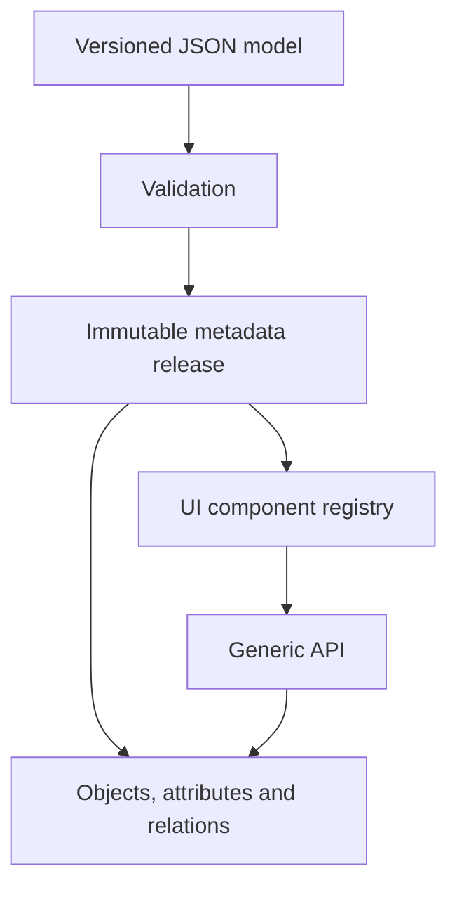

# Architecture

## Core shape

RDM Engine has four layers: model definition, compiled metadata, runtime graph and presentation. The
JSON model is validated and installed as an immutable release. Runtime objects then refer to stable
model keys rather than internal numeric metadata IDs.



## Definition and metadata layer

The model declares:

- Applications
- Global attribute types
- Object types and their attribute bindings
- Forward/reverse relation types
- Allowed source/relation/target combinations
- Views and component configuration

At startup, a canonical hash identifies the model. New content with a new release key/version identity
creates an immutable release and its relational metadata rows; reusing an identity with different
content is rejected. Previous releases remain available for migration planning and audit.

The active release is selected by a singleton database runtime-state row. The configured model file is
bootstrap input: it can install missing content and initialize an empty runtime state, but it is not a
parallel runtime authority. A request reads runtime state once, resolves the selected release to one
immutable parsed model snapshot and uses that release's metadata throughout the request. An in-process
registry may cache snapshots by public release ID and hash; it never decides which release is active.
Definition models are frozen recursively, including nested collections, so cached snapshots cannot be
changed without installing and selecting a different release.

This global selection remains the runtime authority through the pre-production daily-operation and
specialist-workspace releases. Product 0.10 may evolve it into workspace-scoped assignments: a request
must resolve its workspace first, then exactly one immutable release assigned to that workspace.
Staged assignment requires executable data migration, atomic switching, cursor binding to release
identity, protected administration, multi-node propagation and concurrent parser/runtime support for
every permitted schema version. It cannot be implemented as workspace pinning alone.

Model authoring has three explicit stages. Drafts are mutable, versioned database records. Validation,
canonical compilation, semantic diff and compatibility analysis do not persist changes. Installation
creates immutable content-addressed release metadata but leaves runtime selection unchanged.
Activation uses optimistic concurrency on runtime state and is permitted only when stored data is
compatible with the candidate.

Database creation and upgrades run through Alembic. Each revision contains a frozen schema delta or
snapshot and does not import live ORM metadata, so adding a later ORM field cannot change the behavior
of an earlier revision on a fresh database.

## Deployment topology for model administration

Base 0.5 supports mutable model administration only in a single API process. The checked-in container
starts one Uvicorn process and does not set a worker count. `MODEL_ADMIN_MUTATIONS_ENABLED` is disabled
by default and is a deployment guard rather than an authorization system. When enabled, startup must
reject a configured multi-worker topology until cross-process release propagation exists. The runtime
uses Uvicorn's `WEB_CONCURRENCY` setting for this startup guard; the supported administration value is
one.

Within that supported process, immutable release installations are serialized across drafts. The
database uniqueness constraints remain the final identity/hash guard, while process serialization
ensures concurrent identical installation requests retain the documented idempotent response.

Activation commits the database runtime-state change before publishing the new snapshot to the local
registry. If the process cannot refresh that committed selection, readiness is unhealthy and requests
must not fall back to bootstrap content or a guessed cached model. `/health` returns HTTP 503 in that
state until a successful process restart reloads the database-selected release. Read-only release
discovery remains available independently of the mutation flag.

The WP1 migration adopts a legacy database only when it has zero or one active release and every
release key/version identity is unique. Multiple active rows or conflicting historical identities stop
the upgrade before the new schema is applied. The migration does not delete releases, rewrite their
identity or guess which immutable snapshot to preserve.

### Upgrade, backup and rollback operations

The bootstrap model path and the active release are separate operational controls. On startup the
configured JSON is validated and installed when its content is absent. If runtime state already
exists, startup preserves its selected installed release even when the bootstrap file contains a
newer release. Administrators inspect the release catalogue and explicitly activate a compatible
candidate; deployments must never use a bootstrap-file replacement as an implicit publish action.

Before an application upgrade, stop or quiesce writers and take a database-engine-consistent backup.
Keep that backup together with the application image/version and deployment configuration, especially
`DATABASE_URL`, `RDM_MODEL_PATH`, `RDM_CURSOR_SIGNING_KEY`, `MODEL_ADMIN_MUTATIONS_ENABLED` and worker
topology. Run `alembic upgrade head` using the new application before accepting traffic. The startup
path also upgrades to head, but an explicit migration step makes failures observable before service
cutover.

From a source checkout, the explicit migration command is:

```bash
cd backend
.venv/bin/python -m alembic upgrade head
```

For the default SQLite deployment, stop writers and use SQLite's online `.backup` command or copy the
database only while it is closed; retain the database file and application version together. For
PostgreSQL, use the platform's consistent `pg_dump`/snapshot procedure and verify that the restore
includes schema and data. Test restoration before treating either backup as a rollback point.

There are two distinct rollback cases:

- For model content, activate a previously installed release using fresh runtime-state concurrency
  tokens. The same compatibility analysis applies in both directions, so rollback is rejected when
  current stored data would be invalid under the older release.
- For application code or database schema, stop the new deployment and restore the pre-upgrade
  database backup together with the matching older application version. Production rollback must not
  depend on Alembic downgrade scripts or manual edits to immutable release rows; Base 0.5 provides no
  automatic runtime-data migration or transformation executor.

If activation commits but local publication fails, the process becomes unready and refuses
model-dependent requests. Restart the process to load the committed database selection before taking
further action; do not guess the prior selection from the bootstrap file.

## Runtime workspace and object graph

Base 0.6 introduces a global workspace catalogue independently of immutable application models. A
singleton workspace-runtime-state row owns the default key and version. Request scope resolution uses
an explicit known key or that default; it never derives authority by scanning object rows. Retired
workspaces remain addressable for reads but block mutations. Until authentication exists, workspace
administration is controlled by a default-enabled deployment capability and must not be treated as an
authorization boundary.

In the Base 0.5 projection, `objects` contains stable UUID, workspace, application, object type, parent,
state, name, version and timestamps. `parent_object_id` is the primary containment hierarchy used for
efficient navigation and path construction. ADR-020 replaces that row as the content authority in Base
0.6 while retaining stable identity and query projections as described below.

`attribute_values` stores one value per object and attribute type. The declared type selects a physical
column: text, integer, decimal, boolean, date, datetime or JSON. This retains dynamic modelling without
reducing every value to text.

`object_relations` stores typed directed edges. Allowed object-type relationships and cardinality are
validated before insertion. Creating or moving a contained object maintains `parent_object_id` and the
corresponding typed parent relation together.

Product 0.7 will implement ADR-022 exact-binding relation-set versions for mapping concurrency. Each
relation write advances the outgoing and incoming sets for its exact workspace, relation type and
endpoint-type binding. A mapping replacement claims one anchor/direction/binding set and changes its
complete zero/one/many edge state atomically, protecting unmapped and ambiguous rows without allowing
another binding of the same relation type to be replaced accidentally.

`audit_events` is an ordered append-only foundation for history and a future change feed.

### Base 0.6 runtime-object revision direction

ADR-020 evolves the single mutable object projection into a stable logical object with immutable active
and retired revisions plus mutable drafts. A revision snapshots object-owned core fields, parent, typed
attributes and required ownership relationships. Independent associations continue to address the
stable logical object and keep their own relation concurrency and audit history.

The stable object row owns identity, workspace, application and object type. Draft/revision tables are
authoritative for object-owned content and pin the immutable model release used for validation. Query-optimized active
columns and child rows are projections written only by activation in the same transaction as the
active-revision pointer. Draft edits never mutate those projections. Activation against a different
currently resolved model release fails explicitly rather than silently rebasing content. Cloning an
older revision validates the copied snapshot against and pins the currently resolved release; the
immutable source revision keeps its original release identity.

Draft lineage has two edges: the immutable revision copied into the draft and the active revision
superseded when that draft is activated. Activation validates the complete snapshot and atomically
retires the current active revision under an expected-active-revision claim. Direct retirement uses
the same expected identity, clears the active pointer and retains the logical object and history so a
retired revision can seed a later draft. This runtime-data lifecycle remains separate from immutable
application-model releases and their draft/install/activate process.

## Why both hierarchy and relations exist

Containment and semantic relationships overlap but serve different access patterns. Parent IDs make
tree navigation and path building efficient. Typed relations preserve meaning, reverse labels and
model constraints. The service layer owns their consistency; clients must not update them separately.

For a published logical object, retirement replaces physical deletion. A normal retirement never
retires owned dependants implicitly: it returns a structured impact report. An explicitly confirmed
cascade walks containment and model-defined PK→FK ownership edges, retires active dependants, unlinks
their active projections and writes audit events in one transaction. Independent associations remain
attached to stable logical identities but disappear from current-active traversal while an endpoint is
retired. Any mutable draft may be discarded; removing the last never-activated root draft also removes
its empty identity shell. A published logical identity and its history require a separately authorized
future purge operation.

## API projection

The API returns attributes by stable keys and typed JSON values. Clients may request relations using
stable relation keys. It never requires arrays of internal attribute or relation IDs.

Cursor pagination is used throughout. Cursor tokens are signed and bound to their endpoint, ordering
and effective filters. Full extraction belongs to asynchronous export or a resumable change feed
rather than an undocumented unbounded page.

## Presentation foundation

ADR-023 keeps the application-facing UI API in repository-owned semantic wrappers. React Aria
Components supplies composite interaction behavior only; feature modules cannot depend on it directly.
RDM owns plain-CSS tokens, layout, visual states and product-specific dismissal, dirty-input and error
behavior. Native HTML remains the first choice for simple controls, and Lucide icons pass through one
accessible wrapper. This boundary permits a future behavior-provider change without altering the
application model or feature contracts.

## Scale direction

- Model-derived indexes for searchable and unique attribute types
- Bounded bulk upsert with per-item outcomes
- Batched relation expansion without N+1 database access
- Recursive CTEs or a maintained path representation for large hierarchies
- Asynchronous import/export with streamed storage
- Ordered change feed based on audit sequence

The path builder resolves ancestor chains in level order (one query per depth level rather than one per
object), removing the N+1 traversal for typical hierarchies. Recursive CTEs or a maintained path
representation remain the direction for very deep, high-volume hierarchies.

## Security direction

Authentication and authorization remain deferred through the pre-production 0.9 feature releases.
Product 0.10 introduces OIDC authentication plus model-configurable application, object-type and
operation permissions before replacing the default-enabled workspace-administration posture.
Record-level rules should be introduced only for demonstrated RDM needs.
